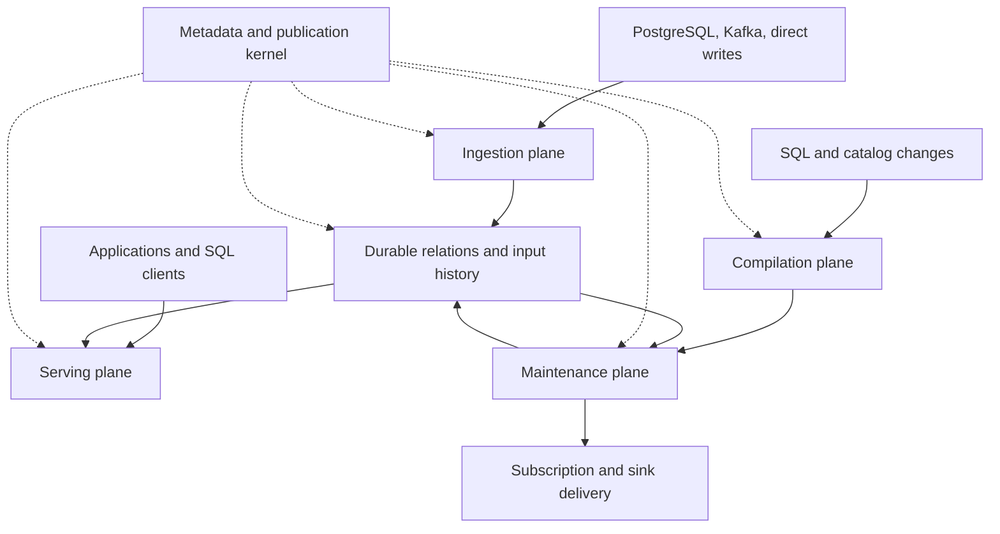

# Rockstream 2: design for a cloud-native incremental database

**Status:** Proposed for review. **Date:** 2026-11-26. **Implementation:** none in this repository yet.

**Baseline:** Rockstream `0.72.0`, commit [`d3f973a84f4263bedd6505039d7f469d4708c478`](https://github.com/trickle-labs/rockstream/commit/d3f973a84f4263bedd6505039d7f469d4708c478).

## 1. Thesis and architectural recommendation

Build a **SQL-first, cloud-native incremental view maintenance (IVM) database** whose internal engine optimizes a whole workload of incremental relational computations. The organizing objects are versioned relations, shared arrangements, immutable delta traces, and atomically published results. Applications specify SQL, freshness, and retention; they do not assemble a distributed stream-processing graph or operate external coordination clusters.

### What makes Rockstream 2 distinct

Existing streaming databases typically require external coordination tiers (etcd, ZooKeeper, or dedicated metadata databases), maintain isolated state per view, or trade away exact SQL semantics. Rockstream 2 combines four architectural pillars into one simple binary:

1. **Zero-external-dependency operation:** One binary for local embedded mode, one binary + object store for the default cloud profile, and multiple instances of the same binary for distributed scale. No external etcd, ZooKeeper, Redis, SQL catalog, or mandatory Kubernetes.
2. **Workload-wide shared and factorized IVM:** DBSP semantics over weighted Apache Arrow batches and DataFusion, with shared canonical arrangements and algebraically verified partial aggregation/factorization (F-IVM) where it reduces total lifetime cost.
3. **Clean cloud-native storage separation:** Immutable object-backed input logs and timestamped delta segments carry durability, exact-parent recovery, and logical MVCC history. SlateDB provides per-domain/partition indexed working state, paired with a bounded in-memory indexed overlay for trailing deltas between periodic checkpoints—giving fast point probes and clean speculative-attempt isolation without per-interval database clones.
4. **Honest cloud latency profiles:**
   - **Object-Native (default):** Zero resident coordinator, compositional single-root S3 conditional-write metadata with pre-allocated owner-generation namespaces, compute scale-to-zero (plus full hibernation for eligible workloads), and warm cached reads. Targets, all unmeasured hypotheses until G0/G4.0 record real measurements: sub-5 ms warm cached reads and ~150 ms–1.5 s end-to-end S3 freshness. Reader leases and conservative GC grace windows are introduced with out-of-process serving at G4; G2–G3b readers run in the owning process under in-process pins ([ADR 0012](docs/adr/0012-staged-mechanism-adoption.md)).
   - **Low-Latency Cloud (G4+ optional, evidence-triggered):** Same binary and logical metadata state machine backed by **embedded OpenRaft**; `<10 ms` strict-latest reads, high-rate metadata commits and ~100–300 ms freshness on S3 Standard segments are unmeasured hypotheses. A `≤100 ms` P99 end-to-end freshness target also requires a separately qualified cross-AZ fast WAL data tier. Stateless compute still scales to zero while voters remain resident.

### Early physics-first validation (lean G0)

G0 validates the existential physics in two parallel tracks and establishes the executable foundation, without building two full engines or premature governance infrastructure. The **foundation track** (`G0.1`, `G0.4`) unlocks G1; the **durability-physics track** (`G0.2`, `G0.3`) runs in parallel with G1 and unlocks G2. The timebox bounds scope, not a delivery date.

| G0 Deliverable | Focus | Decision |
| --- | --- | --- |
| **G0.1** Bootstrap, CI & Golden Workload | Minimal Rust workspace, fast local/CI entry point, frozen `W1-G` fixture, independent PostgreSQL/batch oracle, and minimal RockStyle baseline | Establish executable feedback loop (<5 min CI) |
| **G0.2** Storage & Metadata Physics Probe | On one real provider: conditional-write conformance and latency, sequential freshness round trips, in-process group commit; real **immutable-delta + SlateDB-index + bounded overlay** vs. pure SlateDB history (amplification, `SIGKILL` reopen, cold recovery, one historical point lookup) | Prove S3/SlateDB latency, overlay bounds, and request cost; lock **one** storage layout |
| **G0.3** Core Protocol Model (Quint) | One concise Quint specification of publication atomicity with expected-parent CAS, ownership-generation fencing with idempotent operation outcomes, and GC pin/retire no-resurrection, each with a negative control | Falsify protocol races before coding metadata/GC |
| **G0.4** Native Kernel Spike | Bounded acyclic scalar-epoch Arrow kernel over `W1-G` (plus donor disposition register from Rockstream v1) | Confirm native kernel ergonomics/complexity; only prototype Timely/Differential if native fails concrete bounds |

Reader-lease, grace-window GC under live readers, separate-process reader, cross-AZ WAL and OpenRaft probes belong to the `G4.0` entry probe. [ADR 0011](docs/adr/0011-risk-reduction-before-implementation.md) records the bounded pre-implementation choices and fallback triggers; [ADR 0012](docs/adr/0012-staged-mechanism-adoption.md) records the staging. No performance number or risk is marked closed until real measurements exist.

### Engineering principles

Correctness, simplicity, runtime performance, testability, maintainability, and step-by-step delivery are first-class concerns. Prefer the simplest contract-satisfying design; every abstraction, dependency, or alternate path must earn its verification cost. [RockStyle](ROCK_STYLE.md) turns these principles into executable rules: distinct domain types, checked arithmetic, release-enabled checks on internal invariants, explicit resource contracts, and a small verification stack (Rust/Clippy, Quint, `proptest`, independent PostgreSQL/batch oracles, deterministic state-machine replay for pure Rockstream transitions, and real-process/real-backend crash tests). See [testing and verification](docs/design/testing-and-verification.md) and [development workflow](docs/design/development-workflow.md).

Autonomous coding agents are the primary implementation workforce, operating under lightweight GitHub issue/PR workflows and [risk-based governance](docs/design/agent-development.md): routine contract-bounded implementation advances autonomously via independent oracles, automated checks, and separate-context review, while human maintainers own architecture, invariant/security changes, and release authorization.

## 2. Product boundary

The product is a SQL-first, IVM-first database for application read models, live operational analytics, and maintained relational pipelines. Initial external integrations are PostgreSQL CDC and Kafka sources, Kafka output, PostgreSQL wire (`pgwire`) access, and bounded direct ingestion.

The first stable release does not attempt general OLTP concurrency, arbitrary user code in the data plane, full PostgreSQL emulation, active-active multi-region writes, or every streaming connector. Build incrementally; the [implementation plan](docs/planning/implementation-plan.md) is the single authority for each gate's contents, exit evidence and stop/pivot signals. Summary:

- **G1:** Pure in-memory semantic kernel with exact SQL/Z-set oracle parity.
- **G2 (developer preview):** Single-node durable MVP—one binary, 5-minute local quickstart, standard PostgreSQL clients, single-node S3 durability, crash recovery, view-level fault quarantine, and warm in-process reads.
- **G3a (first public single-node preview):** Real-world SQL and live connectors—outer/semi/anti joins, `DISTINCT`, delete-safe `MIN`/`MAX`, online view lifecycle, PostgreSQL CDC, Kafka source/sink, resumable subscriptions.
- **G3b (shared-engine preview):** Shared canonical arrangements, independent consumer schedules over arbitrary-cut logical MVCC, consumer isolation, single-depth pipelining, eligible F-IVM.
- **G4 (distributed preview):** Multi-node execution, reader leases and grace-window GC, serving pools, cross-domain imports, distributed suspension, optional Embedded OpenRaft.
- **G5 (independent track):** Advanced SQL/IVM features graduate individually without blocking G6.
- **G6:** Production qualification and v1 migration.

An operator in Rust is not a supported SQL feature. Support requires parsing, binding, incremental planning, initial backfill, live updates and retractions, restart, resource limits, protocol output, and independent qualification. The [SQL contract](docs/reference/sql-and-apis.md) governs capability promotion through the five-stage lifecycle: `Planned → Implemented → Verified → Qualified → Supported`.

## 3. Invariants that organize the system

| ID | Invariant | Design consequence |
| --- | --- | --- |
| INV-01 | A published view equals batch evaluation at its declared input cut under its declared numeric semantics. | Every optimization preserves one explicit semantic contract. |
| INV-02 | Published versions reference only complete, durable, protected data and recovery dependencies. | Durable staging precedes atomic metadata publication. |
| INV-03 | A transaction is visible entirely or not at all within its consistency domain. | Epoch assignment cannot split a source transaction across publication boundaries. |
| INV-04 | A stale owner cannot publish or replace live state. | Ownership generations and expected heads are checked in the committing metadata transaction. |
| INV-05 | Retries have one logical effect. | Stable input identities and immutable commit descriptors resolve ambiguous responses. |
| INV-06 | A read never silently changes its snapshot or loses state protected by a valid pin. | Pin acquisition, GC eligibility, and expiry enforcement are coordinated. |
| INV-07 | Resource pressure and operator errors preserve the last correct published version. | Admission, bounded queues, spill, and fail-closed publication are part of execution. |
| INV-08 | Sharing cannot cross an incompatible semantic or security boundary. | Canonical identities include semantic versions and tenant/security context. |
| INV-09 | Compaction preserves all supported snapshots and all recovery obligations. | History retention, current state, replay requirements, and subscriber pins are distinct. |
| INV-10 | A restore cannot revive an old writer or validate a token from another restored incarnation. | Disaster recovery creates a new deployment incarnation and fences the previous one. |

Safety holds under the specified failure assumptions even when progress stops. Liveness depends on access to the authoritative metadata root, readable durable storage, recoverable input and sufficient admitted capacity. No design can promise freshness during an unbounded storage outage.

## 4. Architecture

These are logical responsibilities within the same binary. Embedded mode uses a qualified local filesystem; cloud mode uses a qualified object store. Distributed mode can separate ingestion, maintenance, serving and compaction pools while preserving the same operator and publication contracts. Coordination is work an eligible process performs, not a mandatory always-running external tier.

| Plane | Owns | Must not own |
| --- | --- | --- |
| Ingestion | Source identity, normalization, durable input, complete transaction envelopes | Ad hoc publication of downstream views |
| Compilation | SQL semantics, algebra, physical strategy, state requirements | Storage leases or direct mutable shard access |
| Maintenance | Dependency execution, arrangements, staging, progress evidence | Authoritative visibility outside the publication kernel |
| Storage | Durable immutable data, manifests, cache, compaction, protected versions | SQL meaning or cross-domain transaction promises |
| Serving | Pinned snapshot evaluation, protocol output, cursor delivery | Selecting unrelated latest versions for a supposedly consistent join |
| Coordination | Catalog, domain heads, generations, pins, publication, placement intent | Bulk rows, per-row consensus, or query evaluation |

In the default cloud profile, all authoritative state lives in object storage, **including metadata**: catalog, publication roots, ownership generations, admission/deduplication state, pins and recovery lineage. The in-process metadata kernel conditionally advances one authoritative root pointing into immutable metadata. Every process and its RAM/NVMe can be replaced; only losing the authoritative storage violates that recovery assumption. A coherent backup captures a root and its reachable graph, rather than an arbitrary listing of bucket objects. An optional future consensus profile requires a separate durability and stop/restart qualification.

## 5. Core objects and time

| Object | Identity and contract |
| --- | --- |
| Relation | Stable catalog ID, schema version, security context, changing weighted multiset |
| View | Logical expression plus capability, freshness, retention, and durability policy |
| Plan generation | Immutable semantic/physical plan descriptor; swaps occur at a verified cut |
| Arrangement | Indexed representation of a relation or subexpression with an explicit state and history contract |
| Virtual partition | Stable state/routing identity independent of a worker process |
| Consistency domain | Unit of logical ordering and atomic visibility; consuming result domains can share an ingestion domain |
| SourceCut | Map of source incarnations to complete transaction/partition boundaries, with dependency lineage |
| PublishedVersion | Immutable manifest root identifying outputs, recovery state, input lineage, plan, durable upper and supported logical cut coverage |
| SnapshotToken | Tenant- and incarnation-bound logical cuts, exact protected history roots and a read pin |

A domain uses a monotonically ordered `Epoch`. An **exclusive upper** `U` means every logical time `t < U` is complete. A view at `U > 0` includes input through `U - 1`; the empty initial input history has `U = 0`. Initial output is `Q(empty)`, which can include COUNT's zero row. Numeric epochs from different domains are not comparable. The full rules, including input cuts and history lower bounds, are in [consistency and storage](docs/design/consistency-and-storage.md).

Separate input acceptance, input durability, computation, publication, historical compaction and delivery acknowledgement. A computed frontier cannot certify durability. A Kafka consumer acknowledgement cannot certify that a materialized result was published. A watermark about event time is not a commit frontier.

**Logical MVCC** gives each relation/arrangement a computed upper `Cc`, durable published upper `Cp <= Cc`, inclusive earliest supported cut `S` and explicit cut coverage. A read at `C` includes epochs `e < C`; normally any `S <= C <= Cp` is reconstructible from a protected base and timestamped deltas. Coverage gaps from an explicit repair are never hidden. Physical SlateDB checkpoints need not coincide with these logical cuts. Compaction must preserve intermediate results, including nonlinear operator outputs, at every promised cut. [ADR 0009](docs/adr/0009-logical-mvcc.md) states this contract and its limits.

Start with scalar domain time and explicit dependency edges. Nested iteration time can be introduced for recursion after its progress and termination rules are qualified. Arbitrary multidimensional clocks are not a prerequisite for independent pipelines.

### Domain assignment and cross-domain reads

Tables participating in one atomic source transaction belong to the same ingestion transaction domain. A result publication domain may consume that complete source stream directly or import complete versioned relations from it. Several result domains may consume the same durable input history at different rates; each includes every relevant effect of a complete source transaction before advancing its own cut. By default (from G2 onward), each independent materialized view receives its own lightweight result publication head consuming the ingestion domain, while views requiring joint atomic visibility are placed into one explicit named **atomic publication group** (`WITH (publication_group = '...')`). Domain and publication-group scope is an explicit catalog decision informed by transaction boundaries, dependencies, tenant policy, and desired failure isolation; the optimizer cannot split it merely to improve a latency graph. G2 uses one ingestion domain with per-view or explicitly grouped publication heads; G3b adds shared arrangements and independent scheduling across result domains; G4 adds distributed execution and general cross-domain imports.

Each result domain has one atomic publication group. Independent result domains have separate publication heads. Sharing an arrangement does not merge them. Within a group, a slow required participant still delays its publication; that is the explicit cost of its requested atomic visibility.

General dependencies crossing domains use explicit imports of versioned published relations into a consuming domain. Imports preserve source lineage and only publish compatible cuts for overlapping dependencies: every overlapping source incarnation has the same complete transaction boundary in every selected input, with dependency closure and required logical histories pinned. Being merely beyond the same requested offset is insufficient. Common reads select compatible logical cuts from retained history, even when the physical checkpoint schedules do not coincide. Ad hoc joins of independently selected “latest” views are rejected or made to wait if no certified compatible cut exists. Independent databases have no implied cross-source transaction or real-time ordering guarantee. Domain merging/splitting and arbitrary cross-domain atomic writes remain later, separately modeled changes.

## 6. A transaction from source to reader

Consider customer 7 moving from `North` to `West` while a new order of 20 is inserted in the same source transaction. Existing orders for that customer total 100. A materialized join-aggregate reports sales by customer region.

1. Ingestion normalizes the complete transaction into retractions and insertions, with source incarnation, transaction identity, offsets, schema version, and payload digest. It assigns epoch `e` and commits that assignment, durable-log reference, and deduplication/admission state before returning a durable-input acknowledgement and `WriteToken`.
2. Maintenance begins from the exact published parent. The planner has chosen a first-order join or a qualified factorized alternative. Both must produce `-100` in North and `+120` in West in aggregate value, represented as changes to the complete aggregate rows.
3. Workers evaluate all dependent changes against the previous published state, including interactions between changes on both sides of the join. They may stage work in any physical order but cannot expose intermediate results.
4. Each required partition prepares immutable output and recovery state for the sealed interval ending at exclusive upper `e + 1`. The publication coordinator verifies coverage, identities, dependency cut, generations, durable protection, and the expected previous head.
5. A metadata compare-and-swap publishes one complete descriptor. That transaction is the visibility linearization point. The caller's result-wait succeeds only when its requested, catalog-pinned view set is covered.
6. Serving pins that version before reading. Subscribers consume its committed delta envelope. A slow sink does not hold the source's visible result hostage unless its explicitly purchased retention contract exhausts the admitted resource budget.

If a worker fails before step 5, the prior version remains visible and the interval is replayed. If it fails after step 5, the new worker resumes from the committed descriptor. If the commit response is lost, the retry reads the descriptor by stable commit identity before deciding whether to recompute. The [storage spec](docs/design/consistency-and-storage.md) makes each crash window explicit.

## 7. Algebra, optimization, and view fault isolation

Relations are weighted bags; insertions and retractions carry signed integer weights. At each completed input cut, incremental execution must agree with the batch relation. SQL adds explicit constraints: NULL and duplicate semantics, exact decimal overflow, `Q(empty)` initialization, outer-join unmatched rows, deterministic Top-K ordering, and opt-in approximation for floating-point aggregates.

The compiler stages are **SQL binding → canonical relational IR → incremental algebra → state-aware physical IR → distributed task graph**. Each stage retains schema, keys, semantic version, provenance, and resource obligations. [Semantics and compiler](docs/design/semantics-and-compiler.md) defines the transformations and edge cases.

First-order IVM is the semantic baseline. Eligible partial aggregation and factorization (F-IVM) are evaluated with explicit algebraic side conditions and qualified in G3b; broader higher-order derivatives and automated cost-model / adaptive selection advance independently in G5. Observed statistics rank valid plans but never establish semantic preconditions such as uniqueness. Optimizer decisions and resource bounds are visible in `EXPLAIN INCREMENTAL`.

**View-level fault isolation:** Source validation errors reject a direct-write transaction *before* durable acceptance. If a valid, durably accepted transaction later triggers a runtime error in one derived view (for example, `DECIMAL` overflow or division by zero), the engine commits a durable **`Active → Quarantined`** metadata transition for that failing view (or its explicit coupled `publication_group`) at its last valid published cut with an explicit `ERROR` diagnostic—preventing crash-restart loops—while unaffected views continue advancing. While quarantined, `latest-committed` / `bounded-staleness` reads continue serving the last valid published cut (`INV-07`), while `WAIT FOR PUBLICATION` and `read-your-writes` covering `>= failed_epoch` fail fast with `RS_VIEW_QUARANTINED` rather than hanging until timeout. A quarantined view’s retention pin remains subject to its configured retention budget (`IncrementalRetained → BackfillRequired` on quota expiry) so it can never indefinitely block shared-arrangement or input-log compaction; repair replays incrementally while retained history is available, or backfills cleanly from a base snapshot + tail once history expires (explicit recreate/rebuild in G2; online backfill in G3a)—never silently skipping accepted input.

## 8. Shared graph and arrangement lifecycle

Share canonical, semantically equivalent subexpressions and arrangements within compatible security/tenant boundaries. After digest lookup, compare full canonical descriptors (normalized expression, schema, key/collation rules, numeric behavior, source lineage, semantic version). Physical layout variants remain distinct from logical equivalence.

Creating a view reserves a catalog identity and build pin, selects a certified logical snapshot, backfills the graph, replays retained changes, and activates the new plan generation at a verified cut without disrupting existing readers. Dropping a consumer never deletes state still referenced by snapshots, subscribers, recovery, or backups.

Each consumer declares its own freshness schedule, history window, and resource budget. Sharing is an economic placement choice made *after* semantic/security eligibility: isolate a slow or long-retention consumer through pinned snapshot/replay/verified cutover when isolation has lower lifetime cost than retaining shared history. Cross-tenant sharing is disabled initially.

## 9. Durable state, storage split, and metadata publication

Rockstream 2 separates durable authority from indexed working state cleanly so neither fights the other's physics:

1. **Authoritative Input & Delta Traces (Immutable Object Segments):** Accepted input transactions and committed per-interval output/operator deltas are written as immutable weighted Arrow/batch objects on object storage and referenced by the authoritative manifest. Abandoned preparations are simply unreferenced objects—giving clean exact-parent recovery with zero LSM attempt-namespace pollution and zero per-interval database cloning.
2. **Indexed Working State (SlateDB + Bounded In-Memory Delta Overlay):** SlateDB provides persistent point lookups, join probes, and current-state serving indexes. Because SlateDB checkpoints are amortized across multiple logical epochs (`Cp_ckpt <= Cp`):
   - **Tentative writes stay in memory until CAS commits:** Maintenance workers hold tentative interval updates in a local in-memory overlay, upload immutable delta segments to object storage, and apply committed deltas into SlateDB *only after* publication CAS succeeds (discarding the overlay cheaply on abort/conflict with zero SlateDB rollback).
   - **Bounded trailing-delta overlay for serving & recovery:** Both maintenance and serving nodes maintain a bounded in-memory indexed overlay of committed immutable deltas `(Cp_ckpt, Cp]` over the latest manifest-referenced SlateDB checkpoint, taking a new non-expiring SlateDB checkpoint whenever trailing delta count or bytes reach a configured cap and registering `(slatedb_instance_id, checkpoint_id, ckpt_cut)` in the metadata root before trimming overlay entries `<= ckpt_cut`. If the overlay hits its hard cap while checkpointing is pending or failing, maintenance applies admission backpressure rather than growing unboundedly in RAM or evicting uncheckpointed deltas. On crash, writable recovery verifies an atomic per-interval `_meta/applied_cut` (replaying only `(live_applied_cut, Cp]`) or performs a takeover-only SlateDB clone from `Cp_ckpt` and replays `(Cp_ckpt, Cp]` cleanly—preventing double-apply and partial-apply corruption.
   - **Per-domain isolation first:** Start in G0–G2 with **one SlateDB instance per result publication group (or partition of a group)**—plus one for the ingestion domain's PK index when keyed direct DML is enabled—to preserve domain and quarantine independence ([ADR 0002](docs/adr/0002-consistency-domains.md)). G0.2/G3b measures idle S3 WAL/manifest cost per instance so multi-domain storage grouping (with fenced writer ownership) activates cleanly when instance counts exceed the measured threshold.
3. **Bounded Logical MVCC History:** *Stage:* G2/G3a retain bounded published versions and pins and serve published interval-boundary cuts; the arbitrary-cut design below is adopted at G3b ([ADR 0012](docs/adr/0012-staged-mechanism-adoption.md)). Logical MVCC is decoupled from SlateDB physical checkpoints. Within the **hot fine-grained window `[S_hot, Cp]`**, periodic SlateDB checkpoints (including a checkpoint at or before `S_hot`) paired with per-epoch immutable delta segments allow exact point lookups and scans at *any* cut `C ∈ [S_hot, Cp]` by overlaying `(Cp_ckpt(C), C]` onto the nearest preceding checkpoint `Cp_ckpt(C) <= C`—avoiding both LSM multi-version explosion and undo deltas. Long-term retention `[S, S_hot)` serves periodic consolidated checkpoint cuts or explicitly budgeted archived deltas.
4. **Explicitly Budgeted Direct-DML Primary-Key Index:** Tables accepting direct SQL `UPDATE`/`DELETE` validate uniqueness and normalize retractions against a durable primary-key image index at the accepted-input head. It uses the **exact same checkpoint-registration, writable-recovery, and overlay-cap backpressure pattern** (no synchronous two-store atomicity required): the sequencer validates against its bounded in-memory overlay `(pk_ckpt_cut, input_head]` over the latest manifest-referenced PK SlateDB checkpoint, commits the normalized input segment and `input_head` in the metadata root CAS, applies committed PK updates to SlateDB asynchronously with periodic metadata-registered checkpoints, and recovers from `_meta/applied_cut` or a takeover-only clone of `pk_checkpoint` + trailing committed input segments on crash (acceptance in `P2.1`). Append-only tables and PostgreSQL CDC sources with full before-images avoid this index completely.

G0.2 validates this **immutable-delta + SlateDB-index + bounded overlay** layout against a pure SlateDB-history layout on real object storage and locks one production storage path before G2.

### Compositional single-root metadata kernel

The default **Object-Native** metadata kernel uses **one logical conditional root per installation** over object storage (single-key conditional `PUT` with `If-Match`, evaluating `slatedb-txn-obj` only if current-version discovery avoids `ListObjects` on the read path). All jointly atomic predicates (catalog, domain heads, ownership generations, pins, quotas, and operation outcomes) commit in one root transition. To minimize S3 round trips and root contention:
- **Pre-allocated owner-generation namespaces:** Upon acquiring ownership generation `g`, an owner receives a protected open allocation namespace (`attempts/{domain}/{g}/...`), eliminating a separate per-interval intent-registration CAS from the hot path. Worker liveness heartbeats stay outside the metadata root (ephemeral peer gossip or lightweight advisory objects); the root only records durable ownership transitions.
- **Compositional intra-batch serialization:** Against authoritative root revision `R`, the embedded commit scheduler applies queued operations sequentially in memory against a working tree derived from `R`—so consecutive input admissions to the same domain or concurrent quota-checked operations within one tenant validate and commit in **one single conditional root update** (`R → R+1`), each recording its own stable identity and outcome for idempotent reconciliation.
- **Disposable preferred committer with clean fallback:** In distributed deployments (G4), an advisory hint routes batches to one preferred committer to avoid CAS storms; if unavailable, callers fall back to a new hinted committer or direct conditional CAS with jittered backoff—requiring zero external coordination.

For workloads targeting `<10 ms` strict-latest reads or high-rate metadata commits beyond single-key S3 latency, the G4.0 evidence gate may recommend the optional **Low-Latency Cloud** profile using **embedded OpenRaft** running the exact same logical metadata state machine. The ~100–300 ms S3 Standard data-segment and `≤100 ms` P99 fast-WAL figures are unmeasured hypotheses; the latter requires a separately qualified cross-AZ fast WAL data tier (acknowledging stateful voter/WAL disks until tiered to S3).

### Lease-backed fast reads and grace-window GC

**Stage:** adopted at **G4**, with the first out-of-process readers ([ADR 0012](docs/adr/0012-staged-mechanism-adoption.md)). Through G2–G3b every reader runs in the owning process and holds an in-process pin; repeatable reads, tokens and subscriptions hold durable metadata pins; physical deletion requires a committed tombstone **and** a configured minimum object age. `latest-committed` reads the root inline, and warm bounded-staleness reads use a periodic root refresh, which bounds staleness but is not a GC-protection lease. Probes and the Quint extension for the mechanism below belong to `G4.0`.

To achieve **sub-5 ms warm indexed reads (a target, unmeasured)** from out-of-process readers without compromising GC safety ([INV-06], [INV-09]):
- **Sweeper-observed conservative grace window (`Δ_gc_grace`):** Even after metadata reachability marks an immutable object or checkpoint unreferenced and commits its tombstone, physical deletion waits at least `Δ_gc_grace` (default 10–15 minutes) measured on the GC sweeper's own monotonic clock after observing the committed tombstone (or verified server-side object-store timestamps)—eliminating reliance on synchronized distributed wall clocks.
- **Monotonic-checked warm fast path (zero post-read S3 round trips):** Short bounded reads holding a valid local reader-group/snapshot lease (`Δ_read_lease + clock_skew_bound << Δ_gc_grace`) and cached authorization grant (`bounded-staleness` / `allowed-stale` policies) read directly from local/NVMe cache and the bounded delta overlay, then verify `monotonic_now() < lease_deadline` *after* reading bytes and *before* flushing the response—ensuring a paused or frozen VM cannot return stale or revoked data. The monotonic clock must count suspended time (`CLOCK_BOOTTIME` or a platform equivalent); a detected clock discontinuity is treated as lease loss.
- **Strict policies remain explicit:** `latest-committed` performs a linearizable head check at selection (one inline root read under Object-Native; `<10 ms` is an unmeasured target under Embedded OpenRaft). `strict-immediate-revocation` (G4, where it first matters because leases first exist) is an opt-in security mode that performs synchronous post-read authorization revalidation and pays its documented remote-read latency.

## 10. Runtime, serving, and cloud operations

Use a lean **Rockstream-native Rust runtime**: weighted Arrow batches, DataFusion for SQL parsing and compatible scalar kernels (with Rockstream-owned checked widened decimal/integer accumulators), and Tokio for async I/O. Start in G1–G3a with acyclic graphs, scalar domain epochs, and **one active maintenance interval per publication group** (keeping recovery simple via exact-parent generation replacement). In G3b–G4, **evidence-triggered bounded single-depth pipelining** (`P3.9`, activated only if single-interval freshness is I/O-bound) overlaps compute for interval `k+1` with durable S3 flush/publication of interval `k`, invalidating `k+1` immediately if `k` aborts or quarantines and draining to depth 0 before isolation cutover or reassignment. Only fall back to Timely/Differential if G0.4 hits its predeclared complexity or correctness wall.

Serving pools cache immutable objects, manifests, and bounded trailing-delta overlays by verified content identity, using consistent-hash / tenant-affinity query routing in G4 to preserve NVMe cache locality. Subscriptions bridge a pinned snapshot to committed delta envelopes without gaps (at-least-once network transport with stable cursors). Kafka delivery starts at-least-once with stable delivery IDs; stronger destination-marker protocols are separately gated.

### Compute elasticity and honest hibernation scope

Separate **stateless compute scale-to-zero** (stopping idle maintenance or serving workers while ingestion/coordination runs) from **full zero-process hibernation** (`Active → Draining → Dormant → Restoring → Active`):
- **Stateless compute pools** scale to zero whenever their domain has no pending work.
- **Stage:** G2 qualifies single-process stop/restart on the **Object-Native** profile; G4 adds fleet-wide drain and concurrent activation. Full zero-process hibernation is for genuinely eligible workloads (intermittent, scheduled, dev/staging, or batch-replayed pipelines whose upstream source retention, freshness targets, timers, and external wake trigger permit zero running processes).
- Workloads with continuous PostgreSQL CDC replication slots, strict low-latency read SLOs, or active Kafka sinks use **partial suspension** (or the Embedded Raft low-latency profile) rather than distorting online latency for a dormancy mode they cannot use.

## 11. Implementation boundaries

| Proposed crate | Responsibility | Dependency restrictions |
| --- | --- | --- |
| `rock-core` | Domain IDs, weighted batches, schemas, time, checked codecs | No runtime, network, or backend dependencies |
| `rock-algebra` | Typed semantic IR, rewrite contracts, independent bag reference | `rock-core` only |
| `rock-sql` | DataFusion parser/binder adapter and SQL semantic normalization | `rock-core`, `rock-algebra`; no storage ownership |
| `rock-optimizer` | Physical IR, lifetime costs, sharing/factorization planner | Contracts and stats; no direct publication |
| `rock-engine` | Vectorized operators, progress, scheduling, exchange | Abstract state/environment traits |
| `rock-state` | Immutable delta traces, SlateDB working indexes, manifests | `rock-core` and storage adapters; no SQL |
| `rock-meta` | Compositional metadata kernel, pins, leases, fencing, GC | `rock-core`; no query execution |
| `rock-io` | PostgreSQL CDC, Kafka source/sink, direct-write normalization | Uses admission/publication contracts |
| `rock-server` | `pgwire`, snapshot serving, subscriptions, diagnostics | Uses compiler, serving, and catalog APIs |
| `rock-cli` | Single binary entrypoint, local/cloud profiles, admin CLI | Integration boundary; no alternate semantics |

Create crates **only as their owning gate begins** (`G0.1` starts with the minimal prototype crates; never scaffold empty placeholder crates). Enforce dependency direction in CI from G0.1 onward.

## 12. Step-by-step delivery and evidence

Build incrementally along one executable vertical path (`W1-G` customer/orders join-aggregate). The ladder in [§2](#2-product-boundary) summarizes the gates; the [implementation plan](docs/planning/implementation-plan.md) defines each gate's work IDs, exit evidence and stop/pivot signals, and [ADR 0012](docs/adr/0012-staged-mechanism-adoption.md) records which mechanism is adopted at which gate. G0's two tracks gate G1 (foundation) and G2 (durability physics) separately.

Each topic has one normative specification (`semantics-and-compiler.md` for SQL/algebra/planning, `consistency-and-storage.md` for metadata/storage/MVCC/GC, `runtime-and-operations.md` for execution/connectors/serving/operations, `sql-and-apis.md` for public contracts); ADRs record architectural decisions, and any contract change must update its owning spec and ADR in the same PR. All gates currently remain unexecuted.
