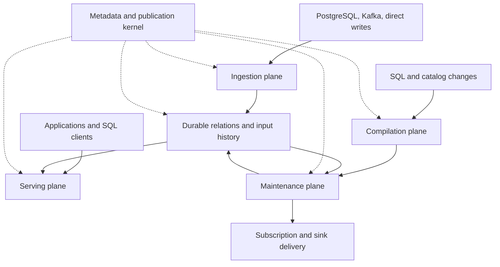

# Rockstream 2: design for a cloud-native incremental database

**Status:** Proposed for review. **Date:** 2026-11-25. **Implementation:** none in this change.

**Baseline:** Rockstream `0.72.0`, commit [`d3f973a84f4263bedd6505039d7f469d4708c478`](https://github.com/trickle-labs/rockstream/commit/d3f973a84f4263bedd6505039d7f469d4708c478). The supplied starting notes are design input, not evidence that the proposed capabilities exist.

## 1. Recommendation

Build a **SQL-first streaming database** whose internal engine optimizes a whole workload of incremental relational computations. The organizing objects are versioned relations, shared arrangements and atomically published results. Applications specify SQL, freshness and retention; they do not assemble a general-purpose computation framework. Compile SQL into typed incremental algebra, maintain it on disposable workers, and serve consistent versions from independently sized read pools.

The working choices are **DBSP semantics, a lean Rockstream-native computation runtime, Apache Arrow batches with DataFusion integration, SlateDB-backed arrangements, logical MVCC and object-storage-backed metadata**. Reuse existing Rockstream algorithms and verification infrastructure where their contracts fit. Qualify important component costs before locking versions; Timely/Differential remains a serious runtime fallback. This preference does not claim an unmeasured implementation advantage.

De-risk these choices before building the full engine. Rockstream owns the semantic, publication, retention and recovery guarantees; component choices must satisfy them within measured operating budgets. Decouple logical-operation frequency from remote metadata writes, physical checkpoints and full-history reconstruction. Retain one object-backed authority initially and make sharing optional, budgeted and reversible.

| Refinement | Required early decision |
| --- | --- |
| Coordination | P0.4: bounded adaptive group commits and reader-group pins; retain linearizable latest selection and explicit retry/revocation safety |
| Logical state | P0.2: current-state access plus timestamped deltas and consolidated bases; compare clone recovery with immutable attempts and amortize checkpoints |
| Runtime | P0.3: bounded acyclic scalar-epoch kernel, one active interval/domain; binding comparison with established runtime components |
| Rewrite | P0.1: transfer donor tests and compare original engine, new kernel and an independent oracle at the same complete cuts |
| Sharing | P0.8: 100/1,000-view lifetime costs, independent consumer contracts and verified isolation; preserve the factorization experiment |
| Hibernation | P0.7: stop every process, lose all caches, recover exact state and measure the whole cold cycle; partial suspension for ineligible workloads |

The [G0 feasibility decisions](docs/planning/qualification.md#g0-feasibility-decisions) require predeclared acceptance limits, negative controls and an explicit fallback. These refinements are proposed requirements and experiments; no risk is marked resolved and no performance goal is promoted by this documentation.

Operational simplicity is a design requirement: one binary for embedded operation, one binary plus a qualified object store for cloud operation, and multiple instances of the same binary for distributed operation. No external etcd, ZooKeeper, Redis or SQL catalog is required. Eligible deployments must be able to stop all Rockstream processes while preserving acknowledged state, then resume through a documented activation path. [ADR 0010](docs/adr/0010-operation-and-hibernation.md) defines the conditions and costs.

The strategic improvement is the integration of these contracts. Existing Rockstream already has DBSP-inspired computation, arrangements, immutable traces, scoped frontier machinery, fault simulation, and qualification infrastructure. Reusing that knowledge is essential. The [audit](docs/research/current-system-audit.md) distinguishes implemented mechanisms from documented aspirations and identifies the boundaries worth replacing.

“Better in all aspects” is an engineering objective, not a universal theorem. More sharing can increase coordination and retention cost; stronger durability can increase latency; a single update can require a very large correct output. Rockstream 2 should expose these tradeoffs, provide useful workload profiles, and earn migration through measured improvements without weakening correctness. [Requirements](docs/planning/requirements.md) and [qualification](docs/planning/qualification.md) turn that ambition into release criteria.

### Engineering principles

Correctness, simplicity, runtime performance, testability, development velocity, maintainability and evidence-driven decisions are first-class architectural concerns. Prefer the simplest contract-satisfying architecture; additional complexity, dependencies or alternate paths require evidence. Correctness is non-negotiable. Design for pure semantic kernels, narrow deterministic environment boundaries, independently checked contracts and a well-balanced test pyramid. Test behavior at the lowest effective layer; retain focused real-dependency and end-to-end evidence. Optimize confidence per second of developer waiting time by keeping routine required PR feedback short and continuously running deeper verification outside the merge path. Merging is not releasing: high-risk changes require applicable safety evidence before merge, and known violations block affected promotion. See [testing and verification](docs/design/testing-and-verification.md) and [development workflow](docs/design/development-workflow.md).

Autonomous coding agents are the primary implementation workforce. Design for self-contained issues, clear ownership, small modules and changes, reproducible bootstrap, enforceable dependency boundaries, diagnostic output and independent verification. Routine implementation is autonomous within approved contracts; human maintainers decide architecture and safety-critical changes and authorize releases. The [agent operating model](docs/design/agent-development.md) governs authority, risk-based review, WIP, isolation and escalation. G0 measures agent throughput and verification/review capacity before forecasting delivery.

## 2. Product boundary

The product is a SQL-first, IVM-first database for application read models, live operational analytics and maintained relational pipelines. Its workload-centric internal architecture shares compatible computation and state without requiring unrelated views to advance together. SQL defines results; freshness, retention, isolation, and recovery policies constrain execution. Initial external integrations are PostgreSQL CDC and Kafka sources, Kafka output, PostgreSQL wire access, and direct transactional ingestion.

The first stable release does not attempt general OLTP concurrency, arbitrary user code in the data plane, unlimited PostgreSQL compatibility, active-active writes across regions, or every streaming connector. Eligible partial aggregation and factorization are tested early as core performance strategies; broader higher-order maintenance, recursive queries, temporal predicates, richer nested data and Arrow Flight SQL advance through separate capability gates.

Optimize the first user journey for one binary, one documented local start command, standard PostgreSQL clients and a correct maintained view within an aspirational five minutes from a prepared supported environment. Initially qualify one Linux server target, one local filesystem profile and one real cloud object-store profile. The [implementation-start brief](docs/planning/implementation-start.md) defines the narrow product, canonical golden workload and G0 feasibility experiments; it does not promote capabilities or freeze internal APIs.

An operator in Rust is not a supported SQL feature. Support requires parsing, binding, incremental planning, initial backfill, live updates and retractions, restart, resource limits, protocol output, and independent qualification. The [SQL contract](docs/reference/sql-and-apis.md) is the proposed capability boundary.

## 3. Invariants that organize the system

| ID | Invariant | Design consequence |
| --- | --- | --- |
| INV-01 | A published view equals batch evaluation at its declared input cut under its declared numeric semantics. | Every optimization preserves one explicit semantic contract. |
| INV-02 | Published versions reference only complete, durable, protected data and recovery dependencies. | Durable staging precedes atomic metadata publication. |
| INV-03 | A transaction is visible entirely or not at all within its consistency domain. | Epoch assignment cannot split a source transaction across publication boundaries. |
| INV-04 | A stale owner cannot publish or replace live state. | Ownership generations and expected heads are checked in the committing metadata transaction. |
| INV-05 | Retries have one logical effect. | Stable input identities and immutable commit descriptors resolve ambiguous responses. |
| INV-06 | A read never silently changes its snapshot or loses state protected by a valid pin. | Pin acquisition, GC eligibility, and expiry enforcement are coordinated. |
| INV-07 | Resource pressure and operator errors preserve the last correct published version. | Admission, bounded queues, spill, and fail-closed publication are part of execution. |
| INV-08 | Sharing cannot cross an incompatible semantic or security boundary. | Canonical identities include semantic versions and tenant/security context. |
| INV-09 | Compaction preserves all supported snapshots and all recovery obligations. | History retention, current state, replay requirements, and subscriber pins are distinct. |
| INV-10 | A restore cannot revive an old writer or validate a token from another restored incarnation. | Disaster recovery creates a new deployment incarnation and fences the previous one. |

Safety holds under the specified failure assumptions even when progress stops. Liveness depends on access to the authoritative metadata root, readable durable storage, recoverable input and sufficient admitted capacity. No design can promise freshness during an unbounded storage outage.

## 4. Architecture

These are logical responsibilities within the same binary. Embedded mode uses a qualified local filesystem; cloud mode uses a qualified object store. Distributed mode can separate ingestion, maintenance, serving and compaction pools while preserving the same operator and publication contracts. Coordination is work an eligible process performs, not a mandatory always-running external tier.

| Plane | Owns | Must not own |
| --- | --- | --- |
| Ingestion | Source identity, normalization, durable input, complete transaction envelopes | Ad hoc publication of downstream views |
| Compilation | SQL semantics, algebra, physical strategy, state requirements | Storage leases or direct mutable shard access |
| Maintenance | Dependency execution, arrangements, staging, progress evidence | Authoritative visibility outside the publication kernel |
| Storage | Durable immutable data, manifests, cache, compaction, protected versions | SQL meaning or cross-domain transaction promises |
| Serving | Pinned snapshot evaluation, protocol output, cursor delivery | Selecting unrelated latest versions for a supposedly consistent join |
| Coordination | Catalog, domain heads, generations, pins, publication, placement intent | Bulk rows, per-row consensus, or query evaluation |

In the default cloud profile, all authoritative state lives in object storage, **including metadata**: catalog, publication roots, ownership generations, admission/deduplication state, pins and recovery lineage. The in-process metadata kernel conditionally advances one authoritative root pointing into immutable metadata. Every process and its RAM/NVMe can be replaced; only losing the authoritative storage violates that recovery assumption. A coherent backup captures a root and its reachable graph, rather than an arbitrary listing of bucket objects. An optional future consensus profile requires a separate durability and stop/restart qualification.

## 5. Core objects and time

| Object | Identity and contract |
| --- | --- |
| Relation | Stable catalog ID, schema version, security context, changing weighted multiset |
| View | Logical expression plus capability, freshness, retention, and durability policy |
| Plan generation | Immutable semantic/physical plan descriptor; swaps occur at a verified cut |
| Arrangement | Indexed representation of a relation or subexpression with an explicit state and history contract |
| Virtual partition | Stable state/routing identity independent of a worker process |
| Consistency domain | Unit of logical ordering and atomic visibility; consuming result domains can share an ingestion domain |
| SourceCut | Map of source incarnations to complete transaction/partition boundaries, with dependency lineage |
| PublishedVersion | Immutable manifest root identifying outputs, recovery state, input lineage, plan, durable upper and supported logical cut coverage |
| SnapshotToken | Tenant- and incarnation-bound logical cuts, exact protected history roots and a read pin |

A domain uses a monotonically ordered `Epoch`. An **exclusive upper** `U` means every logical time `t < U` is complete. A view at `U > 0` includes input through `U - 1`; the empty initial input history has `U = 0`. Initial output is `Q(empty)`, which can include COUNT's zero row. Numeric epochs from different domains are not comparable. The full rules, including input cuts and history lower bounds, are in [consistency and storage](docs/design/consistency-and-storage.md).

Separate input acceptance, input durability, computation, publication, historical compaction and delivery acknowledgement. A computed frontier cannot certify durability. A Kafka consumer acknowledgement cannot certify that a materialized result was published. A watermark about event time is not a commit frontier.

**Logical MVCC** gives each relation/arrangement a computed upper `Cc`, durable published upper `Cp <= Cc`, inclusive earliest supported cut `S` and explicit cut coverage. A read at `C` includes epochs `e < C`; normally any `S <= C <= Cp` is reconstructible from a protected base and timestamped deltas. Coverage gaps from an explicit repair are never hidden. Physical SlateDB checkpoints need not coincide with these logical cuts. Compaction must preserve intermediate results, including nonlinear operator outputs, at every promised cut. [ADR 0009](docs/adr/0009-logical-mvcc.md) states this contract and its limits.

Start with scalar domain time and explicit dependency edges. Nested iteration time can be introduced for recursion after its progress and termination rules are qualified. Arbitrary multidimensional clocks are not a prerequisite for independent pipelines.

### Domain assignment and cross-domain reads

Tables participating in one atomic source transaction belong to the same ingestion transaction domain. A result publication domain may consume that complete source stream directly or import complete versioned relations from it. Several result domains may consume the same durable input history at different rates; each includes every relevant effect of a complete source transaction before advancing its own cut. Results requiring joint atomic visibility are one publication group. Domain scope is an explicit catalog decision informed by transaction boundaries, dependencies, tenant policy, and desired failure isolation; the optimizer cannot split it merely to improve a latency graph. G2 uses one domain. G3 qualifies local independent consuming result domains over common input/history; G4 adds distributed execution and general cross-domain imports.

Each result domain has one atomic publication group. Independent result domains have separate publication heads. Sharing an arrangement does not merge them. Within a group, a slow required participant still delays its publication; that is the explicit cost of its requested atomic visibility.

General dependencies crossing domains use explicit imports of versioned published relations into a consuming domain. Imports preserve source lineage and only publish compatible cuts for overlapping dependencies: every overlapping source incarnation has the same complete transaction boundary in every selected input, with dependency closure and required logical histories pinned. Being merely beyond the same requested offset is insufficient. Common reads select compatible logical cuts from retained history, even when the physical checkpoint schedules do not coincide. Ad hoc joins of independently selected “latest” views are rejected or made to wait if no certified compatible cut exists. Independent databases have no implied cross-source transaction or real-time ordering guarantee. Domain merging/splitting and arbitrary cross-domain atomic writes remain later, separately modeled changes.

## 6. A transaction from source to reader

Consider customer 7 moving from `North` to `West` while a new order of 20 is inserted in the same source transaction. Existing orders for that customer total 100. A materialized join-aggregate reports sales by customer region.

1. Ingestion normalizes the complete transaction into retractions and insertions, with source incarnation, transaction identity, offsets, schema version, and payload digest. It assigns epoch `e` and commits that assignment, durable-log reference, and deduplication/admission state before returning a durable-input acknowledgement and `WriteToken`.
2. Maintenance begins from the exact published parent. The planner has chosen a first-order join or a qualified factorized alternative. Both must produce `-100` in North and `+120` in West in aggregate value, represented as changes to the complete aggregate rows.
3. Workers evaluate all dependent changes against the previous published state, including interactions between changes on both sides of the join. They may stage work in any physical order but cannot expose intermediate results.
4. Each required partition prepares immutable output and recovery state for the sealed interval ending at exclusive upper `e + 1`. The publication coordinator verifies coverage, identities, dependency cut, generations, durable protection, and the expected previous head.
5. A metadata compare-and-swap publishes one complete descriptor. That transaction is the visibility linearization point. The caller's result-wait succeeds only when its requested, catalog-pinned view set is covered.
6. Serving pins that version before reading. Subscribers consume its committed delta envelope. A slow sink does not hold the source's visible result hostage unless its explicitly purchased retention contract exhausts the admitted resource budget.

If a worker fails before step 5, the prior version remains visible and the interval is replayed. If it fails after step 5, the new worker resumes from the committed descriptor. If the commit response is lost, the retry reads the descriptor by stable commit identity before deciding whether to recompute. The [storage spec](docs/design/consistency-and-storage.md) makes each crash window explicit.

## 7. Algebra and optimization

Relations are weighted bags; insertions and retractions carry signed integer weights. At each completed input cut, incremental execution must agree with the batch relation. SQL has additional constraints: NULL and duplicate semantics, exact decimal overflow, empty aggregates, outer-join unmatched rows, deterministic ordering for Top-K, and explicit approximation for floating-point aggregates.

The compiler stages are **SQL binding → canonical relational IR → incremental algebra → state-aware physical IR → distributed task graph**. Each stage retains schema, keys, semantic version, provenance, and resource obligations. Specialized physical kernels implement the same logical operators and are tested against independent reference evaluation. [Semantics and compiler](docs/design/semantics-and-compiler.md) defines the transformations and difficult cases.

First-order IVM is the baseline. Prototype eligible partial aggregation and factorization in G0 and qualify useful shapes with shared workloads in G3. Higher-order derivatives, broader multiway joins and localized recomputation remain independent strategies with proof obligations and cost models. A customer-level sum can make a region change cheaper for a suitable join-aggregate, but it is not valid to apply the transformation to arbitrary filters, multiplicities, or non-decomposable aggregates.

Optimize the lifetime workload cost: maintenance CPU, durable state, requests and bytes, exchange, compaction, serving, recovery, and temporary duplication during changes. Constrain this objective by freshness, memory, correctness, and tenant budgets. Begin with deterministic rules and measured statistics; add adaptive selection only after observability and safe online replacement exist. Optimizer uncertainty must be visible in `EXPLAIN INCREMENTAL`.

## 8. Shared graph and arrangement lifecycle

Share canonical, semantically equivalent subexpressions and arrangements within compatible isolation boundaries. Logical equivalence fingerprints include normalized expressions, schema, arrangement key expressions and their equality/collation rules, numeric behavior, source lineage, and semantic version. Compare full canonical descriptors after a digest lookup; hash equality alone never authorizes reuse. Physical variants additionally identify layout, partitioning, index representation, and encoding. Retention and freshness are obligations aggregated across consumers; incompatible obligations can require another copy rather than silently weakening a contract.

Creating a view reserves a catalog identity and build pin, selects a certified logical snapshot, backfills the graph, replays retained changes and activates a complete plan generation at a cut. Existing views remain readable during build. Cancellation removes subscriptions and pins through an idempotent cleanup path. Dropping the last consumer does not delete state still referenced by snapshots, subscribers, recovery, backups, or an in-progress replacement.

Each consumer has its own cursor, freshness/scheduling policy and history, maintenance and recovery budget; a fast consumer can advance while another reads older logical state. Compare sharing with isolation using base/index bytes, marginal history, CPU, requests, latency, build and recovery costs. Support explicit or rule-based isolation with the first shared arrangements through pinned snapshot/replay, exact-cut verification and atomic binding/retention handoff. Retain valid read and rollback obligations; automatic adaptation follows with hysteresis, cooldown and hard changeover budgets. Budget exhaustion cannot silently delete promised history. Cross-tenant sharing is disabled initially even for identical SQL.

## 9. Durable state and publication

**SlateDB is the preferred storage backend.** Build an IVM-specific arrangement layer over it, including logical MVCC, timestamp-aware consolidation, indexed access and exact-parent recovery. Group compatible arrangements in partitioned databases rather than creating a database per view. Avoid a new general storage engine and a broad backend abstraction. Measure the actual workloads and pursue layout, batching or upstream improvements before replacing the backend for a material drawback.

SlateDB durable checkpoints and transient snapshots have different lifetimes; neither physical sequence numbers nor a transient `DbSnapshot` define Rockstream logical time. The adapter must demonstrate exact reopening, non-expiring protection, fencing, historical reconstruction and coordinated compaction/GC. Physical checkpoints may protect many logical cuts. [SlateDB checkpoint documentation](https://slatedb.io/docs/design/checkpoints/) informs this boundary; the combined arrangement protocol remains Rockstream's responsibility.

Qualify current-state indexes, timestamped deltas and periodic consolidated bases with independent budgets for reconstruction, logical/physical retention, compaction debt, object requests, checkpoint count and recovery. Compare protected checkpoint/clone preparation with immutable attempt namespaces selected by committed manifests; reuse a writer only after proving exact-parent identity and speculative isolation. Attempt filtering must cover probes, scans, indexes, caches, compaction and recovery. Specialized immutable history/scan layouts remain focused experiments under the same contract.

A `PreparedVersion` is not a published result. Immutable durable preparation comes first; a metadata transition then installs the complete group descriptor. Multiple SlateDB databases do not provide cross-database atomicity by themselves. A reader opens the exact protected roots and logical cut named by its token, never a mutable backend latest pointer.

The default metadata kernel uses **one logical conditional root over object storage**, pointing into immutable metadata. Ownership/fences, expected publication head, catalog/plan, sealed intent and retention conditions that jointly authorize a transition are evaluated at one root revision and committed together. A conditional write to one object does not make separately updated catalog or pin objects transactional. `slatedb-txn-obj` is a reuse candidate for the single-object primitive, not a ready-made distributed metadata service. Backend-specific conditional, consistency, ambiguity and reclamation semantics must be qualified. See [the metadata contract](docs/design/consistency-and-storage.md) and [primary sources](docs/research/sources.md).

The root is bounded, but contention and metadata-tree I/O may limit transaction rate. Use bounded adaptive group commits with complete conflict predicates, per-operation durable outcomes and a disposable preferred committer. Reader groups amortize durable pin writes while preserving admission/drain/revocation safety and authoritative latest/completion checks. Declare logical scopes now while mapping them to one root. If measured throughput is inadequate, evaluate partitioned authority with protected import and retention handoff; if coordination latency is inadequate, evaluate mature embedded Raft. Both require separate evidence and decisions before implementation and preserve the same logical metadata state machine.

Completeness is validated through a sealed immutable receipt tree tied to a fixed parent, plan and ownership generation. A digest cannot prove that no partition was omitted. Input, publications, historical cuts, slow-consumer cursors, staging intents and backups have explicit protected roots. Initial recovery persists every stateful operator's required state; later cheap-derived rebuilds require exact recipes and protected input. No optimizer label or idle period permits deleting the only recoverable copy.

## 10. Runtime, serving, and cloud operations

Use a lean Rockstream-native runtime as the working direction: Rust, weighted Arrow batches, DataFusion for the SQL frontend and selected expression kernels, Tokio for I/O, cooperative scheduling and explicit progress. Initially constrain execution to acyclic graphs and scalar domain epochs, with one active maintenance interval/attempt per publication domain and bounded memory, exchange and outstanding work. Operators/partitions within an interval and independent domains can run concurrently. DBSP semantics, compiler contracts and durable publication remain independent of scheduler choice. G0 makes a binding comparison with Timely/Differential and applicable Feldera/DBSP reuse; choose qualified components when the native verification or complexity burden is excessive. Run the production transition/operator logic in deterministic simulation. General recursion, pipelining and sophisticated distributed progress remain later capabilities.

Separate virtual state partitions from tasks. Use single-owner mutable state, bounded memory/queues, spill and fused vectorized operators, with asynchronous I/O/exchange boundaries. Whole-workload scheduling accounts for each consumer's freshness, retention and budget. Shared state does not force a global publication barrier; isolate a hot or long-retention workload when measured costs favor another copy.

Serving pools cache immutable metadata and data under exact identities and reuse authorized repeatable tokens or bounded reader-group protection where qualified. Latest committed reads retain a linearizable selection point; an explicitly requested allowed-stale policy may choose older state. Final protection and authorization validation remains part of the read latency. Other policies include bounded staleness, read-your-writes, exact historical cuts and pinned repeatable snapshots. Subscriptions bridge a protected snapshot to committed deltas without gaps; network transport may repeat. Kafka output starts with at-least-once delivery and stable identities; stronger effects require a separately qualified destination protocol.

Maintenance policies are continuous, freshness-batched, scheduled and on-demand. Scale-to-zero is an early design constraint. A pool can stop when other active roles cover its obligations. **Full hibernation** additionally requires durable protected metadata/data/input, recorded source/timer/sink/cursor obligations, fenced owners and a known activation path. Neither a renewable process lease nor a temporary backend checkpoint protects a sleeping database. Concurrent wake requests use the same root-CAS fencing and exact-parent recovery rules as crash recovery.

A fully stopped binary cannot accept a connection or notice new source data. Manual restart or an optional platform launcher/router/event/schedule must activate it. Continuously captured CDC requires active ingestion, or explicitly qualified upstream retention and an activation policy; missed WAL, deadlines or sink obligations cannot be dismissed as idle. Storage costs remain, and cold reconstruction/catch-up adds latency. Report sleep eligibility, blockers and complete idle/wake costs. No Kubernetes or dedicated external coordinator is required. The [runtime specification](docs/design/runtime-and-operations.md) defines the lifecycle and qualification gates.

## 11. Implementation boundaries

| Proposed crate | Responsibility | Dependency restrictions |
| --- | --- | --- |
| `rock-core` | IDs, weighted batches, schemas, time, checked codecs | No runtime, network, or backend dependencies |
| `rock-algebra` | Typed semantic IR and rewrite specifications | Core only; independent reference interpreter |
| `rock-sql` | Parser/binder adapter and SQL semantic normalization | Core/algebra; no storage ownership |
| `rock-optimizer` | Physical IR, costs, sharing candidates | Contracts and statistics; no direct publication |
| `rock-engine` | Operators, progress, scheduling, exchange execution | Abstract state and environment interfaces |
| `rock-state` | Arrangement APIs, codecs, manifests, backend adapter | Core and storage adapters; no SQL |
| `rock-meta` | Catalog, heads, pins, fencing, lifecycle transactions | Core/contracts; no query execution |
| `rock-io` | Sources, delivery, durable-input normalization | No bypass of ingestion/publication contracts |
| `rock-server` | pgwire, snapshot query execution, subscriptions | Uses compiler and read/catalog APIs |
| `rock-cli` | Composition, local/cloud profiles, administration | Integration boundary; no alternate semantics |

`verification/`, `benchmarks/`, and `deployments/` will host executable qualification and deployment assets. This PR deliberately adds design documents rather than empty crate scaffolding or pseudocode presented as a compiling engine. Crate count is provisional; dependency direction and one production execution path are the requirements. Protect semantic, transaction, durability, security and public compatibility contracts; keep private types, crate layout, traits, cache/scheduling heuristics and unqualified dependencies reversible. Do not freeze speculative internal interfaces for parallel agents; refine them using shared fixtures and reviewed contract boundaries. Evaluate boundaries for independent tests and incremental compile time as well as responsibility. Enforce dependency direction and prohibited edges in CI; avoid circular coupling, duplicate production paths and speculative abstractions. Keep diagnostic traces, bounded resource metrics and actionable errors in each vertical slice. Do not pull the server or backend dependency graph into pure semantic tests. Use the same production transition and operator logic under real and deterministic simulated environments, with explicit gaps covered by real-dependency tests.

## 12. Delivery, evidence, and decisions

Start G0 with the executable test/CI foundation and invariant verification ledger, alongside experiments for logical MVCC and exact recovery over SlateDB; native-versus-reused runtime suitability; conditional metadata publication, pin/GC safety and contention; eligible partial aggregation/factorization; and complete stop/resume without resident coordination. Then build a single-domain vertical slice that ingests a transaction, maintains a join-aggregate, survives loss of all processes/caches and serves the same protected logical result after restart. G3 adds local independent consumers and qualified early optimizations; G4 distributes them. Operational simplicity and suspension begin here, not only at the production-readiness gate.

The [implementation plan](docs/planning/implementation-plan.md) gives issue-ready work packages and acceptance gates. The [qualification plan](docs/planning/qualification.md) defines negative controls and measured cost comparisons. The [migration plan](docs/planning/migration.md) preserves existing production behavior until workload-level parity and rollback are demonstrated. [ADRs](docs/adr/README.md) distinguish architectural commitments from component candidates; [risks](docs/planning/risks-and-open-questions.md) list the evidence needed to resolve the remaining choices.

Transfer original Rockstream's compatible SQL/wire/security tests, minimized failures, independent oracle and protocol counterexamples before porting algorithms. Require three-way cut comparisons for each migrated capability, with independently justified expectations for intentional dialect differences. Migrate a narrow PostgreSQL CDC, join and grouped-aggregate workload first; reconcile both engines, verify rollback history and permit only the authorized engine to produce external effects. Broader parity follows incrementally.

For a conflict, the detailed semantic and consistency specifications govern their respective contracts; update this overview and affected ADRs in the same review. A disagreement between the two detailed specifications is a release-blocking design defect, not an implementation choice. All gates in this repository currently remain unexecuted.
