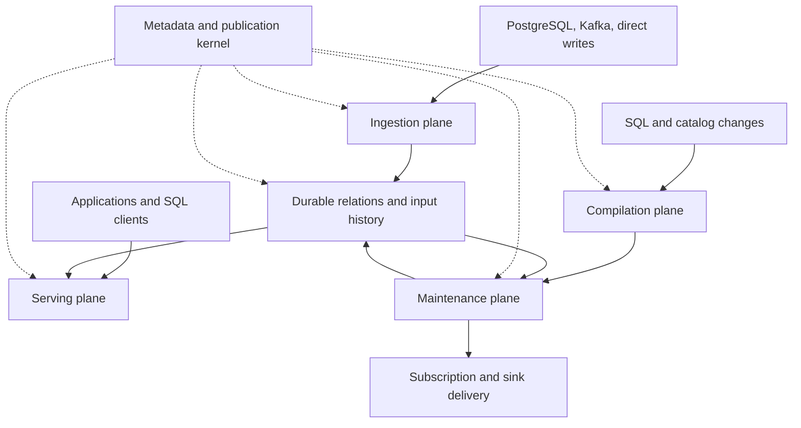

# Rockstream 2: design for a cloud-native incremental database

**Status:** Proposed for review. **Date:** 2026-11-25. **Implementation:** none in this change.

**Baseline:** Rockstream `0.72.0`, commit [`d3f973a84f4263bedd6505039d7f469d4708c478`](https://github.com/trickle-labs/rockstream/commit/d3f973a84f4263bedd6505039d7f469d4708c478). The supplied starting notes are design input, not evidence that the proposed capabilities exist.

## 1. Recommendation

Build a database whose organizing objects are **versioned relations, shared arrangements, and published computation results**. Compile SQL into a small, typed incremental algebra; maintain it on disposable workers; publish complete versions through a strongly consistent metadata service; serve those versions from independently sized read pools.

The strategic improvement is the integration of these contracts. Existing Rockstream already has DBSP-inspired computation, arrangements, immutable traces, scoped frontier machinery, fault simulation, and qualification infrastructure. Reusing that knowledge is essential. The [audit](docs/research/current-system-audit.md) distinguishes implemented mechanisms from documented aspirations and identifies the boundaries worth replacing.

“Better in all aspects” is an engineering objective, not a universal theorem. More sharing can increase coordination and retention cost; stronger durability can increase latency; a single update can require a very large correct output. Rockstream 2 should expose these tradeoffs, provide useful workload profiles, and earn migration through measured improvements without weakening correctness. [Requirements](docs/planning/requirements.md) and [qualification](docs/planning/qualification.md) turn that ambition into release criteria.

## 2. Product boundary

The product is an IVM-first database for application read models, live operational analytics, and maintained relational pipelines. SQL defines results; freshness, retention, isolation, and recovery policies constrain execution. Initial external integrations are PostgreSQL CDC and Kafka sources, Kafka output, PostgreSQL wire access, and direct transactional ingestion.

The first stable release does not attempt general OLTP concurrency, arbitrary user code in the data plane, unlimited PostgreSQL compatibility, active-active writes across regions, or every streaming connector. Later capability tracks add factorized and higher-order maintenance, recursive queries, temporal predicates, richer nested data, and Arrow Flight SQL where evidence justifies them.

An operator in Rust is not a supported SQL feature. Support requires parsing, binding, incremental planning, initial backfill, live updates and retractions, restart, resource limits, protocol output, and independent qualification. The [SQL contract](docs/reference/sql-and-apis.md) is the proposed capability boundary.

## 3. Invariants that organize the system

| ID | Invariant | Design consequence |
| --- | --- | --- |
| INV-01 | A published view equals batch evaluation at its declared input cut under its declared numeric semantics. | Every optimization preserves one explicit semantic contract. |
| INV-02 | Published versions reference only complete, durable, protected data and recovery dependencies. | Durable staging precedes atomic metadata publication. |
| INV-03 | A transaction is visible entirely or not at all within its consistency domain. | Epoch assignment cannot split a source transaction across publication boundaries. |
| INV-04 | A stale owner cannot publish or replace live state. | Ownership generations and expected heads are checked in the committing metadata transaction. |
| INV-05 | Retries have one logical effect. | Stable input identities and immutable commit descriptors resolve ambiguous responses. |
| INV-06 | A read never silently changes its snapshot or loses state protected by a valid pin. | Pin acquisition, GC eligibility, and expiry enforcement are coordinated. |
| INV-07 | Resource pressure and operator errors preserve the last correct published version. | Admission, bounded queues, spill, and fail-closed publication are part of execution. |
| INV-08 | Sharing cannot cross an incompatible semantic or security boundary. | Canonical identities include semantic versions and tenant/security context. |
| INV-09 | Compaction preserves all supported snapshots and all recovery obligations. | History retention, current state, replay requirements, and subscriber pins are distinct. |
| INV-10 | A restore cannot revive an old writer or validate a token from another restored incarnation. | Disaster recovery creates a new deployment incarnation and fences the previous one. |

Safety holds under the specified failure assumptions even when progress stops. Liveness depends on available metadata quorum, readable durable storage, recoverable input, and sufficient admitted capacity. No design can promise freshness during an unbounded storage outage.

## 4. Architecture

These are logical responsibilities, not a requirement to deploy six services. Embedded mode hosts them in one binary. Distributed mode can separate ingestion, maintenance, serving, and compaction pools while preserving the same operator and publication contracts.

| Plane | Owns | Must not own |
| --- | --- | --- |
| Ingestion | Source identity, normalization, durable input, complete transaction envelopes | Ad hoc publication of downstream views |
| Compilation | SQL semantics, algebra, physical strategy, state requirements | Storage leases or direct mutable shard access |
| Maintenance | Dependency execution, arrangements, staging, progress evidence | Authoritative visibility outside the publication kernel |
| Storage | Durable immutable data, manifests, cache, compaction, protected versions | SQL meaning or cross-domain transaction promises |
| Serving | Pinned snapshot evaluation, protocol output, cursor delivery | Selecting unrelated latest versions for a supposedly consistent join |
| Coordination | Catalog, domain heads, generations, pins, publication, placement intent | Bulk rows, per-row consensus, or query evaluation |

The authoritative cloud state consists of **both** object-store contents and metadata. Object storage alone is not a recoverable database without the catalog, manifest roots, deduplication state, and recovery lineage. Maintenance and serving RAM/NVMe are disposable. Metadata voters have durable disks; the phrase “disposable compute” does not mean deleting quorum state.

## 5. Core objects and time

| Object | Identity and contract |
| --- | --- |
| Relation | Stable catalog ID, schema version, security context, changing weighted multiset |
| View | Logical expression plus capability, freshness, retention, and durability policy |
| Plan generation | Immutable semantic/physical plan descriptor; swaps occur at a verified cut |
| Arrangement | Indexed representation of a relation or subexpression with an explicit state and history contract |
| Virtual partition | Stable state/routing identity independent of a worker process |
| Consistency domain | Unit of input sequencing, transaction visibility, and atomic publication |
| SourceCut | Map of source incarnations to complete transaction/partition boundaries, with dependency lineage |
| PublishedVersion | Immutable manifest root identifying the exact outputs, state, input cut, plan, and publication upper |
| SnapshotToken | Tenant- and incarnation-bound reference to compatible published versions and a read pin |

A domain uses a monotonically ordered `Epoch`. An **exclusive upper** `U` means every logical time `t < U` is complete. A view at `U > 0` includes input through `U - 1`; the empty initial input history has `U = 0`. Initial output is `Q(empty)`, which can include COUNT's zero row. Numeric epochs from different domains are not comparable. The full rules, including input cuts and history lower bounds, are in [consistency and storage](docs/design/consistency-and-storage.md).

Separate input acceptance, input durability, computation, publication, historical compaction, and delivery acknowledgement. A computed frontier cannot certify durability. A Kafka consumer acknowledgement cannot certify that a materialized result was published. A watermark about event time is not a commit frontier.

Start with scalar domain time and explicit dependency edges. Nested iteration time can be introduced for recursion after its progress and termination rules are qualified. Arbitrary multidimensional clocks are not a prerequisite for independent pipelines.

### Domain assignment and cross-domain reads

Tables participating in one atomic source transaction belong to the same ingestion transaction domain. A result publication domain may consume that complete source stream directly or import complete versioned relations from it. Several result domains may consume the same durable input history at different rates; each includes every relevant effect of a complete source transaction before advancing its own cut. Results requiring joint atomic visibility are one publication group. Domain scope is an explicit catalog decision informed by transaction boundaries, dependencies, tenant policy, and desired failure isolation; the optimizer cannot split it merely to improve a latency graph. G2 uses one domain; these separate consuming domains arrive with G4.

Independent pipelines have separate publication heads. Within a domain, a slow required participant still delays that publication group. This is a deliberate local synchronization cost, and the design must expose it.

Initially, dependencies crossing domains use explicit imports of versioned published relations into a consuming domain. Imports preserve source lineage and only publish compatible cuts for overlapping dependencies: every overlapping source incarnation has the same complete transaction boundary in every selected input, with dependency closure and required historical versions pinned. Being merely beyond the same requested offset is insufficient. Ad hoc joins of independently selected “latest” views are rejected or made to wait for a compatible retained cut. Independent databases have no implied cross-source transaction or real-time ordering guarantee. Domain merging/splitting and arbitrary cross-domain atomic writes remain later, separately modeled changes.

## 6. A transaction from source to reader

Consider customer 7 moving from `North` to `West` while a new order of 20 is inserted in the same source transaction. Existing orders for that customer total 100. A materialized join-aggregate reports sales by customer region.

1. Ingestion normalizes the complete transaction into retractions and insertions, with source incarnation, transaction identity, offsets, schema version, and payload digest. It assigns epoch `e` and commits that assignment, durable-log reference, and deduplication/admission state before returning a durable-input acknowledgement and `WriteToken`.
2. Maintenance begins from the exact published parent. The planner has chosen a first-order join or a qualified factorized alternative. Both must produce `-100` in North and `+120` in West in aggregate value, represented as changes to the complete aggregate rows.
3. Workers evaluate all dependent changes against the previous published state, including interactions between changes on both sides of the join. They may stage work in any physical order but cannot expose intermediate results.
4. Each required partition prepares immutable output and recovery state for the sealed interval ending at exclusive upper `e + 1`. The publication coordinator verifies coverage, identities, dependency cut, generations, durable protection, and the expected previous head.
5. A metadata compare-and-swap publishes one complete descriptor. That transaction is the visibility linearization point. The caller's result-wait succeeds only when its requested, catalog-pinned view set is covered.
6. Serving pins that version before reading. Subscribers consume its committed delta envelope. A slow sink does not hold the source's visible result hostage unless its explicitly purchased retention contract exhausts the admitted resource budget.

If a worker fails before step 5, the prior version remains visible and the interval is replayed. If it fails after step 5, the new worker resumes from the committed descriptor. If the commit response is lost, the retry reads the descriptor by stable commit identity before deciding whether to recompute. The [storage spec](docs/design/consistency-and-storage.md) makes each crash window explicit.

## 7. Algebra and optimization

Relations are weighted bags; insertions and retractions carry signed integer weights. At each completed input cut, incremental execution must agree with the batch relation. SQL has additional constraints: NULL and duplicate semantics, exact decimal overflow, empty aggregates, outer-join unmatched rows, deterministic ordering for Top-K, and explicit approximation for floating-point aggregates.

The compiler stages are **SQL binding → canonical relational IR → incremental algebra → state-aware physical IR → distributed task graph**. Each stage retains schema, keys, semantic version, provenance, and resource obligations. Specialized physical kernels implement the same logical operators and are tested against independent reference evaluation. [Semantics and compiler](docs/design/semantics-and-compiler.md) defines the transformations and difficult cases.

First-order IVM is the baseline. Factorization, higher-order derivatives, multiway joins, and localized recomputation are strategies with proof obligations and cost models. A customer-level sum can make a region change cheaper for a suitable join-aggregate, but it is not valid to apply the transformation to arbitrary filters, multiplicities, or non-decomposable aggregates.

Optimize the lifetime workload cost: maintenance CPU, durable state, requests and bytes, exchange, compaction, serving, recovery, and temporary duplication during changes. Constrain this objective by freshness, memory, correctness, and tenant budgets. Begin with deterministic rules and measured statistics; add adaptive selection only after observability and safe online replacement exist. Optimizer uncertainty must be visible in `EXPLAIN INCREMENTAL`.

## 8. Shared graph and arrangement lifecycle

Share canonical, semantically equivalent subexpressions and arrangements within compatible isolation boundaries. Logical equivalence fingerprints include normalized expressions, schema, arrangement key expressions and their equality/collation rules, numeric behavior, source lineage, and semantic version. Compare full canonical descriptors after a digest lookup; hash equality alone never authorizes reuse. Physical variants additionally identify layout, partitioning, index representation, and encoding. Retention and freshness are obligations aggregated across consumers; incompatible obligations can require another copy rather than silently weakening a contract.

Creating a view reserves a catalog identity and build pin, selects a published snapshot, backfills the graph, replays retained changes, and activates a complete plan generation at a cut. Existing views remain readable during build. Cancellation removes subscriptions and pins through an idempotent cleanup path. Dropping the last consumer does not delete state still referenced by snapshots, subscribers, recovery, backups, or an in-progress replacement.

Sharing has a measurable limit: a slow consumer can retain expensive history, and a shared hot stage can become a failure or scheduling bottleneck. Budget retention per consumer, attribute shared costs, and permit isolated duplicate state when it improves total cost or SLOs. Cross-tenant sharing is disabled initially even for identical SQL.

## 9. Durable state and publication

Use an IVM-specific arrangement interface. Its first candidate backend is SlateDB, evaluated behind explicit preparation and pinned-version APIs. SlateDB's durable checkpoints and transient snapshots are different concepts; an in-memory snapshot cannot serve as the durable reference for an externally published version. The adapter must demonstrate exact reopening, non-expiring protection, fencing, and old-version reads before adoption. [SlateDB checkpoint documentation](https://slatedb.io/docs/design/checkpoints/) informs this requirement; the requirement itself is Rockstream's design decision.

A `PreparedVersion` is not a published result. Object and backend durability are necessary but insufficient: a complete domain descriptor must also be atomically installed. Multiple SlateDB databases do not provide a cross-database transaction by themselves. No reader follows a backend's mutable “latest” pointer as a substitute for the published manifest.

Use etcd as the proposed cloud metadata reference and SQLite WAL with full synchronization for the embedded profile. The contract requires conditional transactions and linearizable authoritative decisions. Watches and caches accelerate notification; a watch event or stale cache does not authorize publication. The [etcd API guarantees](https://etcd.io/docs/v3.6/learning/api_guarantees/) are a substrate, not a proof of Rockstream's protocol.

Metadata records contain bounded roots and digests, not thousands of rows or one enormous per-partition transaction. Completeness is assembled as an immutable prepared tree whose participants and generation digest are tied to a stable topology revision. A change to ownership invalidates incompatible in-flight preparation. The publication state machine must ensure a bounded metadata CAS cannot accidentally certify omitted partitions.

Storage reconstruction classes are explicit: authoritative source history; expensive derived state normally persisted; cheap derived state reproducible from a protected cut and replay range; ephemeral buffers and caches. Never delete the only recoverable input because an optimizer labels a structure “derived.” Garbage collection honors current state, history, replay, pins, and backups independently.

## 10. Runtime, serving, and cloud operations

Separate virtual state partitions from compute tasks. Execute vectorized batches on cooperative lanes with single-owner mutable state, bounded queues, explicit memory reservations, and spill. Fuse operators when that reduces overhead; put asynchronous boundaries around I/O and exchange. Network delivery may repeat; replay and message identities preserve logical results. Runtime framework selection remains a short, decisive prototype comparing reuse of Differential/Timely, Feldera/DBSP, and a minimal custom substrate.

Serving pools read published versions and maintain disposable caches. Read policies include latest committed, bounded staleness, read-your-writes for requested dependencies, historical version, and a repeatable pinned snapshot. Subscriptions bridge one initial snapshot to committed deltas with no gap; resumable transport can repeat an unacknowledged envelope, so clients deduplicate using its cursor. Kafka output begins with an honest replay/deduplication contract; stronger destination guarantees require a separately qualified marker/transaction protocol.

Backpressure, skew, deadlines, fairness, and compaction capacity are scheduled together. Scale-to-zero applies to eligible pools, while source retention, ingestion, metadata, and timer obligations remain funded. Recovering a cold petabyte is not instantaneous merely because storage is disaggregated. The [runtime and operations spec](docs/design/runtime-and-operations.md) defines connector, security, upgrade, and recovery behavior.

## 11. Implementation boundaries

| Proposed crate | Responsibility | Dependency restrictions |
| --- | --- | --- |
| `rock-core` | IDs, weighted batches, schemas, time, checked codecs | No runtime, network, or backend dependencies |
| `rock-algebra` | Typed semantic IR and rewrite specifications | Core only; independent reference interpreter |
| `rock-sql` | Parser/binder adapter and SQL semantic normalization | Core/algebra; no storage ownership |
| `rock-optimizer` | Physical IR, costs, sharing candidates | Contracts and statistics; no direct publication |
| `rock-engine` | Operators, progress, scheduling, exchange execution | Abstract state and environment interfaces |
| `rock-state` | Arrangement APIs, codecs, manifests, backend adapter | Core and storage adapters; no SQL |
| `rock-meta` | Catalog, heads, pins, fencing, lifecycle transactions | Core/contracts; no query execution |
| `rock-io` | Sources, delivery, durable-input normalization | No bypass of ingestion/publication contracts |
| `rock-server` | pgwire, snapshot query execution, subscriptions | Uses compiler and read/catalog APIs |
| `rock-cli` | Composition, local/cloud profiles, administration | Integration boundary; no alternate semantics |

`verification/`, `benchmarks/`, and `deployments/` will host executable qualification and deployment assets. This PR deliberately adds design documents rather than empty crate scaffolding or pseudocode presented as a compiling engine. Crate count is provisional; dependency direction and one production execution path are the requirements.

## 12. Delivery, evidence, and decisions

Start with three make-or-break experiments: durable arrangement reopening and GC safety; reusable runtime suitability; and bounded metadata publication under concurrent ownership changes. Then build a single-domain vertical slice that ingests one transaction, incrementally maintains a join-aggregate, survives process destruction, and serves the same pinned result after restart.

The [implementation plan](docs/planning/implementation-plan.md) gives issue-ready work packages and acceptance gates. The [qualification plan](docs/planning/qualification.md) defines negative controls and measured cost comparisons. The [migration plan](docs/planning/migration.md) preserves existing production behavior until workload-level parity and rollback are demonstrated. [ADRs](docs/adr/README.md) distinguish architectural commitments from component candidates; [risks](docs/planning/risks-and-open-questions.md) list the evidence needed to resolve the remaining choices.

For a conflict, the detailed semantic and consistency specifications govern their respective contracts; update this overview and affected ADRs in the same review. A disagreement between the two detailed specifications is a release-blocking design defect, not an implementation choice. All gates in this repository currently remain unexecuted.
