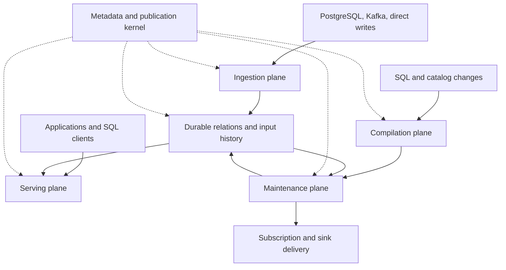

# Rockstream 2: design for a cloud-native incremental database

**Status:** Proposed for review. **Date:** 2026-11-26. **Implementation:** none in this repository yet.

**Baseline:** Rockstream `0.72.0`, commit [`d3f973a84f4263bedd6505039d7f469d4708c478`](https://github.com/trickle-labs/rockstream/commit/d3f973a84f4263bedd6505039d7f469d4708c478).

## 1. Thesis and architectural recommendation

Build a **SQL-first, cloud-native incremental view maintenance (IVM) database** whose internal engine optimizes a whole workload of incremental relational computations. The organizing objects are versioned relations, shared arrangements, immutable delta traces, and atomically published results. Applications specify SQL, freshness, and retention; they do not assemble a distributed stream-processing graph or operate external coordination clusters.

### What makes Rockstream 2 distinct

Existing streaming databases typically require external coordination tiers (etcd, ZooKeeper, or dedicated metadata databases), maintain isolated state per view, or trade away exact SQL semantics. Rockstream 2 combines four architectural pillars into one simple binary:

1. **Zero-external-dependency operation:** One binary for local embedded mode, one binary + object store for the default cloud profile, and multiple instances of the same binary for distributed scale. No external etcd, ZooKeeper, Redis, SQL catalog, or mandatory Kubernetes.
2. **Workload-wide shared and factorized IVM:** DBSP semantics over weighted Apache Arrow batches and DataFusion, with shared canonical arrangements and algebraically verified partial aggregation/factorization (F-IVM) where it reduces total lifetime cost.
3. **Clean cloud-native storage separation:** Immutable object-backed input logs and timestamped delta segments are the authoritative source of durability, exact-parent recovery, and logical MVCC history. SlateDB provides fast per-domain/partition indexed working state without fighting LSM internals to emulate multi-domain speculative attempts.
4. **Honest cloud latency profiles:**
   - **Object-Native (default):** Zero resident coordinator, compositional single-root S3 conditional-write metadata, **conservative GC physical-deletion grace windows + lease-backed serving** for sub-5 ms warm cached reads, ~200 ms–1 s freshness, and compute scale-to-zero (plus full hibernation for eligible workloads).
   - **Low-Latency Cloud (G4+ optional):** Same binary and logical metadata state machine backed by **embedded OpenRaft** when a workload genuinely requires ≤100 ms P99 freshness or high-rate strict-latest reads. Stateless compute still scales to zero while voters remain resident.

### Early physics-first validation (lean G0)

Before building the full engine, four focused G0 deliverables validate the existential physics and establish the executable foundation—without building two full engines or premature governance infrastructure:

| G0 Deliverable | Focus | Decision |
| --- | --- | --- |
| **G0.1** Bootstrap, CI & Golden Workload | Minimal Rust workspace, fast local/CI entry point, frozen `W1-G` fixture, independent PostgreSQL/batch oracle, and minimal RockStyle baseline | Establish executable feedback loop (<5 min CI) |
| **G0.2** Storage & Metadata Physics Probe | Real S3 single-root conditional PUT + compositional intra-batch commit scheduler; real SlateDB checkpoint/recovery vs. immutable-delta + SlateDB-index layout; lease/grace-window read latency and actual reclamation | Prove S3/SlateDB latency, request cost, and lock one storage layout |
| **G0.3** Core Protocol Model (Quint) | One concise Quint specification for publication, ownership fencing, compositional batch outcomes, and grace-window GC safety with negative controls | Falsify protocol races before coding metadata/GC |
| **G0.4** Native Kernel Spike | Bounded acyclic scalar-epoch Arrow kernel over `W1-G` (plus donor disposition register from Rockstream v1) | Confirm native kernel ergonomics/complexity; only prototype Timely/Differential if native fails concrete bounds |

[ADR 0011](docs/adr/0011-risk-reduction-before-implementation.md) records these bounded pre-implementation choices and their fallback triggers. No performance number or risk is marked closed until real G0 measurements exist.

### Engineering principles

Correctness, simplicity, runtime performance, testability, maintainability, and step-by-step delivery are first-class concerns. Prefer the simplest contract-satisfying design; every abstraction, dependency, or alternate path must earn its verification cost. [RockStyle](ROCK_STYLE.md) turns these principles into executable rules: distinct domain types, checked arithmetic, release-enabled checks on internal invariants, explicit resource contracts, and a small verification stack (Rust/Clippy, Quint, `proptest`, independent PostgreSQL/batch oracles, deterministic state-machine replay for pure Rockstream transitions, and real-process/real-backend crash tests). See [testing and verification](docs/design/testing-and-verification.md) and [development workflow](docs/design/development-workflow.md).

Autonomous coding agents are the primary implementation workforce, operating under lightweight GitHub issue/PR workflows and [risk-based governance](docs/design/agent-development.md): routine contract-bounded implementation advances autonomously via independent oracles, automated checks, and separate-context review, while human maintainers own architecture, invariant/security changes, and release authorization.

## 2. Product boundary

The product is a SQL-first, IVM-first database for application read models, live operational analytics, and maintained relational pipelines. Initial external integrations are PostgreSQL CDC and Kafka sources, Kafka output, PostgreSQL wire (`pgwire`) access, and bounded direct ingestion.

The first stable release does not attempt general OLTP concurrency, arbitrary user code in the data plane, full PostgreSQL emulation, active-active multi-region writes, or every streaming connector. Build incrementally:

- **G1:** Pure in-memory semantic kernel with exact SQL/Z-set oracle parity.
- **G2:** Single-node durable MVP—one binary, 5-minute local quickstart, standard PostgreSQL clients, single-node S3 durability, crash recovery, and lease-backed fast reads.
- **G3:** Shared arrangements, independent consumer schedules, online view lifecycle, eligible partial aggregation/factorization, PostgreSQL CDC, Kafka source/sink, and resumable subscriptions.
- **G4:** Multi-node cloud execution, virtual-partition reassignment, independent serving pools, cross-domain versioned imports, distributed suspension, and optional Embedded Raft low-latency profile.
- **G5 (independent track):** Outer/semi/anti joins, `DISTINCT`, Top-K, windows, temporal SQL, bounded recursion, broader F-IVM, and adaptive plans—graduating individually without blocking G6.
- **G6:** Production qualification (72-hour soak, DR restore drills, rolling upgrades, audited SLO/cost bundles, and v1 migration).

An operator in Rust is not a supported SQL feature. Support requires parsing, binding, incremental planning, initial backfill, live updates and retractions, restart, resource limits, protocol output, and independent qualification. The [SQL contract](docs/reference/sql-and-apis.md) governs capability promotion through the five-stage lifecycle: `Planned → Implemented → Verified → Qualified → Supported`.

## 3. Invariants that organize the system

| ID | Invariant | Design consequence |
| --- | --- | --- |
| INV-01 | A published view equals batch evaluation at its declared input cut under its declared numeric semantics. | Every optimization preserves one explicit semantic contract. |
| INV-02 | Published versions reference only complete, durable, protected data and recovery dependencies. | Durable staging precedes atomic metadata publication. |
| INV-03 | A transaction is visible entirely or not at all within its consistency domain. | Epoch assignment cannot split a source transaction across publication boundaries. |
| INV-04 | A stale owner cannot publish or replace live state. | Ownership generations and expected heads are checked in the committing metadata transaction. |
| INV-05 | Retries have one logical effect. | Stable input identities and immutable commit descriptors resolve ambiguous responses. |
| INV-06 | A read never silently changes its snapshot or loses state protected by a valid pin. | Pin acquisition, GC eligibility, and expiry enforcement are coordinated. |
| INV-07 | Resource pressure and operator errors preserve the last correct published version. | Admission, bounded queues, spill, and fail-closed publication are part of execution. |
| INV-08 | Sharing cannot cross an incompatible semantic or security boundary. | Canonical identities include semantic versions and tenant/security context. |
| INV-09 | Compaction preserves all supported snapshots and all recovery obligations. | History retention, current state, replay requirements, and subscriber pins are distinct. |
| INV-10 | A restore cannot revive an old writer or validate a token from another restored incarnation. | Disaster recovery creates a new deployment incarnation and fences the previous one. |

Safety holds under the specified failure assumptions even when progress stops. Liveness depends on access to the authoritative metadata root, readable durable storage, recoverable input and sufficient admitted capacity. No design can promise freshness during an unbounded storage outage.

## 4. Architecture

These are logical responsibilities within the same binary. Embedded mode uses a qualified local filesystem; cloud mode uses a qualified object store. Distributed mode can separate ingestion, maintenance, serving and compaction pools while preserving the same operator and publication contracts. Coordination is work an eligible process performs, not a mandatory always-running external tier.

| Plane | Owns | Must not own |
| --- | --- | --- |
| Ingestion | Source identity, normalization, durable input, complete transaction envelopes | Ad hoc publication of downstream views |
| Compilation | SQL semantics, algebra, physical strategy, state requirements | Storage leases or direct mutable shard access |
| Maintenance | Dependency execution, arrangements, staging, progress evidence | Authoritative visibility outside the publication kernel |
| Storage | Durable immutable data, manifests, cache, compaction, protected versions | SQL meaning or cross-domain transaction promises |
| Serving | Pinned snapshot evaluation, protocol output, cursor delivery | Selecting unrelated latest versions for a supposedly consistent join |
| Coordination | Catalog, domain heads, generations, pins, publication, placement intent | Bulk rows, per-row consensus, or query evaluation |

In the default cloud profile, all authoritative state lives in object storage, **including metadata**: catalog, publication roots, ownership generations, admission/deduplication state, pins and recovery lineage. The in-process metadata kernel conditionally advances one authoritative root pointing into immutable metadata. Every process and its RAM/NVMe can be replaced; only losing the authoritative storage violates that recovery assumption. A coherent backup captures a root and its reachable graph, rather than an arbitrary listing of bucket objects. An optional future consensus profile requires a separate durability and stop/restart qualification.

## 5. Core objects and time

| Object | Identity and contract |
| --- | --- |
| Relation | Stable catalog ID, schema version, security context, changing weighted multiset |
| View | Logical expression plus capability, freshness, retention, and durability policy |
| Plan generation | Immutable semantic/physical plan descriptor; swaps occur at a verified cut |
| Arrangement | Indexed representation of a relation or subexpression with an explicit state and history contract |
| Virtual partition | Stable state/routing identity independent of a worker process |
| Consistency domain | Unit of logical ordering and atomic visibility; consuming result domains can share an ingestion domain |
| SourceCut | Map of source incarnations to complete transaction/partition boundaries, with dependency lineage |
| PublishedVersion | Immutable manifest root identifying outputs, recovery state, input lineage, plan, durable upper and supported logical cut coverage |
| SnapshotToken | Tenant- and incarnation-bound logical cuts, exact protected history roots and a read pin |

A domain uses a monotonically ordered `Epoch`. An **exclusive upper** `U` means every logical time `t < U` is complete. A view at `U > 0` includes input through `U - 1`; the empty initial input history has `U = 0`. Initial output is `Q(empty)`, which can include COUNT's zero row. Numeric epochs from different domains are not comparable. The full rules, including input cuts and history lower bounds, are in [consistency and storage](docs/design/consistency-and-storage.md).

Separate input acceptance, input durability, computation, publication, historical compaction and delivery acknowledgement. A computed frontier cannot certify durability. A Kafka consumer acknowledgement cannot certify that a materialized result was published. A watermark about event time is not a commit frontier.

**Logical MVCC** gives each relation/arrangement a computed upper `Cc`, durable published upper `Cp <= Cc`, inclusive earliest supported cut `S` and explicit cut coverage. A read at `C` includes epochs `e < C`; normally any `S <= C <= Cp` is reconstructible from a protected base and timestamped deltas. Coverage gaps from an explicit repair are never hidden. Physical SlateDB checkpoints need not coincide with these logical cuts. Compaction must preserve intermediate results, including nonlinear operator outputs, at every promised cut. [ADR 0009](docs/adr/0009-logical-mvcc.md) states this contract and its limits.

Start with scalar domain time and explicit dependency edges. Nested iteration time can be introduced for recursion after its progress and termination rules are qualified. Arbitrary multidimensional clocks are not a prerequisite for independent pipelines.

### Domain assignment and cross-domain reads

Tables participating in one atomic source transaction belong to the same ingestion transaction domain. A result publication domain may consume that complete source stream directly or import complete versioned relations from it. Several result domains may consume the same durable input history at different rates; each includes every relevant effect of a complete source transaction before advancing its own cut. Results requiring joint atomic visibility are one publication group. Domain scope is an explicit catalog decision informed by transaction boundaries, dependencies, tenant policy, and desired failure isolation; the optimizer cannot split it merely to improve a latency graph. G2 uses one domain. G3 qualifies local independent consuming result domains over common input/history; G4 adds distributed execution and general cross-domain imports.

Each result domain has one atomic publication group. Independent result domains have separate publication heads. Sharing an arrangement does not merge them. Within a group, a slow required participant still delays its publication; that is the explicit cost of its requested atomic visibility.

General dependencies crossing domains use explicit imports of versioned published relations into a consuming domain. Imports preserve source lineage and only publish compatible cuts for overlapping dependencies: every overlapping source incarnation has the same complete transaction boundary in every selected input, with dependency closure and required logical histories pinned. Being merely beyond the same requested offset is insufficient. Common reads select compatible logical cuts from retained history, even when the physical checkpoint schedules do not coincide. Ad hoc joins of independently selected “latest” views are rejected or made to wait if no certified compatible cut exists. Independent databases have no implied cross-source transaction or real-time ordering guarantee. Domain merging/splitting and arbitrary cross-domain atomic writes remain later, separately modeled changes.

## 6. A transaction from source to reader

Consider customer 7 moving from `North` to `West` while a new order of 20 is inserted in the same source transaction. Existing orders for that customer total 100. A materialized join-aggregate reports sales by customer region.

1. Ingestion normalizes the complete transaction into retractions and insertions, with source incarnation, transaction identity, offsets, schema version, and payload digest. It assigns epoch `e` and commits that assignment, durable-log reference, and deduplication/admission state before returning a durable-input acknowledgement and `WriteToken`.
2. Maintenance begins from the exact published parent. The planner has chosen a first-order join or a qualified factorized alternative. Both must produce `-100` in North and `+120` in West in aggregate value, represented as changes to the complete aggregate rows.
3. Workers evaluate all dependent changes against the previous published state, including interactions between changes on both sides of the join. They may stage work in any physical order but cannot expose intermediate results.
4. Each required partition prepares immutable output and recovery state for the sealed interval ending at exclusive upper `e + 1`. The publication coordinator verifies coverage, identities, dependency cut, generations, durable protection, and the expected previous head.
5. A metadata compare-and-swap publishes one complete descriptor. That transaction is the visibility linearization point. The caller's result-wait succeeds only when its requested, catalog-pinned view set is covered.
6. Serving pins that version before reading. Subscribers consume its committed delta envelope. A slow sink does not hold the source's visible result hostage unless its explicitly purchased retention contract exhausts the admitted resource budget.

If a worker fails before step 5, the prior version remains visible and the interval is replayed. If it fails after step 5, the new worker resumes from the committed descriptor. If the commit response is lost, the retry reads the descriptor by stable commit identity before deciding whether to recompute. The [storage spec](docs/design/consistency-and-storage.md) makes each crash window explicit.

## 7. Algebra, optimization, and view fault isolation

Relations are weighted bags; insertions and retractions carry signed integer weights. At each completed input cut, incremental execution must agree with the batch relation. SQL adds explicit constraints: NULL and duplicate semantics, exact decimal overflow, `Q(empty)` initialization, outer-join unmatched rows, deterministic Top-K ordering, and opt-in approximation for floating-point aggregates.

The compiler stages are **SQL binding → canonical relational IR → incremental algebra → state-aware physical IR → distributed task graph**. Each stage retains schema, keys, semantic version, provenance, and resource obligations. [Semantics and compiler](docs/design/semantics-and-compiler.md) defines the transformations and edge cases.

First-order IVM is the semantic baseline. Eligible partial aggregation and factorization (F-IVM) are evaluated with explicit algebraic side conditions and qualified in G3; broader higher-order derivatives and adaptive selection advance independently in G5. Observed statistics rank valid plans but never establish semantic preconditions such as uniqueness. Optimizer uncertainty is visible in `EXPLAIN INCREMENTAL`.

**View-level fault isolation:** Source validation errors reject a direct-write transaction *before* durable acceptance. If a valid, durably accepted transaction later triggers a runtime error in one derived view (for example, `DECIMAL` overflow or division by zero), the engine **quarantines that failing view** at its last valid published cut with an explicit `ERROR` diagnostic, while unaffected views continue advancing. Views explicitly placed in a coupled atomic publication group halt together as the documented cost of joint atomicity. Repair replaces or alters the failing view and backfills cleanly from retained history—never silently skipping accepted input.

## 8. Shared graph and arrangement lifecycle

Share canonical, semantically equivalent subexpressions and arrangements within compatible security/tenant boundaries. After digest lookup, compare full canonical descriptors (normalized expression, schema, key/collation rules, numeric behavior, source lineage, semantic version). Physical layout variants remain distinct from logical equivalence.

Creating a view reserves a catalog identity and build pin, selects a certified logical snapshot, backfills the graph, replays retained changes, and activates the new plan generation at a verified cut without disrupting existing readers. Dropping a consumer never deletes state still referenced by snapshots, subscribers, recovery, or backups.

Each consumer declares its own freshness schedule, history window, and resource budget. Sharing is an economic placement choice made *after* semantic/security eligibility: isolate a slow or long-retention consumer through pinned snapshot/replay/verified cutover when isolation has lower lifetime cost than retaining shared history. Cross-tenant sharing is disabled initially.

## 9. Durable state, storage split, and metadata publication

Rockstream 2 separates durable authority from indexed working state cleanly so neither fights the other's physics:

1. **Authoritative Input & Delta Traces (Immutable Object Segments):** Accepted input transactions and committed per-interval output/operator deltas are written as immutable weighted Arrow/batch objects on object storage and referenced by the authoritative manifest. Abandoned preparations are simply unreferenced objects—giving clean exact-parent recovery with zero LSM attempt-namespace pollution and zero per-interval database cloning.
2. **Indexed Working State (SlateDB per Domain/Partition):** SlateDB provides fast point lookups, join probes, and indexed serving state. Starting in G0–G2, assign **one SlateDB instance per consistency domain (or partition of a domain)** rather than co-locating unrelated domains under one mutable writer. This preserves true domain independence ([ADR 0002](docs/adr/0002-consistency-domains.md)) and avoids cross-domain checkpoint/failover coupling. Multi-domain physical grouping is deferred to G3/G4 only if measured manifest overhead justifies it.
3. **Bounded Logical MVCC History:** Logical MVCC is decoupled from SlateDB physical checkpoints. Exact cut reconstruction is guaranteed within a bounded hot-history window (active pins + configured fine-grained delta window); long-term multi-day history uses periodic consolidated checkpoints or explicitly budgeted retained delta segments rather than unbounded uncoalesced per-epoch nonlinear history inside an LSM tree.
4. **Explicitly Budgeted Direct-DML Primary-Key Index:** Tables accepting direct SQL `UPDATE`/`DELETE` require a durable primary-key image index at the accepted-input head to normalize retractions. That index uses the same SlateDB storage layer and is explicitly accounted for in memory, storage, and cold-recovery budgets. Append-only tables and PostgreSQL CDC sources with full before-images avoid this index completely.

G0.2 validates this **immutable-delta + SlateDB-index** layout against a pure SlateDB-history layout on real object storage and locks one production storage path before G2.

### Compositional single-root metadata kernel

The default **Object-Native** metadata kernel uses **one logical conditional root per installation** over object storage (single-key conditional `PUT` with `If-Match`, evaluating `slatedb-txn-obj` only if current-version discovery avoids `ListObjects` on the read path). All jointly atomic predicates (catalog, domain heads, ownership generations, pins, quotas, intents, and operation outcomes) commit in one root transition.

To prevent single-key contention from throttling throughput, the embedded commit scheduler uses **compositional intra-batch serialization**: against authoritative root revision `R`, it applies queued operations sequentially in memory against a working tree derived from `R`—so consecutive input admissions to the same domain or concurrent quota-checked operations within one tenant all validate and commit in **one single conditional root update** (`R → R+1`), each recording its own stable identity and outcome for idempotent reconciliation.

If a workload genuinely requires **≤100 ms P99 freshness** or high-rate strict-latest reads beyond single-key S3 latency, G4 introduces the optional **Low-Latency Cloud** profile using **embedded OpenRaft** running the exact same logical metadata state machine.

### Lease-backed fast reads and grace-window GC

To achieve **sub-5 ms warm indexed reads** without compromising GC safety ([INV-06], [INV-09]):
- **Conservative physical-deletion grace window (`Δ_gc_grace`):** Even after metadata reachability marks an immutable object or checkpoint unreferenced, physical deletion waits for a conservative grace window (e.g., 5–15 minutes) that strictly exceeds the maximum short-query lease (`Δ_read_lease + clock_skew_bound << Δ_gc_grace`).
- **Zero-S3-round-trip warm fast path:** Short bounded reads operating under a valid reader-group/snapshot lease and cached authorization grant (`bounded-staleness` / `allowed-stale` policies) read directly from local/NVMe cache with **zero synchronous S3 metadata round-trips at completion**.
- **Strict policies remain explicit:** `latest-committed` performs a linearizable head check at selection (fast under Embedded Raft; one S3 root check under Object-Native). `strict-immediate-revocation` is an opt-in security mode that performs synchronous post-read auth revalidation and pays its documented remote-read latency.

## 10. Runtime, serving, and cloud operations

Use a lean **Rockstream-native Rust runtime**: weighted Arrow batches, DataFusion for SQL parsing/expression kernels, and Tokio for async I/O. Start in G1–G2 with acyclic graphs, scalar domain epochs, and **one active maintenance interval per domain** (keeping recovery simple via exact-parent generation replacement). In G3–G4, add **bounded single-depth pipelining** (overlapping compute for interval `k+1` with durable S3 flush/publication of interval `k`) so single-domain cloud freshness is not capped by serialized object-store I/O. Only fall back to Timely/Differential if G0.4 reveals a concrete complexity or correctness blocker in the native kernel.

Serving pools cache immutable objects and manifests by verified content identity. Subscriptions bridge a pinned snapshot to committed delta envelopes without gaps (at-least-once network transport with stable cursors). Kafka delivery starts at-least-once with stable delivery IDs; stronger destination-marker protocols are separately gated.

### Compute elasticity and honest hibernation scope

Separate **stateless compute scale-to-zero** (stopping idle maintenance or serving workers while ingestion/coordination runs) from **full zero-process hibernation** (`Active → Draining → Dormant → Restoring → Active`):
- **Stateless compute pools** scale to zero whenever their domain has no pending work.
- **Full zero-process hibernation** is supported on the **Object-Native** profile for genuinely eligible workloads (intermittent, scheduled, dev/staging, or batch-replayed pipelines whose upstream source retention, freshness targets, timers, and external wake trigger permit zero running processes).
- Workloads with continuous PostgreSQL CDC replication slots, strict low-latency read SLOs, or active Kafka sinks use **partial suspension** (or the Embedded Raft low-latency profile) rather than distorting online latency for a dormancy mode they cannot use.

## 11. Implementation boundaries

| Proposed crate | Responsibility | Dependency restrictions |
| --- | --- | --- |
| `rock-core` | Domain IDs, weighted batches, schemas, time, checked codecs | No runtime, network, or backend dependencies |
| `rock-algebra` | Typed semantic IR, rewrite contracts, independent bag reference | `rock-core` only |
| `rock-sql` | DataFusion parser/binder adapter and SQL semantic normalization | `rock-core`, `rock-algebra`; no storage ownership |
| `rock-optimizer` | Physical IR, lifetime costs, sharing/factorization planner | Contracts and stats; no direct publication |
| `rock-engine` | Vectorized operators, progress, scheduling, exchange | Abstract state/environment traits |
| `rock-state` | Immutable delta traces, SlateDB working indexes, manifests | `rock-core` and storage adapters; no SQL |
| `rock-meta` | Compositional metadata kernel, pins, leases, fencing, GC | `rock-core`; no query execution |
| `rock-io` | PostgreSQL CDC, Kafka source/sink, direct-write normalization | Uses admission/publication contracts |
| `rock-server` | `pgwire`, snapshot serving, subscriptions, diagnostics | Uses compiler, serving, and catalog APIs |
| `rock-cli` | Single binary entrypoint, local/cloud profiles, admin CLI | Integration boundary; no alternate semantics |

Create crates **only as their owning gate begins** (`G0.1` starts with the minimal prototype crates; never scaffold empty placeholder crates). Enforce dependency direction in CI from G0.1 onward.

## 12. Step-by-step delivery and evidence

Build incrementally along one executable vertical path (`W1-G` customer/orders join-aggregate):

1. **G0 (2–4 weeks):** Workspace/CI bootstrap, frozen `W1-G` oracle, real S3 metadata + SlateDB physics probe, Quint protocol model, and native kernel validation.
2. **G1:** Pure in-memory semantic kernel passing exact PostgreSQL/batch oracle checks on `W1-G` and generated histories.
3. **G2:** Single-node durable MVP—one binary, `pgwire`, 5-minute local quickstart, single-node S3 durability, crash recovery, and lease-backed warm reads.
4. **G3:** Shared arrangements, independent consumer domains, online view lifecycle, eligible F-IVM factorization, PostgreSQL CDC, Kafka source/sink, and resumable subscriptions.
5. **G4:** Multi-node cloud execution, virtual-partition reassignment, independent serving pools, cross-domain imports, distributed suspension, and optional Embedded Raft profile.
6. **G5 (independent) & G6:** Advanced SQL/IVM features graduate individually in G5; G6 qualifies sustained 72-hour soaks, DR drills, rolling upgrades, and three-way strangler migration from Rockstream v1.

For any conflict, the detailed specifications (`semantics-and-compiler.md` and `consistency-and-storage.md`) govern their respective domains and must be kept aligned with this overview and ADRs in the same PR. All gates currently remain unexecuted.
