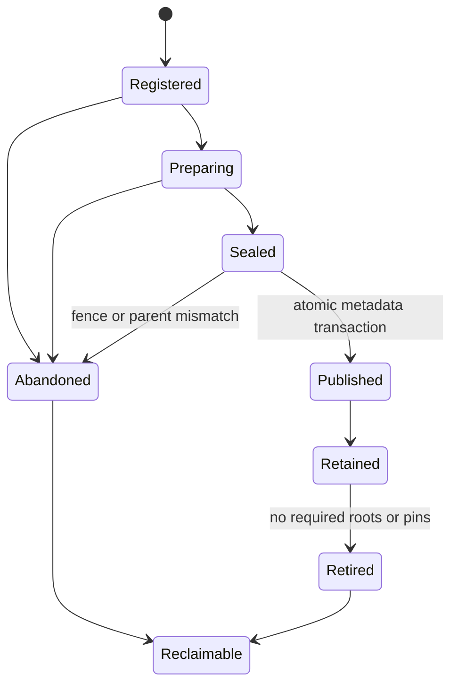

# Consistency, publication, and durable state

**Status:** Proposed. **Design date:** 2026-11-26. No Rockstream 2 engine or storage adapter is implemented by this document.

This specification defines the safety boundary shared by ingestion, incremental execution, serving, and operations. The [main design](../../DESIGN.md) describes the architecture; [semantics and compiler](semantics-and-compiler.md) defines the meaning of the results being published. “Must” below is a proposed implementation requirement, not a claim about existing software.

## 1. The contract and its limits

A published version is an immutable, durable description of a complete result at a declared input cut. It remains correct if every maintenance and serving process disappears. An accepted input is recoverable independently of whether its consequences have finished computing. A prepared worker result is invisible until the metadata kernel publishes it.

The default object-native cloud failure model covers process crashes, lost responses, message duplication and reordering, network partitions, disposable disk loss, and an availability-zone failure within the selected object service's qualified durability envelope. All authoritative input, data, catalog, publication, deduplication, ownership and retention metadata reside in that object service. Rockstream requires its qualified conditional-update and consistency semantics; it does not require an external coordination service. The model assumes authenticated, non-Byzantine components and detects corrupted bytes through checksums. It does not promise availability when the metadata root or required objects are unavailable, recovery from destruction of all authoritative copies, or zero data loss after restoring an older asynchronous backup.

The same logical state machine runs in an embedded deployment against a qualified local filesystem adapter with exclusive process ownership and durable root updates. A laptop restart is recoverable; destruction of its only disk is not. Cloud RAM, local disks and every Rockstream process may disappear without losing acknowledged state. That is a recovery guarantee, not a promise that a sleeping deployment can receive requests without an external launcher or platform activation path.

The safety invariants are:

| ID | Required invariant |
| --- | --- |
| CS-01 | Every published relation equals its specified query over the manifest's complete input cut, under the declared SQL numeric semantics. |
| CS-02 | Published progress never exceeds durable input and fully prepared computation. |
| CS-03 | Each accepted input identity has one logical effect, even if physical processing repeats. |
| CS-04 | One metadata transaction selects the visible version for a consistency domain. |
| CS-05 | A stale owner, plan, configuration, or restore incarnation cannot publish. |
| CS-06 | A reader uses exactly the versions and schema recorded by its snapshot token. |
| CS-07 | No object reachable from a live root, valid pin, or protected staging intent is reclaimed. |
| CS-08 | Resource or availability failures preserve the previous published result and return an explicit incomplete/error state. |

These are independently testable obligations. Algebraic proofs do not prove the storage protocol; storage tests do not prove SQL semantics.

## 2. Names, time, and progress

The first implementation uses an ordered `Epoch` within each consistency domain. A domain groups relations that need atomic visibility and one input ordering. It is not a worker, storage shard, tenant, or cluster. A tenant may have several domains, and a domain may span many workers. A transaction that changes multiple tables belongs entirely to one domain. Cross-domain atomic writes are rejected initially.

For the initial PostgreSQL connector, all subscribed tables that can participate in one source transaction enter one ingestion transaction domain; an arbitrary per-table split is forbidden. Independently progressing downstream view groups use consuming domains that import complete published source transactions/versions from that domain. Publication remains atomic within each declared group, so a slow required participant can block its group. This deliberate local synchronization cost cannot be optimized away by changing the advertised transaction boundary.

An upper frontier is **exclusive**: `U = 43` means all work at epochs `t < 43` is complete. A published version with upper `43` includes epoch `42`. Genesis has empty history and `U = 0`; publishing epoch `e` advances through `e + 1`. Counters must fail on exhaustion rather than wrap. All APIs, tests, interval descriptors, and metrics use this convention. Version identifiers and metadata revisions are separate from epochs; compaction can create a new physical version without changing the input cut.

| Name | Meaning |
| --- | --- |
| `ClusterId`, `RunIncarnation` | Stable installation identity and a fresh identity after disaster restore. |
| `DomainId`, `Epoch` | Ordered computation time within one consistency domain. |
| `SourceId`, `SourceIncarnation` | Source identity and lineage; resetting a stream cannot reuse its former offset identity. |
| `SourceCut` | Map from relevant source partitions to complete, durable source positions, plus source transaction boundaries and imported version lineage. |
| `VersionId` | Unique immutable publication record; never inferred from wall time or object listing order. |
| `PlanRevision`, `OwnershipGeneration` | Execution and placement identities validated at publication. |
| `AttemptId` | Unique execution attempt for an unpublished interval; never reused after abandonment. |
| `SnapshotToken` | Run identity, catalog revision, logical read cuts, protected publication/arrangement roots, source cut, schema/semantic versions, and a retention pin. |

Epoch numbers from different domains are incomparable. Comparing sales epoch `100` to fraud epoch `99` says nothing about freshness or causal order. Source positions also need typed comparators: PostgreSQL log positions, Kafka partition offsets, and direct-input sequences are not interchangeable integers.

Expose accepted, input-durable, computed, published, retained-history, and delivered progress separately. Within one domain, `published_upper <= computed_upper <= input_durable_upper` for the same plan and input interval. A computed frontier is a completion claim, not durable evidence. Delivered progress is per subscription or sink. Event-time watermarks are input assertions used by particular SQL operators; they are not commit frontiers.

A domain's input sequencer durably assigns complete transactions to epochs and seals intervals `[L,U)`. Several transactions can share an epoch, but no transaction is split across published intervals. Large transactions may spill while assembling; they become admissible only after their end marker and all fragments are present. Empty intervals can advance progress only when their input completeness is established.

### 2.1 Logical MVCC and supported cuts

Logical MVCC is a core arrangement and relation contract. It lets readers and downstream maintenance choose an exact retained cut while another consumer progresses. It does not add general OLTP transaction isolation or make ownership and publication atomic by itself. [ADR 0009](../adr/0009-logical-mvcc.md) records this choice.

Use **cut** `C` for the state containing epochs `e < C`. Every advertised relation/arrangement history records a computed upper `Cc`, a durable published upper `Cp`, an inclusive earliest reconstructible cut `S` (the logical `since` boundary), and exact cut coverage. Normally all cuts `S <= C <= Cp` are available; `Cp <= Cc`. At genesis, `S = Cp = 0` and the relation is `Q(empty)`. Epoch `e` is visible only when `Cp > e`. Metadata revisions, backend sequence numbers, physical checkpoint IDs and wall-clock timestamps are separate identities.

One valid representation is a durable base `R(S)` plus timestamped output deltas `ΔR(e)` for `S <= e < Cp`:

```text
R(C) = R(S) + sum(ΔR(e) for S <= e < C),  S <= C <= Cp
```

Records carry relation/arrangement identity, logical epoch, row/key and signed weight under a versioned encoding. The read descriptor selects the authoritative records and their physical roots; a timestamp filter over an uncommitted writer is not a snapshot protocol. Every advertised cut also has a protected boundary-indexed mapping to source positions/incarnations, transaction/import dependency closure and applicable schema/semantics. The mapping may be compressed, but logical compaction must preserve it for all supported cuts even after input segments are removed. Reconstructible rows alone cannot certify cross-domain compatibility. Stateful operators also retain the recovery state or exact reconstruction recipe needed at their own published boundary. A result trace alone is not necessarily sufficient to rebuild internal operator state cheaply.

Physical checkpoints or registered immutable references protect the bytes used by this representation; checkpoints need not exist at every logical cut. A checkpoint at `Cp = 100` can serve cut `80` if its protected base and deltas actually reconstruct `80`. Publishing one batch `[L,U)` may make several logical cuts available at once, but it must preserve the results at each promised cut. For nonlinear operators such as DISTINCT, outer joins and MIN/MAX, netting all input changes across that interval can erase an intermediate result. The baseline evaluates complete epochs and retains their timestamped output; coarser evaluation is allowed only with a proof or a narrower explicitly declared cut-coverage contract. Correctness and initial `Q(empty)` still apply at every advertised cut.

Published coverage is certified by a committed descriptor. Merely retaining raw input does not make an old cut immediately queryable: replay requires the matching semantics, schema, plans and dependencies, and may be an explicit rebuild operation. Repair that bypasses an invalid intermediate snapshot records a coverage gap. A cut selector checks coverage as well as `[S,Cp]`; it never silently fills a gap or substitutes a nearby snapshot.

Consumers keep independent durable cursors, requested freshness and retention obligations. Shared producers can advance without waiting for every consumer to publish. A slow consumer can hold back logical compaction and consume storage; quotas, isolation into another copy, or an explicit expired-cursor/resnapshot outcome bound that cost. Physical sharing does not combine publication groups or impose a global barrier. A transaction is still all-or-nothing within its declared group.

## 3. Durable ingestion and acknowledgements

The authoritative input log contains normalized changes, source provenance, transaction boundaries, schema identifiers, input identity, and the epoch assignment. Raw source payloads may be retained separately for diagnosis, with access controls and an explicit retention policy. Parsing or schema failures stop the affected source or enter a declared quarantine workflow; silently omitting a record is not the default.

Initial cloud ingestion writes immutable log segments to object storage. A segment header includes format version, source and run identities, epoch interval, per-source position ranges, row/transaction counts, byte length, and checksums. Multipart uploads are not accepted as durable segments until completion succeeds. A small metadata transaction records their manifest root, advances the accepted input head, and records deduplication progress. It compares the expected input head, source incarnation, connector ownership generation, schema/catalog revision, and current ingestion authorization, so a stale source reader cannot accept input after reassignment or rebootstrap. Only then may Rockstream acknowledge the durable input or acknowledge source progress upstream.

Direct-write validation uses a serialized primary-key admission index at the **durable accepted-input head**, including previously accepted transactions whose views are not yet published. Validate key uniqueness, before-images, expected versions, and constraints against a bounded in-memory overlay `(pk_ckpt_cut, input_head]` over the latest manifest-referenced SlateDB PK checkpoint, normalize the SQL operation once, upload the immutable input segment, and advance `input_head` + admission state in the metadata root CAS. Committed PK updates are then applied to SlateDB asynchronously with periodic checkpoints—using the exact same checkpoint-registration, writable-recovery, and overlay-cap backpressure rules as working indexes (§5.2; no synchronous two-store atomicity required). Each new PK SlateDB checkpoint `(slatedb_instance_id, checkpoint_id, pk_ckpt_cut)` is registered in the metadata root (either piggybacked on an admission CAS or via an explicit checkpoint-advance CAS checking `ingestion_generation` and `pk_ckpt_cut <= input_head`) before discarding overlay entries `<= pk_ckpt_cut`. If `(pk_ckpt_cut, input_head]` reaches its configured byte or segment cap while checkpointing is pending or failing, direct-DML admission applies hard backpressure (`RS_RESOURCE_LIMIT` or bounded wait) rather than growing unboundedly in memory or evicting uncheckpointed overlay entries. On crash, recovery follows §5.2 (`_meta/applied_cut` verification or takeover-only clone from `pk_checkpoint`) and replays trailing committed input segments up to `input_head` before admitting further writes. Append-only tables and PostgreSQL CDC sources carrying full before-images avoid this index completely. Validating against only the last published view could admit conflicting updates while maintenance is behind.

Two distinct acknowledgements are supported:

1. **Durable input:** the exact input and its identity survive the declared fault model. Return a `WriteToken` binding the domain, assigned position, and run incarnation. A view can still be behind or blocked.
2. **Published result:** the named dependency set has a published version covering the write token. The response identifies that version. It does not mean external sink delivery completed.

A timeout can have an unknown outcome. The client retries the same idempotency identity or requests its status; it must not manufacture a new identity merely because an acknowledgement was lost. Reusing an identity with different bytes is an error.

Direct-input identities are `(client_id, signed_client_generation, sequence)`, scoped to run incarnation, tenant, database, domain, and operation stream; catalog mutations use a separate stream. Registration issues the generation and its validity bounds; clients assign sequences inside the admitted window. The input state durably records the generation, admission low/high watermarks, admitted gaps, payload digests, and recent result mappings. A closed generation or sequence below its replay floor returns `RS_IDEMPOTENCY_EXPIRED`, even if its detailed outcome was pruned. Optional opaque client labels cannot replace this identity. Unknown/expired generations require explicit registration; they are never treated as fresh retries. Once a request identity is registered, a definitive rejected outcome is recorded before replying and cannot become an acceptance on retry; a corrected request uses a new sequence. This avoids an impossible promise: an arbitrary forgotten string cannot be distinguished from a never-used string. Ordered source streams similarly retain a durable high-water position and lineage even after individual log segments are compacted.

For PostgreSQL CDC, the bootstrap protocol records a consistent exported snapshot and the corresponding stream fence, loads all captured tables against that snapshot, then consumes complete transactions after the fence. Restart must reconcile the recorded position and source incarnation. PostgreSQL explicitly documents possible retransmission after a crash and a snapshot/stream handoff mechanism; the connector therefore owns deduplication and gap detection. Slot invalidation or missing WAL causes a visible rebootstrap requirement. [S7]

For Kafka input, the identity is `(cluster/topic incarnation, partition, offset)`. Read-committed consumption excludes aborted transactions, but partition offsets alone do not establish a single atomic cut across arbitrary topics or databases. A cross-partition transaction guarantee requires a qualified connector protocol that assembles complete transaction boundaries; otherwise the capability is partition-ordered ingestion. Consumer-group offsets are advisory restart positions, never the authority for Rockstream's acceptance state.

Durable admission does not guarantee that every future view computation will succeed. By default from G2 onward, each independent materialized view owns its own lightweight result publication group (`PublicationGroup`) consuming the ingestion domain, while views requiring joint atomic visibility belong to an explicit named **atomic publication group** (`WITH (publication_group = '...')`). If a valid, durably accepted transaction triggers a runtime evaluation error (such as `DECIMAL` overflow or division by zero) or exceeds an operator's admitted bounds in one derived view, the engine leaves that publication group's published progress unchanged and commits a durable metadata transition **`Active → Quarantined { failed_epoch, error_code, diagnostic_digest, replay_state: IncrementalRetained }`** (fenced by `pub_group.head`, `ownership_generation`, and `status == Active`) while unaffected publication groups continue advancing. Making quarantine durable in metadata prevents a crash-restart loop from endlessly re-evaluating the failing epoch. Views explicitly placed in a coupled `publication_group` quarantine together as the documented cost of joint atomicity.

While `Quarantined`, `latest-committed` and `bounded-staleness` reads continue serving the last valid published version (`INV-07`), with quarantine status and `failed_epoch` surfaced in `view_progress` and `SHOW FRESHNESS`; `WAIT FOR PUBLICATION` and `read-your-writes` covering `>= failed_epoch` fail fast with **`RS_VIEW_QUARANTINED`** (carrying the underlying error, e.g., `RS_NUMERIC_OVERFLOW`, and `published_upper`) rather than blocking until `RS_DEADLINE_EXCEEDED`. A quarantined publication group's `replay_floor` pin on the ingestion domain (or shared arrangements) stays subject to its configured retention quota: once that quota is reached, an authoritative metadata transition updates **`replay_state: IncrementalRetained → BackfillRequired`** and releases `replay_floor` so a forgotten broken view can never indefinitely wedge healthy compaction (`INV-07`, `INV-09`). Repair alters or replaces the failing view: if `IncrementalRetained` still holds, it installs the repaired `PlanRevision` and replays incrementally from `published_upper`; if `BackfillRequired`, it backfills from a pinned base snapshot plus tail (explicit drop/recreate or offline rebuild from durable source state in G2; online backfill in G3a `P3.2a`) and records an explicit declared historical coverage gap `(published_upper, C_repaired)`—never silently skipping accepted input or manufacturing historical results across an unavailable gap.

## 4. The metadata kernel

### 4.1 One atomic metadata root on object storage

The default cloud deployment is the Rockstream binary plus a qualified object store. The metadata kernel is an in-process library. It requires no etcd, ZooKeeper, Redis or external SQL catalog, and no dedicated process that must stay alive during full suspension. Eligible Rockstream processes may coordinate active work; they recover authority from storage rather than from a privileged machine's memory.

Start with **one logical, conditionally updated metadata root per installation**. The bounded root identifies a monotonically increasing metadata revision, run incarnation, allocation generation and immutable metadata-tree root. Catalog, domain heads, ownership, pins, intents, operation outcomes and lifecycle records live in that tree. Immutable pages are prepared durably before the conditional root update. A successful expected-version root transition atomically selects the new tree and is the linearization point for its logical transaction. It may update several records together without a multi-object transaction in the object service.

The storage primitive must provide a linearizable read of the current root and a durable conditional transition from an expected revision. AWS S3 documents conditional object writes; other services and S3-compatible implementations require their own qualification. An ETag is an opaque condition token, not necessarily a content hash. Unconditional last-writer-wins overwrites, a successful object upload, or an eventually consistent root listing do not implement this contract. [S1]

Evaluate reuse of `slatedb-txn-obj` before writing this primitive. Its transactional object and optional epoch fencing concern **one logical object**. Its object-store protocol can use a sequence of versioned objects rather than overwriting one physical key. Rockstream must verify the chosen protocol's conditional-create, current-version discovery, deletion-boundary and error semantics. It does not provide automatic multi-record catalog transactions, ownership leases or the pin/GC protocol. Grouping the required records beneath one authoritative root is Rockstream's design responsibility. The root abstraction does not mandate one physical object layout. [S2]

The embedded profile uses the same logical root transitions on a qualified local filesystem, with an exclusive process lock and durable recovery of acknowledged changes. Its adapter must explicitly implement the required compare-and-update/durability behavior; ordinary rename alone is not a multi-process CAS. Embedded libraries may supply that implementation, but they add no separately operated service. Local storage has the failure envelope described in section 1.

### 4.2 Atomic predicates, contention and failures

| Record | Essential fields |
| --- | --- |
| Ingestion domain | `input_head`, `input_durable_upper`, `pk_checkpoint` (`slatedb_instance_id`, `checkpoint_id`, `pk_ckpt_cut`), deduplication/admission watermarks, catalog revision, `ingestion_generation`. |
| Publication group | Result-domain identity (one per view by default, or explicit `publication_group`), `head`, `published_upper`, `plan_revision`, `ownership_generation`, `working_checkpoint` (`slatedb_instance_id`, `checkpoint_id`, `ckpt_cut`), `replay_floor` pin, and `status` (`Active` or `Quarantined { failed_epoch, error_code, diagnostic_digest, replay_state }`). |
| Publication | Parent/version identity, root digest, upper, supported cut coverage, source-cut digest, semantic/storage format versions. |
| Ownership | Immutable assignment-map root, generation, authorized publisher identity, pre-allocated open allocation namespace (liveness heartbeats stay outside the metadata root). |
| Lifecycle intent | Operation/build/backup identity, expected parent/generation, protected bases, reserved capacity, allocation namespace, lifecycle state. |
| Pin | Protected roots and logical cut/range, owner, purpose, revocation/renewal generation, explicit retention policy, run incarnation. |
| Restore/backup/lifecycle | Retained roots, metadata revision, completion state, suspension or activation generation. |

**All predicates that jointly authorize a transition are checked against the same root revision.** For publication these include expected parent, run, catalog/plan, ownership generation, publisher identity and sealed intent. For retention they include version eligibility, existing references/pins and retirement state. Checking a fence in one object and updating a publication pointer in another does not provide atomic fencing. A failed CAS refreshes the root and revalidates every predicate; it cannot blindly replay a mutation calculated from stale state.

The root write is small, but the tree, reads, conflicts, and serialized transition rate still cost requests and latency. The initial design qualifies the compositional commit scheduler below; per-logical-operation remote writes are not an acceptable unexamined default. G0.2 measures conditional-write behavior, root round trips and in-process group commit; G2 measures in-process pin churn, admission and publication together. G4.0 measures lease traffic and separate-reader contention. One root is a first implementation constraint, not an assertion of unbounded scale. Independent groups need not wait for one another's computation; they do share this metadata serialization point.

An unknown write outcome is reconciled by stable operation/attempt identity recorded in the selected tree. A timeout is neither evidence of failure nor permission to repeat a non-idempotent effect. Bootstrap uses conditional creation and a unique installation identity; concurrent bootstrap/activation must converge on the existing root rather than create separate authoritative histories. Metadata revision and ownership counters never wrap or get reused. Loss of access stops new authoritative transitions and GC; it must not elect an unfenced local authority.

Large source cuts, schemas and partition receipts are immutable objects referenced by authenticated digests. A publication coordinator validates the full expected receipt set and creates a sealed preparation record tied to a fixed parent, plan, ownership generation and intent. A digest establishes content identity, not correctness: the validator traverses the expected partition set and rejects duplicates, gaps, mismatched intervals and foreign receipts. The final root transition compares the identities that made that validation valid.

The initial simplification is one `OwnershipGeneration` per publication domain. Reassignment invalidates all preparations under the old generation. Physical storage groups also have explicit ownership/fence identities; grouping arrangements does not let one domain's stale writer mutate another's committed storage. Finer-grained fences and partitioned metadata require separate models and measured benefit. Splitting the atomic root without replacing its cross-record transaction guarantees is forbidden.

#### 4.2.1 Bounded metadata commit scheduler

An embedded scheduler collects compatible logical operations into one root transition. Each operation declares a stable identity and payload digest, tenant/run and logical scope, expected versions, complete predicate/read and write footprint, required durable references, priority/deadline and result. These are logical contract fields, not a frozen Rust interface. All scopes initially map to the same root.

1. Admit into bounded queues with per-scope fairness and explicit overload responses. Bound queued count/bytes, batch count/bytes, metadata preparation work, retry work and maximum group-commit delay. Reserve service for fencing, revocation and lifecycle operations without allowing either priority traffic or bulk publication to starve other admitted work. In distributed mode (G4), a disposable preferred committer advertised via an advisory endpoint hint (or peer gossip) funnels batches to avoid CAS storms; its identity grants no authority beyond each operation's checked authorization, and if unreachable or slow, callers fail over to a newly hinted committer or fall back directly to conditional S3 root CAS with jittered backoff.
2. **Compositional in-memory application:** Read authoritative revision `R`. Resolve already-recorded operation identities before planning new effects. Apply remaining queued operations **sequentially in memory against a working tree derived from `R`**, validating each candidate's exact preconditions (authorization, updated tenant quota balance, domain head, retention references, sealed preparation proof) against the live in-batch working state. Because state evolves compositionally inside the batch, consecutive input admissions to the same domain or concurrent quota-checked operations within one tenant commit together in **one single conditional root update** instead of falsely conflicting. An operation whose preconditions fail is definitively rejected without aborting unrelated valid operations.
3. Prepare the immutable metadata tree containing all selected effects and their individual outcome records. Commit one conditional transition from `R`. All accepted effects become visible at that transition; each operation retains its own identity, result and source-transaction boundaries. Co-batching unrelated operations does not promise clients a new cross-domain transaction API. Unselected work remains pending; a definitive rejection follows the durable identity/outcome rules rather than silently becoming acceptance on retry.
4. A known conflict reloads and revalidates the whole remaining batch. An ambiguous response reconciles **each operation**, even if the root has since advanced or retries regroup operations into different batches. Durable outcome records and retained identity/replay floors prevent both duplicate effects and forgotten retries being treated as new work. Bound outcome-record storage in the single metadata tree so it cannot grow without limit: client and catalog streams prune detailed outcomes strictly behind their durable monotonic generation/sequence low-watermarks (returning `RS_IDEMPOTENCY_EXPIRED` below the floor), while internal publication, checkpoint-advance, quarantine, and lifecycle transitions are fenced by monotonic expected-head or expected-generation predicates plus bounded recent-attempt tracking. Batch IDs alone are insufficient. Do not acknowledge a queued operation before its durable outcome exists.

Group-commit delay adapts to observed load within declared latency and resource limits; sparse traffic need not wait for a full batch. Losing the committer loses only unacknowledged volatile scheduling work: callers retry stable identities and another eligible process reconstructs authority from storage. Suspension drains or reconciles pending durable work under the normal lifecycle protocol. Report logical operations per successful root transition, total root reads/CAS attempts, conflicts, metadata-page writes, queue age, rejected/timed-out work and cost; batching the root while multiplying tree writes is not automatically an improvement.

#### 4.2.2 Scoped transactions without premature partitioning

Make the metadata transaction boundary explicitly name all affected scopes and predicates. Keep publication, fencing, ownership, authorization and retention conditions that must be atomic under one authority. The initial implementation resolves every scope to one root and rejects unsupported cross-authority operations; it does not implement distributed transactions or hidden best-effort updates.

If `G4.0` multi-writer contention measurements motivate partitioning research, `G4.0` records a dependency map for candidate boundaries before proposing any partitioning ADR: input/publication heads and complete source transactions; catalog/schema/plan changes; current authorization and revocation; shared quota predicates; physical writer ownership; staging and reader pins; GC; and backup/restore incarnation. Distinct domain IDs do not prove independence when any of these decisions remain coupled. An installation-wide authorization, quota, or lifecycle root on every request would retain a shared bottleneck even after publication heads split.

Truly independent workloads may use separate installations with disjoint authority, namespaces and retention obligations; compare their full resource/request cost where applicable. This deployment option neither proves internal partitioning nor promises atomic cross-installation administration, imports or sharing. Within one installation, keep coupled domains on the initial root while measuring batching, reader amortization and fair admission.

If measured aggregate throughput remains inadequate, evaluate dependency-closed partitioning. A cross-root import would require protected immutable source history, a durable import identity/reference, destination acceptance and an idempotent acknowledged handoff of every retention/replay obligation before source protection is released. Crash or ambiguity must retain protection conservatively. The design must also resolve every cross-root predicate in the dependency map, including revocation and restore; an import handoff alone is insufficient. Independent CAS operations cannot replace an atomic publication/fence or a pin/retire decision. Model and qualify the protocol in a separate ADR before moving a live scope. Partitioning addresses contention, not the irreducible latency of authoritative remote reads.

### 4.3 Dual cloud metadata profiles (Object-Native default + optional Embedded Raft)

A single S3-CAS root plus S3 Standard data segments is expected to have a ~150 ms–1.5 s end-to-end cloud-freshness envelope across input segment PUT, input-acceptance CAS, delta/manifest PUT, and publication CAS (an unmeasured target, not a result; per-interval intent CAS is eliminated by pre-allocated owner-generation namespaces). Rockstream 2 defines two explicit cloud profiles running the **exact same logical metadata state machine**:

| Profile | Metadata & data authority | Freshness / read envelope | Operating contract |
| --- | --- | --- | --- |
| **Object-Native (default, G2+)** | Single conditional object-store root (`If-Match` PUT) + S3 Standard segments | ~150 ms–1.5 s end-to-end freshness, `<5 ms` warm bounded-staleness reads and ~20–60 ms strict-latest S3 reads are unmeasured hypotheses | Zero resident coordinator; every process/disk disposable; full zero-process hibernation for eligible workloads |
| **Low-Latency Cloud (optional, G4+)** | Embedded [OpenRaft](https://docs.rs/openraft/0.9.21/openraft/docs/getting_started/index.html) metadata inside the Rockstream binary; S3 Standard segments (or optional separately qualified cross-AZ fast WAL tier) | `<10 ms` strict-latest reads/high-rate metadata commits and ~100–300 ms freshness on S3 Standard segments are unmeasured hypotheses; `≤100 ms` P99 is a hypothesis requiring the optional cross-AZ fast WAL tier | Active voter quorum with durable voter/WAL disks required for commits; stateless maintenance/serving workers still scale to zero |

Embedded OpenRaft is compiled into the single Rockstream binary (not an external service) and implemented only after the G4.0 probe supplies a partner need and latency evidence. Profile transitions and any replicated fast WAL data tier require separate durability, failover, and backup/restore qualification. If aggregate throughput exceeds one root even with compositional batching, scoped metadata partitioning is a separate G4+ ADR.

## 5. Immutable delta traces, SlateDB working indexes, and bounded overlays

Rockstream 2 separates **authoritative durable history** from **indexed working state** so neither fights the other's physics, governed by one authoritative metadata manifest:

1. **Authoritative Input & Delta Traces (Immutable Object Segments):** Accepted input batches and committed per-interval operator/output deltas are stored as immutable weighted Arrow/batch objects on object storage and referenced directly by the committed manifest. Because staged segments are immutable and invisible until publication CAS succeeds:
   - Abandoned preparations require **zero SlateDB database cloning** and **zero LSM attempt-namespace key filtering**; they are unreferenced objects reclaimed by GC.
   - Sequential scans, replay, historical delta reads, and subscriptions stream immutable segments directly without LSM compaction overhead.
2. **Indexed Working State (SlateDB + Bounded In-Memory Delta Overlay):** **SlateDB** provides persistent point lookups, join probes, current-state serving indexes, and—for tables accepting direct SQL `UPDATE`/`DELETE`—the explicitly budgeted durable primary-key image index. Because physical SlateDB checkpoints are amortized across multiple logical epochs (`Cp_ckpt <= Cp`):
   - **Tentative writes stay out of SlateDB until CAS commits:** During an unpublished interval, maintenance workers hold tentative index updates in a local in-memory overlay, upload immutable delta segments to object storage, and apply committed deltas into SlateDB *only after* publication CAS succeeds. On abort or CAS conflict, discarding the in-memory overlay costs zero SlateDB reopens or rollbacks.
   - **Bounded trailing-delta overlay for serving & recovery:** Both maintenance and serving nodes maintain a bounded in-memory indexed overlay of committed immutable deltas `(Cp_ckpt, Cp]` merged on top of the latest manifest-referenced SlateDB checkpoint, taking a new non-expiring SlateDB checkpoint whenever trailing delta count or bytes hit a configured cap and registering that checkpoint in the metadata root before trimming overlay entries `<= ckpt_cut` (§5.2). If `(Cp_ckpt, Cp]` reaches its configured byte or count cap while checkpoint creation or registration is pending or failing, maintenance applies hard admission backpressure (stopping new intervals for that publication group) rather than growing unboundedly in RAM or evicting uncheckpointed overlay entries; a single interval exceeding the overlay cap triggers a checkpoint first or fails with `RS_RESOURCE_LIMIT`.
   - **Per-domain isolation first:** Start in G0–G2 with **one SlateDB instance per result publication group (or partition of a publication group)**—plus one SlateDB instance for the ingestion domain's PK index when keyed direct DML is enabled—rather than co-locating unrelated independent groups under a single mutable writer. This preserves true domain and quarantine independence ([ADR 0002](../adr/0002-consistency-domains.md)) and avoids cross-group checkpoint/failover coupling. G0.2/G3b measures idle S3 WAL/manifest overhead per instance so multi-domain physical grouping (with fenced writer ownership) activates cleanly when instance counts exceed the measured threshold.

The storage boundary deliberately has **no public publish method**. Operators stage immutable delta segments and index updates; only the metadata kernel linearizes publication.

```rust
// Contract sketch; types and async syntax are illustrative.
trait ArrangementStore {
    fn open_as_of(&self, history: PublishedHistory, cut: LogicalCut,
                  pin: &ReadPin) -> Snapshot;
    fn lookup(&self, snapshot: &Snapshot, key: Key) -> WeightedRows;
    fn scan(&self, snapshot: &Snapshot, range: KeyRange) -> BatchStream;
    fn prepare(&self, base: PublishedHistory, changes: TimestampedChanges,
               intent: &StageIntent) -> DurablePrepared;
    fn verify(&self, prepared: &DurablePrepared) -> IntegrityResult;
    fn compact(&self, history: PublishedHistory, permit: &CompactionPermit)
               -> DurablePrepared;
    fn release(&self, retired: RetiredVersion) -> ReclamationWork;
}
```

### 5.1 Bounded logical MVCC history and G0.2 layout lock

**Stage:** G2/G3a retain latest, pinned and a bounded recent set of published versions and promise only published interval-boundary cuts. Full arbitrary-cut coverage `[S_hot, Cp]` is adopted at G3b, when independent consumer schedules need it ([ADR 0012](../adr/0012-staged-mechanism-adoption.md)).

Logical MVCC is decoupled from SlateDB sequence numbers and physical checkpoints:
- **Hot fine-grained window (`[S_hot, Cp]`):** Retains periodic SlateDB checkpoints (including a checkpoint at or before `S_hot`) paired with per-epoch immutable delta segments (including nonlinear intermediate transitions for `DISTINCT`, `MIN`/`MAX`, and outer joins). Serving a point lookup or scan at *any* cut `C ∈ [S_hot, Cp]` opens the nearest preceding retained checkpoint `Cp_ckpt(C) <= C` and applies the bounded in-memory overlay `(Cp_ckpt(C), C]`—serving active pins, short historical queries, consumer catch-up, and cross-domain cut alignment without aligned checkpoints, LSM version explosion, or undo deltas.
- **Longer retention (`[S, S_hot)`):** Uses periodic consolidated checkpoint bases (or explicitly budgeted immutable delta archives) rather than storing unbounded uncoalesced per-epoch nonlinear history inside an LSM tree.

**G0.2** runs one focused real-provider comparison between this **immutable-delta + SlateDB-index + bounded overlay** layout and a **pure SlateDB-history** layout on `W1-G`, measuring write/request amplification, checkpoint cost, exact-parent recovery after `SIGKILL`, cold recovery, overlay bounds, and one in-process historical lookup at a retained earlier cut—and locks **one** production layout before G2. Separate-process readers, arbitrary-cut history qualification, and actual grace-window deletion under live readers belong to G4.0; Direct-DML PK-index recovery is accepted in P2.1.

### 5.2 Exact-parent recovery, checkpoint registration, and writable reopen

Under the preferred immutable-delta + SlateDB-index + bounded overlay layout:
- A maintenance attempt holds tentative index updates in memory, stages its immutable delta segments under its pre-allocated owner-generation namespace (`attempts/{pub_group}/{owner_gen}/{attempt_id}/`), and records a sealed receipt before publication CAS.
- SlateDB working-index updates are applied *only after* publication CAS commits (`U <= Cp`). An abandoned attempt never writes to SlateDB: aborting simply discards the in-memory overlay.
- **Checkpoint registration before overlay trimming:** When trailing committed deltas `(Cp_ckpt, Cp]` reach the configured count or byte cap, the owner creates a non-expiring SlateDB checkpoint at an exact committed interval boundary `ckpt_cut <= Cp`, then durably registers `(slatedb_instance_id, checkpoint_id, ckpt_cut)` in the metadata root (`advance_checkpoint`, either piggybacked on a subsequent publication CAS or as an explicit CAS checking `ownership_generation`, `expected_prev_ckpt`, and `ckpt_cut <= Cp`). Only *after* that metadata transition commits may the owner discard in-memory overlay entries `<= ckpt_cut` and mark the prior checkpoint eligible for GC retirement (once no pin or G3b `[S_hot, Cp]` window references it). A checkpoint created before a crash that was never registered in metadata remains an unreferenced orphan cleaned up under the owner's namespace/GC rules; recovery falls back cleanly to the last manifest-referenced checkpoint.
- **Writable recovery without double-apply or partial-apply corruption:** Because SlateDB checkpoints are read-only snapshots, simply reopening a live writable DB risks double-applying intervals already flushed beyond `Cp_ckpt` or reading a partial chunked interval if the previous owner crashed mid-apply. Rockstream closes both hazards with one explicit rule:
  1. **Atomic single-batch apply (normal path):** Each committed interval `[L, U)` that fits within one atomic SlateDB `WriteBatch` atomically writes both its index mutations and `_meta/applied_cut = U` (strictly for committed `U <= Cp`). On clean reopen of the same SlateDB instance, recovery reads `_meta/applied_cut`, asserts `Cp_ckpt <= live_applied_cut <= Cp`, and replays only `(live_applied_cut, Cp]` into memory/SlateDB—zero double-apply.
  2. **Takeover-only clone / fresh generation prefix (chunked or dirty recovery):** Whenever a committed interval must be chunked across multiple SlateDB writes (so a crash mid-apply could leave partial state), on ownership takeover, or if `_meta/applied_cut` is missing, inconsistent, or outside `[Cp_ckpt, Cp]`, recovery creates a **takeover-only** SlateDB clone (or clean working instance under a fresh generation-scoped prefix) from the immutable manifest-referenced `Cp_ckpt` and replays `(Cp_ckpt, Cp]` cleanly. Takeover clones occur only on crash/ownership recovery—never per microbatch—preserving zero per-interval clones on the hot path.
- Direct-DML PK indexes (`§3`) follow the exact same checkpoint-registration, `_meta/applied_cut` / takeover-clone recovery, and overlay-cap backpressure rules against `input_head`. If G0.2 selects pure SlateDB history instead, it must prove exact-parent isolation and bounded clone/namespace cost before G2.

### 5.3 Storage-group ownership (deferred multi-domain co-location)

In G0–G2, each result publication group (or partition of a group)—plus each ingestion domain's PK index when keyed direct DML is enabled—owns its own fenced SlateDB writer and checkpoint schedule, giving zero cross-group physical interference. G0.2 and G3b measure idle per-instance WAL/manifest overhead on S3; when instance counts exceed the measured threshold, multi-domain physical storage groups activate with explicit group fencing, bounded interference budgets, and grouped-versus-isolated measurements.

## 6. Publication protocol

A version manifest contains publication-group/run/attempt identity; parent version; `[L,U)`; durable published upper, logical `since` and supported cut coverage; complete source-cut and imported-history lineage; plan/catalog/ownership revisions; arrangement roots (including the manifest-referenced `working_checkpoint`); timestamped durable output-delta roots; input-log references; complete expected partition coverage; schema and codec versions; and reconstructibility descriptors. Unchanged arrangements reuse protected parent references. The graph is acyclic and integrity checked.

Preparation is speculative; visibility remains ordered per publication group. Through G1–G3a, permit **one active maintenance interval and attempt per publication group**, from parent selection through publication or abandonment. Operators and partitions within that interval, and independent publication groups, may execute concurrently. At **G3b (`P3.9`)**, bounded single-depth pipelining (depth 1: computing interval `k+1` in memory over `k`'s tentative overlay while `k` flushes/publishes to object storage) activates only if measured single-interval freshness is I/O-bound: `k+1` must name `k`'s sealed `VersionId` as its `expected_parent`, count toward the group's peak memory reservation, discard `k+1`'s tentative overlay immediately if `k` aborts, conflicts, or enters `Quarantined`, and drain to depth 0 before consumer-isolation cutover (`P3.2b`) or planned reassignment (G4). Deeper speculation remains deferred until separately qualified.



The protocol is:

1. Read the publication-group head and fixed membership (verifying `status == Active`). The authorized owner already holds a **pre-allocated open allocation namespace** (`attempts/{pub_group}/{owner_gen}/...`) acquired with its ownership generation—eliminating a separate per-interval intent-registration CAS on the hot path (explicit lifecycle intent CAS is reserved for backfill, replacement, isolation, and backup operations). Select a fresh monotonic `AttemptId` within that namespace, seal the complete durable input interval `[L, U)`, and reserve execution capacity or return a controlled backlog condition.
2. Execute from the exact parent state (holding tentative index updates in a local in-memory overlay). Exchange messages carry run, plan, generation, `AttemptId`, epoch, producer/partition identity, and sequence. Receivers reject messages outside their active attempt. Acknowledged transport completion does not replace logical frontier accounting.
3. Each expected partition uploads immutable delta segments under its attempt prefix and records a receipt bound to that exact attempt. Partitions with no changes still attest completion. A coordinator must not infer an absent partition from a lack of traffic or combine receipts from different attempts.
4. Validate the complete receipt set and all object/checkpoint references. Produce a sealed manifest and immutable validation record. Sealing makes the attempt's object membership immutable.
5. Atomically compare the expected publication-group head, `Active` status, run incarnation, catalog/plan revision, membership generation, authorized publisher identity, and open owner namespace; install the version, advance published upper/source cut (and any completed `working_checkpoint`), and record the attempt identity as published. This is the visibility linearization point. After commit, apply the committed deltas to the local SlateDB working index (creating and registering a new checkpoint when trailing deltas hit their cap, §5.2).
6. Notify serving and delivery workers. These notifications may repeat or disappear; workers reconcile from metadata. Resolve lost responses by looking up the attempt/version identity.

```text
publish(attempt):
    p = load_sealed_preparation(attempt)
    require verified_complete(p) and p.upper <= ingestion_domain.input_durable_upper
    return meta.compare_and_write(
        pub_group.head == p.parent,
        pub_group.status == Active,
        run == p.run,
        pub_group.plan == p.plan,
        catalog == p.catalog,
        pub_group.generation == p.generation,
        pub_group.publisher == p.publisher,
        owner_namespace_open(p.pub_group, p.generation),
        writes = [version_record(p), pub_group_head(p), published_attempt(p.attempt_id)]
    )

quarantine(pub_group, failed_epoch, error):
    return meta.compare_and_write(
        pub_group.head == expected_head,
        pub_group.status == Active,
        pub_group.generation == expected_gen,
        writes = [pub_group.status = Quarantined(failed_epoch, error, IncrementalRetained)]
    )
```

The comparison against durable input is tied to the sealed input reference and its recorded acceptance proof; a stale numeric observation alone is insufficient. The trusted coordinator validates the immutable preparation, while atomic comparisons prevent the validated facts about parent, membership, and authorization from changing underneath it.

**Concrete recovery example:** the published head is `V17`, upper `43`. Input `[43,46)` is durably accepted. All partitions stage `V18`, but the coordinator dies before the transaction. Readers still see `V17`; recovery may finish a valid sealed attempt or recompute `[43,46)`. If the transaction committed and its response was lost, recovery sees `V18`, upper `46`, and resumes at `46`. It never integrates `[43,46)` again into `V18` merely because a worker failed to hear the acknowledgement.

## 7. Ownership, exchange, and reassignment

Heartbeats and scheduling leases help detect abandoned work. Safety comes from immutable namespaces, monotonic generations, and generation comparisons in the same root transition that publishes. A worker's belief that its clock or lease permits work is not authority. Competing recovery/activation attempts acquire ownership by CAS; losing candidates cannot publish. Restart after ordinary failure and wake from suspension use the same fencing and exact-parent recovery invariants.

For reassignment, stop admitting new work for the selected domain interval, let eligible work publish or abandon it, pin the last published root, and atomically install the new assignment map with a higher generation. The replacement restores that root, replays only accepted unpublished input, then resumes preparation. A stale process may finish uploading old-generation objects, but it cannot make them visible. Its messages are rejected by new-generation receivers.

Moving ownership does not change the logical partition layout. Splitting or merging durable partitions is a separate operation: create shadow partitions from a pinned boundary, catch them up, validate coverage and output equivalence, and switch the layout with a new plan/catalog generation at a publication boundary. The old layout remains pinned until readers, rollback policy, and replay users release it. No partition is removed from completeness accounting before its replacement covers the cut.

The initial recovery design replays a whole unpublished interval instead of relying on durable per-message acknowledgement logs. Bounded exchange buffers and producer sequence identities permit duplicate suppression within an attempt; an attempt restart allocates a new `AttemptId` and reinitializes all affected mutable state from the published parent. Suppression state is keyed by attempt as well as producer and sequence. Delayed packets from an abandoned attempt must be rejected even when run, owner, plan, and epoch are unchanged. A later partial-task recovery scheme must prove it does not mix outputs from different attempts.

## 8. Cross-domain consistency and serving

Independent domains improve liveness only for independent dependencies. They do not create a global transaction order. A cross-domain maintained query initially imports explicit, published input versions into a consuming domain. Imports carry complete lineage and source cuts, and the consuming domain durably records the import as input. A new import is a version-to-version delta, not a change in a pointer to an independently moving latest value.

Compatibility requires **equal complete boundaries for every overlapping source incarnation**, complete source transactions, and closure over recorded causal/import dependencies. Merely requiring each view's frontier to be greater than or equal to a target is insufficient. For disjoint sources, the product cut is explicit but does not assert that those sources participated in a real-world atomic transaction. If overlapping dependencies cannot be aligned using certified logical history, the query waits for a supported compatible cut or fails with an actionable consistency error. It never picks independently latest versions and labels the join consistent.

An import first acquires a durable source-version pin and retains its lineage. It may release that pin only after all required imported bytes and future replay obligations are durably owned by the consumer, or after references to the source objects have disappeared. Sharing an object pointer across domains transfers no retention ownership by itself. Dropping or pausing a producer cannot invalidate an accepted consumer input.

Example: `orders_summary` has source cut `{orders: 100, customers: 70}`; `customer_flags` has `{customers: 73}`. Reading both latest versions mixes customer states. Reconstruct `customer_flags` at the compatible customer boundary `70` from certified retained history, advance and align the summary, or fail. It is not necessary that both producers created a physical checkpoint at `70`. It is necessary that the selected logical histories have compatible lineage, complete transactions and causal closure. Source offsets here are illustrative typed boundaries, not domain epoch values. An import cycle between domains is rejected initially; recursion belongs inside an explicitly supported computation scope.

For histories in the **same logical time domain**, a candidate cut satisfies `max(S_i) <= C <= min(Cp_i)` and belongs to every history's supported coverage. For a latest common read choose the greatest eligible cut; if no such cut exists, wait or fail. Across domains, perform this selection through source-cut/lineage mappings and dependency closure, not a numerical minimum of unrelated epochs. A physical checkpoint may be newer than `C` while its logical history validly reconstructs `C`. The returned token records both the logical cut and the exact protected roots used to produce it.

Read policies select a certified cut and physical roots, then use the same pinning protocol. Latest committed reads resolve authoritative heads at a linearizable metadata selection point and choose the latest compatible cut. An explicitly requested allowed-stale policy may select an older eligible cut and reports it; replica lag does not silently redefine latest committed. Bounded-staleness reads verify the freshness contract and wait/fail if the replica cannot load an eligible cut. Read-your-writes follows the write token's dependency coverage. Historical reads require a certified retained cut; they never fall back silently to newer data. Repeatable multi-statement reads reuse one snapshot token. Tenant binding and current authorization are checked for every token use; possession of a signed token is not a grant of access.

Durable pins (used for long-running queries, repeatable transactions, and subscriptions) create pin protection and validate version/cut eligibility in one metadata root transition. Reading an unprotected pointer, downloading data, and only then acquiring a pin is unsafe. Durable pins are metadata records—not process-local handles or object TTLs—and their renewal, policy-driven revocation, and retirement compete through the same root. Serving caches never determine authority.

### 8.1 Monotonic lease-backed reader protection and sweeper-observed GC grace windows

**Stage:** Reader leases, the sweeper-observed `Δ_gc_grace` protocol, post-read deadline check, reader groups and strict-immediate-revocation are adopted at G4, the first gate with out-of-process readers ([ADR 0012](../adr/0012-staged-mechanism-adoption.md)). Through G2–G3b, readers run in the owning process and hold in-process pins; long-running queries, repeatable reads, tokens and subscriptions use durable metadata pins. Physical deletion requires a committed tombstone and a configured minimum object age. `latest-committed` reads the root inline; a periodic root refresh bounds warm-read staleness but is not a GC-protection lease. The G4.0 probe tests the lease protocol, including suspend-aware clock behavior.

Requiring two synchronous object-store root reads per query (before *and* after reading bytes) makes sub-5 ms warm reads physically impossible and turns scaled serving pools into single-prefix S3 read storms. From G4, Rockstream 2 achieves GC safety ([INV-06], [INV-09]) and fast warm reads by separating **logical unpinning** from **physical object deletion**:

1. **Sweeper-observed conservative physical-deletion grace window (`Δ_gc_grace`):** Even after metadata reachability marks an immutable delta segment or SlateDB checkpoint unreferenced and commits its tombstone, physical deletion waits at least `Δ_gc_grace` (default 10–15 minutes) measured on the **GC sweeper's own local monotonic clock after observing the committed tombstone revision** (or verified server-side object-store timestamps)—never relying on synchronized distributed wall clocks. Because `Δ_read_lease + clock_skew_bound << Δ_gc_grace`, no object referenced by a valid short lease can be physically deleted underneath the reader.
2. **Short bounded reads with post-read monotonic deadline check (zero post-read S3 round trips):** A serving node refreshes verified immutable metadata roots and authorization grants within a bounded local lease (`Δ_read_lease`, e.g., 1–10 seconds), recording a local monotonic deadline `lease_deadline`. Any short bounded query reads verified immutable objects from local/NVMe cache and the bounded delta overlay with **zero synchronous S3 metadata round trips at completion**, then **checks `monotonic_now() < lease_deadline` *after* reading bytes and *before* flushing the final response**. If a VM pause, GC stall, or slow scan pushes execution past `lease_deadline`, the server aborts with a retryable lease-expired error (or promotes to a durable pin before crossing the boundary)—guaranteeing a paused node never violates `max_staleness` or bounded authorization revocation.
3. **Long-running queries, repeatable transactions, and subscriptions:** Acquire explicit durable pins (or shared reader-group pins) in the metadata root so retention holds indefinitely across hours or restarts without relying on `Δ_gc_grace`; renewal and revocation compete atomically in the metadata root.
4. **Opt-in `strict-immediate-revocation`:** Callers requiring zero-window authorization revocation opt into synchronous post-read authorization validation against the authoritative root before returning the result and pay its documented remote-read latency.

### 8.2 Read latency and availability envelope

| Policy | Selection requirement | Completion check & warm-cache path |
| --- | --- | --- |
| **Bounded staleness / Allowed stale** | Certified compatible cut within declared `max_staleness`; G2–G3b use a periodic root refresh, G4 out-of-process readers may use a reader lease | G2–G3b warm in-process reads hold an in-process pin; from G4, **0 S3 metadata round trips on warm cache hit** plus post-read monotonic deadline check (protected by `Δ_gc_grace` and bounded auth-cache TTL). Sub-5 ms P99 is an unmeasured target |
| **Latest committed** | Linearizable authoritative head check during the request (inline root read under Object-Native; `<10 ms` is an unmeasured target for optional Embedded OpenRaft) | In-process pin through G3b; from G4, valid lease + post-read monotonic deadline check (no second post-read S3 GET on short queries) |
| **Historical / Repeatable** | Exact retained cut pinned via durable metadata pin | Durable pin protects objects across arbitrary durations; fails explicitly if history expired |
| **Strict immediate revocation (opt-in)** | Authoritative head/pin selection | Synchronous post-read authoritative authorization check against the root before returning result |

G0.2 measures conditional-write behavior and sequential freshness round trips on a real provider. G4.0 measures warm versus strict-latest read latency, extends Quint with leases, VM pauses and clock discontinuities, and exercises actual grace-window deletion under live separate-process readers. The lease clock must count suspended time (`CLOCK_BOOTTIME` or platform equivalent); a detected discontinuity is treated as lease loss.

## 9. Retention, compaction, and garbage collection

Three operations must remain distinct: physical compaction rewrites equivalent bytes; logical history compaction combines changes into a base snapshot; garbage collection deletes objects proved unreachable. Dropping old deltas never permits deleting rows that still belong to the current relation. An inactive view's reconstruction needs may retain input that no historical query can access.

Implement protection, replacement and retirement through the existing metadata kernel, with one authoritative root graph and checked backend release path. This centralizes authority, not every proof: reachability does not prove row equivalence, nonlinear historical-cut coverage or sufficient operator recovery state. Replacement must satisfy those obligations before the kernel selects it. SlateDB retains responsibility for its native compaction/GC subject to protected checkpoints; directly stored batches follow registered allocation reachability. No secondary cleaner or backend latest pointer can overrule the selected roots.

Retention roots include the **durable accepted-input head and its deduplication/admission state**, current publications, retained historical versions, active read pins, subscriptions, sink delivery cursors, branches, backups, rolling-upgrade rollback roots, staged replacement plans, and durable intents. Accepted but unpublished input stays protected after its upload intent closes, even if no view exists. Input-log compaction must preserve the authoritative source relation in a durable checkpoint and every remaining replay obligation before removing segments. A shared arrangement's retention is determined by all consumers. A slow consumer may exceed its budget and be explicitly disconnected or forced to resnapshot; the engine must not silently truncate its required history.

For scalar domain time, `since = S` is the **inclusive earliest supported cut**. Advancing it to `S2` requires a protected base at `S2` and sufficient timestamped deltas/recipes for every still-promised cut, after satisfying all consumer, read, rebuild and backup obligations. Consolidating changes across epochs below `S2` is allowed; coalescing away a promised intermediate cut at or above `S2` is not. Replacement history roots and coverage become authoritative in a root transition that checks pins and expectations; old physical roots remain protected until their references retire. Input-log retention follows each dependent consumer's replay floor, not merely the newest producer upper.

Compaction and GC may be paused for full suspension. Backend TTLs and external bucket lifecycle rules must not expire authoritative input, metadata, published checkpoints or retained dependency roots while no process is running. Expired customer retention policies can be reconciled on wake through the normal pin/retirement protocol; expiry is not permission for an independent cleaner to bypass reachability.

GC must close the “checked unreferenced, then newly referenced” race:

1. Data objects belong to registered allocation namespaces. An intent registers and pins every existing base before reading or reusing it. New objects cannot be adopted by arbitrary raw object key. Immutable metadata pages written while changing the root use its current open allocation generation; the root CAS checks that revision/generation. A failed CAS cannot resurrect pages from a closed generation. Metadata bootstrap and any sequenced-root GC have explicit qualified boundary rules.
2. At metadata revision `R`, close allocation generation `g` and mark every live root, pin, and protected staging namespace. New allocations use `g+1`. A still-open namespace is protected as a unit, including uploads finishing after the mark traversal.
3. New references to old-generation objects must descend from an already protected live root or namespace. The API prohibits resurrecting retired/tombstoned roots. Pin creation compares the version's live state; retirement compares its pin/reference state.
4. Sweep only unmarked, closed-generation allocations. Commit durable tombstones at metadata revision `R_tomb`, then wait at least `Δ_gc_grace` (where `Δ_gc_grace >> Δ_read_lease + clock_skew_bound`) measured on the **sweeper's own monotonic clock after observing `R_tomb`** (or verified server-side object-store tombstone creation time) before physically deleting objects—never relying on synchronized distributed wall clocks. Retries are idempotent; deletion failure leaks bytes rather than invalidating a live root.
5. Reconcile backend checkpoint deletion under the same retirement proof. SlateDB's own GC must remain constrained by its durable checkpoints; Rockstream must not run an independent bucket lifecycle rule that bypasses them.

**Race example:** GC tries to retire `V17` while a query requests it. If the pin transaction wins, retirement cannot complete and the query is protected. If retirement wins, pin creation fails before any successful query result. A query that first reads `V17` from a cache and later asks to pin it receives that same failure. Neither ordering permits deletion underneath a valid pin.

Generational reachability and the no-resurrection rule require a model-checking gate. A timestamp grace period or two object listings alone is not a proof. The conservative fallback is retaining extra namespaces or pausing GC when metadata is unavailable.

A disposable diagnostic run may temporarily retain everything within a fixed byte/time cap, but it cannot qualify bounded storage cost, reclamation safety, or hibernation economics. G0.3 models abstract pin/retire and no-resurrection behavior; G4.0/G4 exercise actual grace-window deletion under live readers, late writes and pin/retire races. Stop or defer work before a diagnostic cap is exhausted; disabling deletion is no substitute for the GC gate.

### Customer data lifecycle and retirement

A logical row DELETE changes the declared relation at its published cut. It does not erase prior rows from accepted input, historical deltas, shared arrangements, caches, spill, audit artifacts, backups, object versions or downstream systems. Retention expiry changes supported history only through the normal authoritative pin/retirement protocol; physical reclamation follows reachability and provider semantics. Do not advertise immediate erasure or a general deletion/compliance guarantee.

Treat object/database/tenant retirement as an authorized, audited lifecycle transition with stable operation identity, not a recursive bucket delete. Reject new admissions and new dependency references in the affected scope; resolve or explicitly terminate reads, pins, subscriptions and delivery obligations under their declared contracts; fence old writers and credentials and record durable retirement intent and progress. A valid pin is never reclaimed underneath its contract. Shared objects remain until all entitled consumers and backup/rollback roots release them. Decommissioning must distinguish access disabled, logical retirement, remaining contractual retention, physical cleanup and verified completion; surface blockers, orphan cleanup, provider version/retention-lock constraints and outstanding external copies. Reconcile ambiguous effects and retries idempotently. Do not silently remove accepted input or promise to erase data in independently controlled sources/sinks.

Backups and old formats may contain retired data. Record retirement/deletion decisions and retention deadlines with sufficient durable evidence for the declared restore scope. Before reopening an older backup, reconcile applicable newer retirement decisions and access revocations against an authoritative surviving record or verified operator-supplied evidence; if that evidence is unavailable, fail closed for affected data pending explicit recovery review. A new incarnation alone is not erasure. This requirement does not introduce an always-running external coordinator or claim recovery of decisions lost with every authoritative copy. Include independent backups, versions, caches and key references in decommission inventories; destroying a shared key cannot be used to invalidate still-protected data. Claim physical reclamation only within verified storage and copy boundaries, and report unverifiable or externally retained copies separately. Qualification covers concurrent pin/retire, late writes, suspension, backup expiry and restore before supporting a deletion profile.

## 10. Reconstructibility and storage layout

Initially persist every stateful operator's required recovery state. Later the optimizer may classify state as authoritative, expensive derived, cheap derived, or ephemeral. A reconstructible arrangement descriptor must identify its exact input checkpoint/log interval, executable plan and semantic version, schema, required upstream pins, expected rebuild time, and fallback if its recovery budget is exceeded. Persisting only a label saying “rebuildable” is insufficient.

The durable format is versioned separately from the software release. Manifests include a format identifier, checksum algorithm, compression/encoding identifiers, row and key schema, weighted multiplicity encoding, epoch bounds, and content digest. Decode rejects unknown required fields, incompatible semantics, invalid ranges, and checksums. Encryption key references are part of restore requirements. Maintain compatibility fixtures and explicit upgrade readers; avoid embedding Rust's in-memory representation.

RAM holds active working sets; local NVMe holds caches and spill. Spill may bound a transaction's execution memory, but required bytes must reach authoritative storage before publication. Choose representation by access pattern within the same publication, retention and recovery contract:

| State/access pattern | Initial choice or qualified candidate |
| --- | --- |
| Point indexes and join arrangements | Indexed SlateDB state with committed logical-history selection |
| Hot aggregate working state | Bounded memory cache backed by durable state or an exact protected reconstruction recipe |
| Durable input | Append-oriented immutable segments with complete transaction boundaries |
| Logical history and sequential scans | Immutable object-backed delta segments (G0.2 compares against pure SlateDB history and locks one path) |
| Temporary execution/spill | RAM/local NVMe; never the sole copy of acknowledged state |

Specialized immutable layouts complement the preferred backend only after the same exact-cut, checksum, authorization, retention and recovery qualification. They do not introduce a general-purpose storage engine or a second public semantics. Object count, metadata fanout, compaction amplification, and cache refill cost are qualification dimensions, not implementation afterthoughts.

## 11. Subscription and sink boundaries

A subscription pins snapshot version `V`, registers its change-retention cursor in the same metadata transition, emits the complete snapshot, then emits committed changes strictly after `V` in publication order. Cursor tokens bind run, relation/plan identity, version, output partition, and row/batch position. Snapshot and delta pages have stable identities. A reconnect can replay an unacknowledged page; clients use the cursor identity to deduplicate. Exactly-once logical state does not imply exactly-once network delivery.

Subscription acknowledgements release retention only after their recorded cursor advances. An expired cursor returns `RESNAPSHOT_REQUIRED`. Schema or incompatible plan changes terminate or version the stream according to an explicit contract; they must not reinterpret an old cursor.

The first Kafka sink capability is an outbox of published delta batches with stable delivery IDs and **at-least-once delivery**. A transactional producer alone does not atomically update Rockstream's metadata cursor. If Kafka commits but its response is lost, blindly resending after a restart can duplicate a committed output. Kafka's own documentation distinguishes Kafka transaction guarantees from coordination with external state. [S8]

A stronger optional sink protocol must atomically write output and a durable destination-side delivery marker, fence predecessor producers, and recover the last committed marker through read-committed consumption before advancing or retrying. Marker retention, transactional IDs, topic lineage, transaction size limits, and source/destination disaster restore must be qualified together. Nontransactional HTTP endpoints offer at-least-once attempts unless the receiver provides a durable idempotency contract.

An internal ownership generation cannot cancel a source acknowledgement or sink send already issued to an external system. Delayed source acknowledgements must refer only to input already durably accepted under its original valid authority. Reconcile native source positions on takeover. Delayed/duplicate sink effects remain possible under the initial at-least-once contract; prohibiting further predecessor effects requires separately qualified destination-side fencing. Drain/wake uses these same external contracts, rather than claiming that metadata CAS alone fences another system.

## 12. Failure behavior

| Failure boundary | Required outcome |
| --- | --- |
| Before input metadata acceptance | No durable acknowledgement; retry may find or discard orphan uploads. |
| After input acceptance, before its response | Status/retry returns the existing input identity and token. |
| During computation or exchange | Keep the old publication; replay the unpublished interval from its exact parent. |
| After state upload, before sealing | Protect active intents; incomplete receipts cannot publish. |
| After sealing, before publication | Reuse only if all recorded fences still match; otherwise abandon and recompute. |
| After publication, before response/notification | Read the committed attempt identity; do not apply its delta again. |
| After publication CAS, before or mid-SlateDB apply, or before checkpoint registration | Committed cut remains readable from manifest-referenced `Cp_ckpt` + committed deltas; writable recovery verifies `_meta/applied_cut` or performs a takeover-only clone from `Cp_ckpt` and replays `(applied_cut, Cp]` with zero double-apply; unregistered checkpoints are reclaimed as orphans. |
| Bounded trailing-delta or PK-index overlay hits cap while checkpointing is slow/failing | Apply admission backpressure (stop new intervals or direct-DML writes with bounded wait or `RS_RESOURCE_LIMIT`); never grow unboundedly in memory or evict uncheckpointed overlay entries. |
| Derived view hits runtime error (`DECIMAL` overflow, division by zero) after durable acceptance | Commit durable `Active → Quarantined` transition at the last valid published cut; unaffected publication groups keep advancing; `WAIT FOR PUBLICATION`/RYW fails fast with `RS_VIEW_QUARANTINED`; retention-quota expiry transitions `IncrementalRetained → BackfillRequired` without wedging healthy compaction. |
| Old worker resumes after reassignment | Generation rejects messages and publication; its immutable orphan bytes are reclaimable. |
| Metadata root unavailable or CAS outcome unknown | Stop new authority and GC; reconcile stable identities. `latest-committed`, `strict-immediate-revocation`, and reads requiring durable-pin creation, renewal, or authoritative validation fail closed; already in-process pinned reads (G2–G3b) and valid-lease bounded-staleness reads completing before `lease_deadline` and auth-cache TTL (G4) obey their declared policy. |
| Object storage throttled/unavailable | Backpressure ingress/maintenance; serve only resolvable published snapshots; never acknowledge undurable state. |
| Corrupt or missing committed object | Fail the affected read/recovery, raise an integrity incident, repair from verified copies; do not substitute an older result as success. |
| Pin expires during query | Fail/restart under a new valid token; do not claim the old query completed successfully. |
| Sink response lost | Reconcile destination marker if qualified; otherwise replay with documented at-least-once behavior. |
| Concurrent wake or old process returns after suspension | Root CAS installs one new ownership generation; reject stale internal acceptance/publication/cursor/protection changes. Reconcile external effects under their separate delivery protocol. |
| All Rockstream processes and local caches disappear | Recover metadata root, protected input, published history and lifecycle from authoritative storage; replay accepted unpublished work. |

Test failures before and after every durable boundary, including response loss after successful operations. A single happy-path restart test cannot establish these properties.

## 13. Backup, restore, and upgrades

A backup is a verified metadata-root revision plus its entire reachable metadata/data/input/checkpoint graph, compatible executables or format readers, and decryptable key references. Begin with a durable backup intent that blocks reclamation of the capture boundary. Finish only after the metadata revision, root inventory, and required copied objects are verified and an immutable completion marker is recorded. All cloud authority is in object storage, but an uncoordinated bucket listing/copy is not a consistent backup: it can mix root revisions or omit still-referenced objects. A completed capture records and protects one coherent graph.

For regional recovery, restore the latest **complete** backup, quantify its RPO against acknowledged inputs/publications, and open read-only until integrity checks finish. Create a new `RunIncarnation`; all pre-restore worker credentials, publication attempts, snapshot tokens, and subscription cursors become invalid. Preserve source lineage separately so offsets cannot be confused with new source data.

A new run identifier alone does not stop a surviving old control plane from writing. The recovery procedure must fence or quarantine the former deployment, revoke its write credentials, isolate its object namespace, and reconcile destination-side sink ownership before opening traffic. Do not run two writable restored clusters against the same authoritative namespace. Sinks stay paused until duplicate-effect reconciliation is complete.

Rolling upgrades pin rollback roots, admit only mutually compatible plan/state formats, and change catalog/plan revisions at publication boundaries. A migration writes new immutable state and validates it before switching. Old code must reject unreadable formats explicitly. Rollback is possible only while compatible state and required input remain pinned; its retention cost is visible.

## 14. Qualification gates and unresolved choices

G0 has two tracks: foundation (`G0.1`, `G0.4`) unlocks G1; durability physics (`G0.2`, `G0.3`) runs in parallel and unlocks G2. **G0.2** measures conditional-write conformance/latency, in-process group commit, sequential freshness round trips, and the immutable-delta + SlateDB + bounded-overlay layout against pure SlateDB history on one real provider (amplification, post-CAS/mid-apply `SIGKILL` writable reopen with zero double-apply, checkpoint registration and overlay-cap enforcement, cold recovery, and a retained in-process historical lookup), then locks one layout under the predeclared rubric. **G0.3** models publication atomicity/expected-parent CAS, ownership-generation fencing/idempotent outcomes, and abstract GC pin/retire reachability, including negative controls. Reader leases and live-reader grace-window GC, separate-process readers, cross-AZ WAL and OpenRaft move to the `G4.0` probe; Direct-DML PK-index recovery is accepted in P2.1. See [G0 feasibility decisions](../planning/qualification.md#g0-feasibility-decisions).

**G2** requires crash-consistent input, exact published interval-boundary reads, immutable publication, deduplication, view-level fault quarantine, in-process read pins, and single-process stop/restart recovery on both local and cloud adapters, including accepted input with zero views and destruction of every process/local cache. **G3a** adds real-world SQL, online view lifecycle, PostgreSQL CDC, Kafka source/sink, and resumable subscriptions. **G3b** adds shared retention, independently scheduled consumers, arbitrary-cut logical MVCC, disjoint checkpoint cadences, rule-based/explicit consumer isolation, bounded single-depth pipelining, and eligible F-IVM. **G4** adds the `G4.0` entry probe, reader leases and grace-window GC, concurrent coordinators, preferred-committer discovery/fallback, fenced reassignment, distributed drain/wake, cache-affinity serving pools, cross-domain imports, and optional Embedded OpenRaft. **G6** supplies sustained economics, restore/upgrade drills and runbooks. All are proposed, unexecuted gates.

Required counterexamples include a missing receipt; delayed abandoned-attempt traffic; stale generation publishing after a successful takeover; a fence check separated from head update; a lost successful CAS response; concurrent bootstrap/wake; metadata-page GC during a root transition; checkpoint expiry across a long suspension; two physical checkpoint schedules with a valid common logical cut; an unavailable cut hidden inside nominal `[S,Cp]`; DISTINCT changes that cancel across an interval but produce an intermediate row; GC versus a history pin; a paused serving node waking past `lease_deadline` (G4); accepted input with no views; and restore while the former deployment survives. Assert complete snapshots and transcripts, not just row counts.

Add batch conflicts through shared quota/retention predicates; partial retry/regrouping after a lost successful batch response; preferred-committer death; reader admission racing the last local release; revocation while a reader is paused; restart or cross-server token use with a lost local registration; cached-head selection after a newer completed publication; abandoned namespaces contaminating probes/scans/caches/compaction; and unbounded parent/checkpoint retention despite apparently small logical history. Safe extra retention is preferable to unsafe deletion, but cannot count as a passed bounded-cost experiment.

Open implementation choices are the compatible SlateDB and transactional-object releases, logical trace/index layout, grouping and checkpoint frequency, conditional-root protocol and supported object services, contention envelope, pin validation/revocation cost, source-cut representation and cold-recovery budget. These questions may narrow a qualified performance/deployment envelope or trigger an explicitly reviewed alternative. They do not reopen correctness, no mandatory external coordination service, or truthful retention guarantees.

## Sources and relationship to prior work

External pages were checked on **2026-11-25**. They establish component behavior and precedents; the Rockstream-specific protocol above is a proposal that still requires implementation and verification.

- **[S1]** [AWS S3 conditional writes](https://docs.aws.amazon.com/AmazonS3/latest/userguide/conditional-writes.html) and [consistency model](https://docs.aws.amazon.com/AmazonS3/latest/userguide/Welcome.html#ConsistencyModel): storage primitives whose complete error and concurrency behavior must be qualified by the metadata adapter.
- **[S2]** [`slatedb-txn-obj` 0.17.0](https://docs.rs/slatedb-txn-obj/0.17.0/slatedb_txn_obj/): single-object optimistic updates, pluggable persistence and epoch fencing; not a multi-object metadata service.
- **[S3]** [OpenRaft 0.9.21 integration guide](https://docs.rs/openraft/0.9.21/openraft/docs/getting_started/index.html): application-owned storage/network/state-machine integration for the optional, evidence-triggered consensus alternative.
- **[S4]** [SlateDB writes](https://slatedb.io/docs/design/writes/): in-memory completion and durability waiting.
- **[S5]** [SlateDB checkpoints](https://slatedb.io/docs/design/checkpoints/): durable checkpoint lifetimes, snapshot distinction, and pinned readers. Current documentation must be matched to the release selected by the implementation spike.
- **[S6]** [Materialize Persist design](https://github.com/MaterializeInc/materialize/blob/main/doc/developer/design/20220330_persist.md): a primary design precedent for immutable blobs with a consensus-controlled root. This informs the architecture; it does not validate this new protocol.
- **[S7]** [PostgreSQL 18 logical decoding concepts](https://www.postgresql.org/docs/18/logicaldecoding-explanation.html): retransmission, slot lifecycle, and exported snapshots. Supported connector versions will be explicitly qualified.
- **[S8]** [Apache Kafka 4.1 delivery semantics](https://kafka.apache.org/41/design/design/#message-delivery-semantics): transactional boundaries and cooperation with external systems.
- **[S9]** [SlateDB clones](https://slatedb.io/docs/design/clones/) and [readers](https://slatedb.io/docs/design/readers/): explicit checkpoint ownership, clone WAL/external-reference costs and exact-source durability caveats; attempt namespaces remain a Rockstream proposal.
- **[R1]** [Rockstream scoped frontier implementation](https://github.com/trickle-labs/rockstream/blob/d3f973a84f4263bedd6505039d7f469d4708c478/crates/rockstream-control/src/frontier.rs): scope, generation, incarnation, and publication fencing are existing foundations to preserve.
- **[R2]** [Rockstream shared traces](https://github.com/trickle-labs/rockstream/blob/d3f973a84f4263bedd6505039d7f469d4708c478/crates/rockstream-storage/src/trace.rs): retained snapshots and consumer-driven compaction already exist. The proposed redesign centralizes their durable lifecycle rather than claiming these concepts are new.
