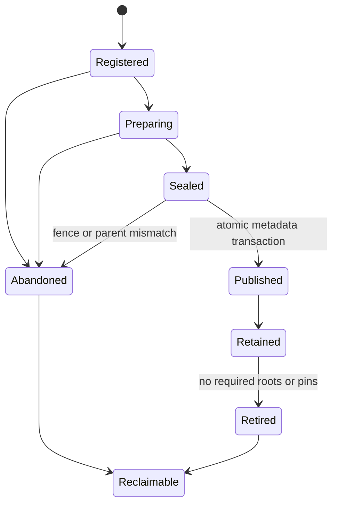

# Consistency, publication, and durable state

**Status:** Proposed. **Design date:** 2026-11-25. No Rockstream 2 engine or storage adapter is implemented by this document.

This specification defines the safety boundary shared by ingestion, incremental execution, serving, and operations. The [main design](../../DESIGN.md) describes the architecture; [semantics and compiler](semantics-and-compiler.md) defines the meaning of the results being published. “Must” below is a proposed implementation requirement, not a claim about existing software.

## 1. The contract and its limits

A published version is an immutable, durable description of a complete result at a declared input cut. It remains correct if every maintenance and serving process disappears. An accepted input is recoverable independently of whether its consequences have finished computing. A prepared worker result is invisible until the metadata kernel publishes it.

The cloud failure model covers process crashes, lost responses, message duplication and reordering, network partitions, disposable disk loss, and one availability-zone failure, provided the configured object service and a metadata quorum preserve their acknowledged data. It assumes authenticated, non-Byzantine components and detects corrupted bytes through checksums. It does not promise availability during loss of metadata quorum, recovery from destruction of all authoritative copies, or zero data loss after restoring an older asynchronous disaster-recovery backup.

The same state machine runs in an embedded deployment, but a local metadata database and local object directory have a different fault envelope. A laptop restart is recoverable; destruction of its only disk is not. Cloud compute is disposable because both authoritative storage services survive outside that compute fleet.

The safety invariants are:

| ID | Required invariant |
| --- | --- |
| CS-01 | Every published relation equals its specified query over the manifest's complete input cut, under the declared SQL numeric semantics. |
| CS-02 | Published progress never exceeds durable input and fully prepared computation. |
| CS-03 | Each accepted input identity has one logical effect, even if physical processing repeats. |
| CS-04 | One metadata transaction selects the visible version for a consistency domain. |
| CS-05 | A stale owner, plan, configuration, or restore incarnation cannot publish. |
| CS-06 | A reader uses exactly the versions and schema recorded by its snapshot token. |
| CS-07 | No object reachable from a live root, valid pin, or protected staging intent is reclaimed. |
| CS-08 | Resource or availability failures preserve the previous published result and return an explicit incomplete/error state. |

These are independently testable obligations. Algebraic proofs do not prove the storage protocol; storage tests do not prove SQL semantics.

## 2. Names, time, and progress

The first implementation uses an ordered `Epoch` within each consistency domain. A domain groups relations that need atomic visibility and one input ordering. It is not a worker, storage shard, tenant, or cluster. A tenant may have several domains, and a domain may span many workers. A transaction that changes multiple tables belongs entirely to one domain. Cross-domain atomic writes are rejected initially.

For the initial PostgreSQL connector, all subscribed tables that can participate in one source transaction enter one ingestion transaction domain; an arbitrary per-table split is forbidden. Independently progressing downstream view groups use consuming domains that import complete published source transactions/versions from that domain. Publication remains atomic within each declared group, so a slow required participant can block its group. This deliberate local synchronization cost cannot be optimized away by changing the advertised transaction boundary.

An upper frontier is **exclusive**: `U = 43` means all work at epochs `t < 43` is complete. A published version with upper `43` includes epoch `42`. Genesis has empty history and `U = 0`; publishing epoch `e` advances through `e + 1`. Counters must fail on exhaustion rather than wrap. All APIs, tests, interval descriptors, and metrics use this convention. Version identifiers and metadata revisions are separate from epochs; compaction can create a new physical version without changing the input cut.

| Name | Meaning |
| --- | --- |
| `ClusterId`, `RunIncarnation` | Stable installation identity and a fresh identity after disaster restore. |
| `DomainId`, `Epoch` | Ordered computation time within one consistency domain. |
| `SourceId`, `SourceIncarnation` | Source identity and lineage; resetting a stream cannot reuse its former offset identity. |
| `SourceCut` | Map from relevant source partitions to complete, durable source positions, plus source transaction boundaries and imported version lineage. |
| `VersionId` | Unique immutable publication record; never inferred from wall time or object listing order. |
| `PlanRevision`, `OwnershipGeneration` | Execution and placement identities validated at publication. |
| `AttemptId` | Unique execution attempt for an unpublished interval; never reused after abandonment. |
| `SnapshotToken` | Run identity, catalog revision, domain/version bindings, source cut, schema/semantic versions, and a retention pin. |

Epoch numbers from different domains are incomparable. Comparing sales epoch `100` to fraud epoch `99` says nothing about freshness or causal order. Source positions also need typed comparators: PostgreSQL log positions, Kafka partition offsets, and direct-input sequences are not interchangeable integers.

Expose accepted, input-durable, computed, published, retained-history, and delivered progress separately. Within one domain, `published_upper <= computed_upper <= input_durable_upper` for the same plan and input interval. A computed frontier is a completion claim, not durable evidence. Delivered progress is per subscription or sink. Event-time watermarks are input assertions used by particular SQL operators; they are not commit frontiers.

A domain's input sequencer durably assigns complete transactions to epochs and seals intervals `[L,U)`. Several transactions can share an epoch, but no transaction is split across published intervals. Large transactions may spill while assembling; they become admissible only after their end marker and all fragments are present. Empty intervals can advance progress only when their input completeness is established.

## 3. Durable ingestion and acknowledgements

The authoritative input log contains normalized changes, source provenance, transaction boundaries, schema identifiers, input identity, and the epoch assignment. Raw source payloads may be retained separately for diagnosis, with access controls and an explicit retention policy. Parsing or schema failures stop the affected source or enter a declared quarantine workflow; silently omitting a record is not the default.

Initial cloud ingestion writes immutable log segments to object storage. A segment header includes format version, source and run identities, epoch interval, per-source position ranges, row/transaction counts, byte length, and checksums. Multipart uploads are not accepted as durable segments until completion succeeds. A small metadata transaction records their manifest root, advances the accepted input head, and records deduplication progress. It compares the expected input head, source incarnation, connector ownership generation, schema/catalog revision, and active ingestion lease, so a stale source reader cannot accept input after reassignment or rebootstrap. Only then may Rockstream acknowledge the durable input or acknowledge source progress upstream.

Direct-write validation uses a serialized admission index at the **durable accepted-input head**, including previously accepted transactions whose views are not yet published. Validate key uniqueness, before-images, expected versions, and constraints there, normalize the SQL operation once, and replay those normalized effects. The index is either durable with that head or reconstructible from its protected source checkpoint and accepted log; recovery restores it before admitting further writes. Validating against only the last published view could admit conflicting updates while maintenance is behind.

Two distinct acknowledgements are supported:

1. **Durable input:** the exact input and its identity survive the declared fault model. Return a `WriteToken` binding the domain, assigned position, and run incarnation. A view can still be behind or blocked.
2. **Published result:** the named dependency set has a published version covering the write token. The response identifies that version. It does not mean external sink delivery completed.

A timeout can have an unknown outcome. The client retries the same idempotency identity or requests its status; it must not manufacture a new identity merely because an acknowledgement was lost. Reusing an identity with different bytes is an error.

Direct-input identities are `(client_id, signed_client_generation, sequence)`, scoped to run incarnation, tenant, database, domain, and operation stream; catalog mutations use a separate stream. Registration issues the generation and its validity bounds; clients assign sequences inside the admitted window. The input state durably records the generation, admission low/high watermarks, admitted gaps, payload digests, and recent result mappings. A closed generation or sequence below its replay floor returns `RS_IDEMPOTENCY_EXPIRED`, even if its detailed outcome was pruned. Optional opaque client labels cannot replace this identity. Unknown/expired generations require explicit registration; they are never treated as fresh retries. Once a request identity is registered, a definitive rejected outcome is recorded before replying and cannot become an acceptance on retry; a corrected request uses a new sequence. This avoids an impossible promise: an arbitrary forgotten string cannot be distinguished from a never-used string. Ordered source streams similarly retain a durable high-water position and lineage even after individual log segments are compacted.

For PostgreSQL CDC, the bootstrap protocol records a consistent exported snapshot and the corresponding stream fence, loads all captured tables against that snapshot, then consumes complete transactions after the fence. Restart must reconcile the recorded position and source incarnation. PostgreSQL explicitly documents possible retransmission after a crash and a snapshot/stream handoff mechanism; the connector therefore owns deduplication and gap detection. Slot invalidation or missing WAL causes a visible rebootstrap requirement. [S7]

For Kafka input, the identity is `(cluster/topic incarnation, partition, offset)`. Read-committed consumption excludes aborted transactions, but partition offsets alone do not establish a single atomic cut across arbitrary topics or databases. A cross-partition transaction guarantee requires a qualified connector protocol that assembles complete transaction boundaries; otherwise the capability is partition-ordered ingestion. Consumer-group offsets are advisory restart positions, never the authority for Rockstream's acceptance state.

Durable admission does not guarantee that every future view computation will succeed. An accepted transaction that triggers an arithmetic error or exceeds an operator's admitted bounds leaves published progress unchanged and marks the affected maintenance graph blocked. Repair requires a validated plan/schema change or a rebuild at a later complete cut containing all accepted inputs under an explicit repair contract. A later compensating row alone cannot make ordinary sequential replay pass an earlier failing epoch. A repair that widens an unpublished interval or rebuilds beyond that epoch preserves all accepted input and explicitly reports intermediate snapshots as unavailable; it does not manufacture historical results or silently skip the offending transaction.

## 4. The metadata kernel

The proposed cloud reference backend is a three-voter etcd deployment across three availability zones. Use linearizable reads and atomic compare-and-write transactions for publication, ownership, retention pins, and catalog transitions. Watches accelerate notification but are not evidence that a current ownership or visibility decision is valid. etcd documents durable, strictly serializable KV operations and weaker watch timing; the adapter must preserve that distinction. [S1]

The proposed embedded backend is SQLite using WAL mode, `synchronous=FULL`, one serialized metadata writer, and a filesystem whose durability behavior is qualified. SQLite documents the durability difference between `FULL` and `NORMAL` in WAL mode. Embedded operation offers the same transaction semantics through `MetaStore`, not the same distributed availability. [S3]

The metadata kernel stores small pointers and state transitions:

| Record | Essential fields |
| --- | --- |
| Domain | Input head, publication head, plan/catalog revisions, ownership generation, status. |
| Publication | Parent/version identity, root digest, upper, source-cut digest, semantic/storage format versions. |
| Ownership | Immutable assignment-map root, generation, publisher identity, lease identity. |
| Staging intent | Attempt identity, expected parent/generation, protected bases, allocation namespace, lifecycle state. |
| Pin | Root/version, owner, purpose, lease or explicit lifetime, restore incarnation. |
| Restore/backup | Backup identity, retained roots, metadata snapshot revision, completion state. |

Bulk input cuts, per-partition descriptors, schemas, and large manifests are immutable objects with authenticated digests. The final publication transaction is bounded in size; it does not contain thousands of partition receipts. This matters because etcd is designed for small metadata requests and has explicit request and database limits. [S2]

One publication coordinator validates the complete receipt set outside the transaction and creates a sealed preparation record containing its root digest and coverage proof. That record is valid only for a fixed parent, plan, membership generation, and intent. The transaction compares those identities before moving the head. A digest establishes content identity, not mathematical correctness: validation code must traverse the expected partition set and reject duplicates, gaps, mismatched intervals, or foreign receipts.

The initial safety simplification is one `OwnershipGeneration` per domain. Any reassignment changes it, invalidating all prepares made against the old membership. This may cause recomputation during frequent rebalancing but makes the final fence check constant-sized. Finer-grained generation validation is a later optimization with its own proof and scale gate.

## 5. Immutable arrangements and backend contracts

An arrangement has a logical identity derived from normalized input expression, schema, key expressions, equality/collation rules, tenant/security scope, and semantic version. A physical layout additionally identifies partitioning, encoding, algorithm version, and storage backend. Equivalent expressions do not automatically authorize sharing across security scopes or incompatible retention policies.

The `ArrangementStore` boundary deliberately has **no public publish method**. Operators prepare state; only `MetaStore` can select a visible root.

```rust
// Contract sketch; types and async syntax are not an implementation API.
trait ArrangementStore {
    fn open(&self, version: ArrangementVersion, pin: &ReadPin) -> Snapshot;
    fn lookup(&self, snapshot: &Snapshot, key: Key) -> WeightedRows;
    fn scan(&self, snapshot: &Snapshot, range: KeyRange) -> BatchStream;
    fn prepare(&self, base: ArrangementVersion, delta: Delta,
               intent: &StageIntent) -> DurablePrepared;
    fn verify(&self, prepared: &DurablePrepared) -> IntegrityResult;
    fn release(&self, retired: RetiredVersion) -> ReclamationWork;
}
```

`DurablePrepared` is returned only after all required bytes and backend retention references survive process destruction. It identifies the exact base, `[L,U)`, attempt, semantic/codec versions, ownership generation, checksum root, reconstruction class, and protected backend checkpoint. A successful mutable KV write, a completed in-memory snapshot, or a local spill file cannot satisfy this return type.

The first candidate backend is SlateDB, but qualification must demonstrate the entire adapter contract. Current SlateDB documentation distinguishes in-memory write completion from waiting for durability, and distinguishes transient `DbSnapshot` objects from durable checkpoints. An exact checkpoint reader is required; following a database's latest manifest would expose staged writes or the wrong version. [S4] [S5]

A conservative adapter starts an attempt from an isolated branch reconstructed or copied from the exact parent checkpoint; a backend-native clone may implement this only after qualification. An existing mutable writer whose state is ahead of that parent is not a valid base. It then serializes each partition's staging boundary: finish writes for `[L,U)`, stop subsequent writes, await durability, and create and persist an exact checkpoint. It verifies that the checkpoint contains all intended writes and no later interval. Published readers open the checkpoint referenced by the Rockstream manifest, never the live writer. Multiple SlateDB databases do not provide one Rockstream transaction; metadata publication supplies that atomicity.

After an abandoned preparation, discard its mutable branch and restore the next attempt from the last published checkpoint. Opening the same live SlateDB prefix after a crash can recover unpublished writes, so reopening it and applying the interval again is forbidden. Reusing a live handle after successful publication is an optimization requiring proof that it is exactly the new parent, with no speculative descendants included. Abort-then-retry and new-owner restart after staging are mandatory adapter tests.

Checkpoint lifetime is a safety boundary. Before publication, establish a **non-expiring durable checkpoint**, associated with a registered staging intent. Do not publish a temporary checkpoint and assume a background task will remove its expiry in time. A sufficiently long outage could outlive the temporary pin. A crash between checkpoint creation and registration may leak storage; an inventory reconciler can recover or quarantine that orphan. It must not guess that an unrecognized checkpoint is disposable. No native checkpoint is removed until Rockstream's root graph proves it unreferenced.

The adapter must also show that stale writers cannot overwrite committed bytes, fencing works on the selected object backend, restart identifies the exact persisted boundary, independent readers survive compaction, and rolling upgrades preserve checkpoints. If these tests fail, keep the interface and use a simple immutable batch backend for correctness prototypes while resolving the adapter gap. Do not silently weaken publication semantics to fit a dependency.

## 6. Publication protocol

A version manifest contains domain/run/attempt identity; parent version; `[L,U)`; complete source-cut and imported-version lineage; plan/catalog/ownership revisions; arrangement roots; durable output-delta roots; input-log references; complete expected partition coverage; schema and codec versions; and reconstructibility descriptors. Unchanged arrangements reuse protected parent references. The graph is acyclic and integrity checked.

Preparation is speculative and may run in parallel; visibility remains ordered per domain. The initial implementation permits one publishing interval at a time per domain. Pipelining can later prepare descendants, but they must be invalidated if their expected parent is not published.



The protocol is:

1. Read the domain head and fixed membership. Register an intent, pin its base/dependencies, and reserve a unique allocation namespace. Seal the complete durable input interval. Admission reserves enough capacity or returns a controlled backlog condition.
2. Execute from the exact parent state. Exchange messages carry run, plan, generation, `AttemptId`, epoch, producer/partition identity, and sequence. Receivers reject messages outside their active attempt. Acknowledged transport completion does not replace logical frontier accounting.
3. Each expected partition prepares durable arrangement changes and output changes, then records a receipt bound to that exact attempt. Partitions with no changes still attest completion. A coordinator must not infer an absent partition from a lack of traffic or combine receipts from different attempts.
4. Validate the complete receipt set and all object/checkpoint references. Produce a sealed manifest and an immutable validation record. Sealing makes the attempt's object membership immutable.
5. Atomically compare the expected domain head, run incarnation, catalog/plan revision, membership generation, publisher lease key, and sealed intent; install the version, advance published upper/source cut, and mark the intent published. This is the visibility linearization point.
6. Notify serving and delivery workers. These notifications may repeat or disappear; workers reconcile from metadata. Resolve lost responses by looking up the attempt/version identity.

```text
publish(attempt):
    p = load_sealed_preparation(attempt)
    require verified_complete(p) and p.upper <= durable_input_upper
    return meta.compare_and_write(
        domain.head == p.parent,
        run == p.run,
        domain.plan == p.plan,
        domain.catalog == p.catalog,
        domain.generation == p.generation,
        publisher_lease_key == p.publisher_lease,
        intent.state == SEALED and intent.digest == p.digest,
        writes = [version_record(p), domain_head(p), intent_state(PUBLISHED)]
    )
```

The comparison against durable input is tied to the sealed input reference and its recorded acceptance proof; a stale numeric observation alone is insufficient. The trusted coordinator validates the immutable preparation, while atomic comparisons prevent the validated facts about parent, membership, and authorization from changing underneath it.

**Concrete recovery example:** the published head is `V17`, upper `43`. Input `[43,46)` is durably accepted. All partitions stage `V18`, but the coordinator dies before the transaction. Readers still see `V17`; recovery may finish a valid sealed attempt or recompute `[43,46)`. If the transaction committed and its response was lost, recovery sees `V18`, upper `46`, and resumes at `46`. It never integrates `[43,46)` again into `V18` merely because a worker failed to hear the acknowledgement.

## 7. Ownership, exchange, and reassignment

Leases detect abandoned work and enable failover. Safety comes from immutable namespaces, monotonic generations, and generation comparisons in the same transaction that publishes. A worker's belief that its lease has not expired is not authority.

For reassignment, stop admitting new work for the selected domain interval, let eligible work publish or abandon it, pin the last published root, and atomically install the new assignment map with a higher generation. The replacement restores that root, replays only accepted unpublished input, then resumes preparation. A stale process may finish uploading old-generation objects, but it cannot make them visible. Its messages are rejected by new-generation receivers.

Moving ownership does not change the logical partition layout. Splitting or merging durable partitions is a separate operation: create shadow partitions from a pinned boundary, catch them up, validate coverage and output equivalence, and switch the layout with a new plan/catalog generation at a publication boundary. The old layout remains pinned until readers, rollback policy, and replay users release it. No partition is removed from completeness accounting before its replacement covers the cut.

The initial recovery design replays a whole unpublished interval instead of relying on durable per-message acknowledgement logs. Bounded exchange buffers and producer sequence identities permit duplicate suppression within an attempt; an attempt restart allocates a new `AttemptId` and reinitializes all affected mutable state from the published parent. Suppression state is keyed by attempt as well as producer and sequence. Delayed packets from an abandoned attempt must be rejected even when run, owner, plan, and epoch are unchanged. A later partial-task recovery scheme must prove it does not mix outputs from different attempts.

## 8. Cross-domain consistency and serving

Independent domains improve liveness only for independent dependencies. They do not create a global transaction order. A cross-domain maintained query initially imports explicit, published input versions into a consuming domain. Imports carry complete lineage and source cuts, and the consuming domain durably records the import as input. A new import is a version-to-version delta, not a change in a pointer to an independently moving latest value.

Compatibility requires **equal complete boundaries for every overlapping source incarnation**, complete source transactions, and closure over recorded causal/import dependencies. Merely requiring each view's frontier to be greater than or equal to a target is insufficient. For disjoint sources, the product cut is explicit but does not assert that those sources participated in a real-world atomic transaction. If overlapping dependencies cannot be aligned using retained snapshots, the query waits for a supported compatible cut or fails with an actionable consistency error. It never picks independently latest versions and labels the join consistent.

An import first acquires a durable source-version pin and retains its lineage. It may release that pin only after all required imported bytes and future replay obligations are durably owned by the consumer, or after references to the source objects have disappeared. Sharing an object pointer across domains transfers no retention ownership by itself. Dropping or pausing a producer cannot invalidate an accepted consumer input.

Example: `orders_summary` has source cut `{orders: 100, customers: 70}`; `customer_flags` has `{customers: 73}`. Reading both latest versions mixes customer states. Select a retained `customer_flags` version at `70`, advance and align the summary to a compatible cut, or fail. Comparing their domain epoch numbers cannot solve the mismatch. An import cycle between domains is rejected initially; recursion belongs inside an explicitly supported computation scope.

Read policies select a version, then use the same pinning protocol. Latest committed reads resolve the head through linearizable metadata. Bounded-staleness reads verify the freshness contract and wait/fail if the replica cannot load an eligible version. Read-your-writes follows the write token's dependency coverage. Historical reads require a retained version; they never fall back silently to newer data. Repeatable multi-statement reads reuse one snapshot token. Tenant binding and current authorization are checked for every token use; possession of a signed token is not a grant of access.

Pin creation and version eligibility are one metadata transaction. Reading a pointer, downloading data, and only then pinning it is unsafe. A reader renews before its lease expires; after renewal uncertainty it must stop successful completion and reacquire/validate, rather than assume its old root still exists. Serving caches accelerate versioned reads and never determine authority.

## 9. Retention, compaction, and garbage collection

Three operations must remain distinct: physical compaction rewrites equivalent bytes; logical history compaction combines changes into a base snapshot; garbage collection deletes objects proved unreachable. Dropping old deltas never permits deleting rows that still belong to the current relation. An inactive view's reconstruction needs may retain input that no historical query can access.

Retention roots include the **durable accepted-input head and its deduplication/admission state**, current publications, retained historical versions, active read pins, subscriptions, sink delivery cursors, branches, backups, rolling-upgrade rollback roots, staged replacement plans, and durable intents. Accepted but unpublished input stays protected after its upload intent closes, even if no view exists. Input-log compaction must preserve the authoritative source relation in a durable checkpoint and every remaining replay obligation before removing segments. A shared arrangement's retention is determined by all consumers. A slow consumer may exceed its budget and be explicitly disconnected or forced to resnapshot; the engine must not silently truncate its required history.

For scalar domain epochs, a requested history boundary `S` may advance only to the minimum safe boundary across all remaining retention requirements. Explicit snapshot pins also retain their exact physical roots. Input-log retention uses each dependent view's replay floor and any rebuild/backup requirement, not merely the newest published frontier.

GC must close the “checked unreferenced, then newly referenced” race:

1. All objects belong to registered allocation namespaces. An intent registers and pins every existing base before reading or reusing it. New objects cannot be adopted by arbitrary raw object key.
2. At metadata revision `R`, close allocation generation `g` and mark every live root, pin, and protected staging namespace. New allocations use `g+1`. A still-open namespace is protected as a unit, including uploads finishing after the mark traversal.
3. New references to old-generation objects must descend from an already protected live root or namespace. The API prohibits resurrecting retired/tombstoned roots. Pin creation compares the version's live state; retirement compares its pin/reference state.
4. Sweep only unmarked, closed-generation allocations. Record durable tombstones before physical deletion. Retries are idempotent; deletion failure leaks bytes rather than invalidating a live root.
5. Reconcile backend checkpoint deletion under the same retirement proof. SlateDB's own GC must remain constrained by its durable checkpoints; Rockstream must not run an independent bucket lifecycle rule that bypasses them.

**Race example:** GC tries to retire `V17` while a query requests it. If the pin transaction wins, retirement cannot complete and the query is protected. If retirement wins, pin creation fails before any successful query result. A query that first reads `V17` from a cache and later asks to pin it receives that same failure. Neither ordering permits deletion underneath a valid pin.

Generational reachability and the no-resurrection rule require a model-checking gate. A timestamp grace period or two object listings alone is not a proof. The conservative fallback is retaining extra namespaces or pausing GC when metadata is unavailable.

## 10. Reconstructibility and storage layout

Initially persist every stateful operator's required recovery state. Later the optimizer may classify state as authoritative, expensive derived, cheap derived, or ephemeral. A reconstructible arrangement descriptor must identify its exact input checkpoint/log interval, executable plan and semantic version, schema, required upstream pins, expected rebuild time, and fallback if its recovery budget is exceeded. Persisting only a label saying “rebuildable” is insufficient.

The durable format is versioned separately from the software release. Manifests include a format identifier, checksum algorithm, compression/encoding identifiers, row and key schema, weighted multiplicity encoding, epoch bounds, and content digest. Decode rejects unknown required fields, incompatible semantics, invalid ranges, and checksums. Encryption key references are part of restore requirements. Maintain compatibility fixtures and explicit upgrade readers; avoid embedding Rust's in-memory representation.

RAM holds active working sets; local NVMe holds caches and spill. Spill may bound a transaction's execution memory, but required bytes must reach authoritative storage before publication. Large immutable batch and columnar layouts can later complement SlateDB where benchmarks justify them. Object count, metadata fanout, compaction amplification, and cache refill cost are qualification dimensions, not implementation afterthoughts.

## 11. Subscription and sink boundaries

A subscription pins snapshot version `V`, registers its change-retention cursor in the same metadata transition, emits the complete snapshot, then emits committed changes strictly after `V` in publication order. Cursor tokens bind run, relation/plan identity, version, output partition, and row/batch position. Snapshot and delta pages have stable identities. A reconnect can replay an unacknowledged page; clients use the cursor identity to deduplicate. Exactly-once logical state does not imply exactly-once network delivery.

Subscription acknowledgements release retention only after their recorded cursor advances. An expired cursor returns `RESNAPSHOT_REQUIRED`. Schema or incompatible plan changes terminate or version the stream according to an explicit contract; they must not reinterpret an old cursor.

The first Kafka sink capability is an outbox of published delta batches with stable delivery IDs and **at-least-once delivery**. A transactional producer alone does not atomically update Rockstream's metadata cursor. If Kafka commits but its response is lost, blindly resending after a restart can duplicate a committed output. Kafka's own documentation distinguishes Kafka transaction guarantees from coordination with external state. [S8]

A stronger optional sink protocol must atomically write output and a durable destination-side delivery marker, fence predecessor producers, and recover the last committed marker through read-committed consumption before advancing or retrying. Marker retention, transactional IDs, topic lineage, transaction size limits, and source/destination disaster restore must be qualified together. Nontransactional HTTP endpoints offer at-least-once attempts unless the receiver provides a durable idempotency contract.

## 12. Failure behavior

| Failure boundary | Required outcome |
| --- | --- |
| Before input metadata acceptance | No durable acknowledgement; retry may find or discard orphan uploads. |
| After input acceptance, before its response | Status/retry returns the existing input identity and token. |
| During computation or exchange | Keep the old publication; replay the unpublished interval from its exact parent. |
| After state upload, before sealing | Protect active intents; incomplete receipts cannot publish. |
| After sealing, before publication | Reuse only if all recorded fences still match; otherwise abandon and recompute. |
| After publication, before response/notification | Read the committed attempt identity; do not apply its delta again. |
| Old worker resumes after reassignment | Generation rejects messages and publication; its immutable orphan bytes are reclaimable. |
| Metadata quorum unavailable | Stop publication, new authoritative pins, ownership changes, and GC; existing unexpired pinned reads may continue. |
| Object storage throttled/unavailable | Backpressure ingress/maintenance; serve only resolvable published snapshots; never acknowledge undurable state. |
| Corrupt or missing committed object | Fail the affected read/recovery, raise an integrity incident, repair from verified copies; do not substitute an older result as success. |
| Pin expires during query | Fail/restart under a new valid token; do not claim the old query completed successfully. |
| Sink response lost | Reconcile destination marker if qualified; otherwise replay with documented at-least-once behavior. |

Test failures before and after every durable boundary, including response loss after successful operations. A single happy-path restart test cannot establish these properties.

## 13. Backup, restore, and upgrades

A backup is a verified metadata snapshot plus its entire reachable object/input/checkpoint graph, compatible executables or format readers, and decryptable key references. Begin with a durable backup intent that blocks reclamation of the capture boundary. Finish only after the metadata revision, root inventory, and required copied objects are verified and an immutable completion marker is recorded. Copying an object bucket alone is not a database backup.

For regional recovery, restore the latest **complete** backup, quantify its RPO against acknowledged inputs/publications, and open read-only until integrity checks finish. Create a new `RunIncarnation`; all pre-restore worker credentials, publication attempts, snapshot tokens, and subscription cursors become invalid. Preserve source lineage separately so offsets cannot be confused with new source data.

A new run identifier alone does not stop a surviving old control plane from writing. The recovery procedure must fence or quarantine the former deployment, revoke its write credentials, isolate its object namespace, and reconcile destination-side sink ownership before opening traffic. Do not run two writable restored clusters against the same authoritative namespace. Sinks stay paused until duplicate-effect reconciliation is complete.

Rolling upgrades pin rollback roots, admit only mutually compatible plan/state formats, and change catalog/plan revisions at publication boundaries. A migration writes new immutable state and validates it before switching. Old code must reject unreadable formats explicitly. Rollback is possible only while compatible state and required input remain pinned; its retention cost is visible.

## 14. Qualification gates and unresolved choices

G2 requires one-node crash-consistent input, exact checkpoint reads, immutable publication, deduplication, and recovery against both local and object-store adapters. G3 adds shared retention, online graph changes, CDC handoff, and subscription/sink cursor qualification. G4 adds real metadata quorum faults, fenced reassignment, complete distributed coverage, and scale tests. G6 requires restore drills, upgrade/rollback, sustained storage degradation, and tested runbooks. Security and fault injection start before G2; they are not deferred to productization.

Required falsification tests include a missing partition receipt, delayed exchange from an abandoned attempt, old-generation upload/publish, checkpoint expiry across a long outage, duplicated accepted source transaction, a pruned client sequence retry, source incarnation reuse, mixed source cuts, GC versus pin acquisition, accepted unpublished input with zero views during GC, abandoned upload completing after GC starts, lost publication response, stalled subscriber retention, and restore while the previous deployment still exists. Assert full result snapshots and output transcripts, not merely matching row counts.

Open prototype decisions are the exact SlateDB release/API pin, checkpoint granularity and cost, etcd publication/pin throughput at target view count, snapshot-token renewal policy, source-cut representation size, and cold-recovery budget. These are performance and implementation questions under fixed invariants. They do not reopen whether unpublished state may be exposed or whether expired history may be silently substituted.

## Sources and relationship to prior work

External pages were checked on **2026-11-25**. They establish component behavior and precedents; the Rockstream-specific protocol above is a proposal that still requires implementation and verification.

- **[S1]** [etcd v3.6 API guarantees](https://etcd.io/docs/v3.6/learning/api_guarantees/): KV durability/ordering and watch limitations.
- **[S2]** [etcd v3.6 system limits](https://etcd.io/docs/v3.6/dev-guide/limit/): metadata request/database constraints.
- **[S3]** [SQLite synchronous pragma](https://www.sqlite.org/pragma.html#pragma_synchronous): WAL durability configuration.
- **[S4]** [SlateDB writes](https://slatedb.io/docs/design/writes/): in-memory completion and durability waiting.
- **[S5]** [SlateDB checkpoints](https://slatedb.io/docs/design/checkpoints/): durable checkpoint lifetimes, snapshot distinction, and pinned readers. Current documentation must be matched to the release selected by the implementation spike.
- **[S6]** [Materialize Persist design](https://github.com/MaterializeInc/materialize/blob/main/doc/developer/design/20220330_persist.md): a primary design precedent for immutable blobs with a consensus-controlled root. This informs the architecture; it does not validate this new protocol.
- **[S7]** [PostgreSQL 18 logical decoding concepts](https://www.postgresql.org/docs/18/logicaldecoding-explanation.html): retransmission, slot lifecycle, and exported snapshots. Supported connector versions will be explicitly qualified.
- **[S8]** [Apache Kafka 4.1 delivery semantics](https://kafka.apache.org/41/design/design/#message-delivery-semantics): transactional boundaries and cooperation with external systems.
- **[R1]** [Rockstream scoped frontier implementation](https://github.com/trickle-labs/rockstream/blob/d3f973a84f4263bedd6505039d7f469d4708c478/crates/rockstream-control/src/frontier.rs): scope, generation, incarnation, and publication fencing are existing foundations to preserve.
- **[R2]** [Rockstream shared traces](https://github.com/trickle-labs/rockstream/blob/d3f973a84f4263bedd6505039d7f469d4708c478/crates/rockstream-storage/src/trace.rs): retained snapshots and consumer-driven compaction already exist. The proposed redesign centralizes their durable lifecycle rather than claiming these concepts are new.
