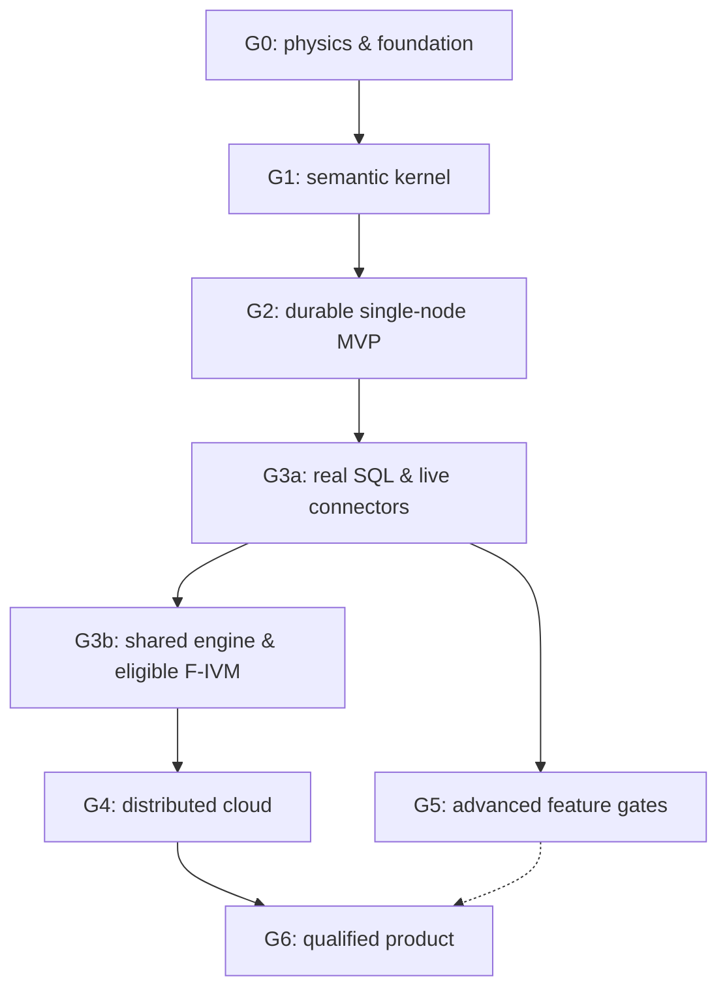

# Implementation plan and delivery gates

**Status:** Proposed, 2026-11-25. This is a plan for building the system, not a record of completed work. Every gate is currently **Not started**. Autonomous coding agents are the primary implementation workforce. Roles below are responsibilities, not assigned people or agent instances. See [requirements](requirements.md), [qualification](qualification.md), and [risks](risks-and-open-questions.md).

## 1. Delivery strategy

Establish the semantic and durability contracts before distributing them. Build an end-to-end vertical slice through the public interface; expand one verified boundary at a time. Reuse existing Rockstream tests, fixtures, operational knowledge and selected kernels after dependency and semantic review. Avoid a wholesale fork that imports the old coupling into the new architecture.

The working direction is a SQL-first database with a lean Rockstream-native Arrow/DataFusion/Tokio runtime, DBSP semantics, immutable delta traces + SlateDB working indexes + bounded in-memory overlays, bounded logical MVCC, and single-root compositional object-store metadata with pre-allocated owner-generation namespaces and monotonic lease-backed fast reads. **G0** validates these existential physics in 2–4 weeks without building two full engines upfront: Timely/Differential evaluation is triggered only if the minimal native kernel spike (`G0.4`) hits a concrete predeclared complexity or correctness blocker. No mandatory external coordination service or custom storage engine is on the baseline delivery path. Embedded OpenRaft (Low-Latency Cloud) and scoped metadata partitioning remain G4+ optional/evidence-triggered profiles, not parallel G0–G2 projects.

The main release path is **G0 → G1 → G2 → G3a → G3b → G4 → G6**. **G5** is a portfolio of advanced features that can begin after their prerequisites and graduate independently. Splitting G3 into **G3a (Real-World SQL & Live Connectors)** and **G3b (Shared Workload Engine & Eligible F-IVM)** ensures Rockstream 2 delivers real application read models and CDC pipelines (`LEFT OUTER JOIN`, `DISTINCT`, semi/anti joins, `MIN`/`MAX`, PG CDC, Kafka, subscriptions) rapidly before taking on 1,000-view sharing and F-IVM. Migration of a workload still requires parity for every capability that workload uses.

Security, pure state-machine replay + real-backend crash testing, resource accounting, observability, compatibility and suspension are work in every stage. G2 proves durable single-process stop/restart from object storage, G3b accounts for shared consumer obligations, and G4 proves distributed drain/fencing and concurrent activation. G6 hardens and qualifies these behaviors; it is not when they first appear.

## 2. Agent-first capacity planning and estimates

**Implementation model: primarily autonomous coding agents.** Organize work into compiler/algebra, storage/consistency, runtime/cloud, connectors/serving and independent verification responsibilities as needed, not a fixed number of people or agents. Human maintainer(s) prioritize work, decide architectural/contract changes, approve high-risk changes and authorize releases. Independent review agents handle routine medium-risk reviews and assist safety review; an authorized human signs off safety gates and releases, never as a substitute for independent review. The [agent operating model](../design/agent-development.md) defines risk tiers, authority, claims, worktree isolation and escalation. Start with at most three independent active implementation issues, one per agent and one owner per coupled contract change; increase only from G0 evidence and maintainer approval. Reduce scope, especially G5, rather than omit qualification when independent review or human decision capacity is constrained.

The earlier six-to-eight-engineer staffing assumption and 9–15 month calendar envelope are **superseded**, not forecasts for agent-led development. Preserve the earlier effort ranges below only as historical rough human engineer-week complexity indicators. They are neither agent-weeks nor a basis for multiplying human output by an assumed agent speedup. No delivery date or agent budget is established yet. After G0, re-estimate each gate from actual accepted safe issue throughput, dependency/critical-path constraints, review and human decision wait, rework/reverts, and agent/CI/cloud spend. Report forecast uncertainty and include failed/abandoned work.

| Gate | Historical human effort (not a forecast) | Owner roles | Exit product |
| --- | --- | --- | --- |
| G0 | 8–14 engineer-weeks | Leads, verification | Evidence-backed runtime, logical MVCC, storage, metadata, suspension and numeric decisions |
| G1 | 10–18 | Compiler/algebra, verification | Small semantic engine and independent oracle |
| G2 | 18–30 | Storage, engine, gateway | Durable single-domain database slice with logical MVCC and stop/resume |
| G3 | 22–38 | Compiler, storage, connectors | Shared graph, independent consumer schedules, online lifecycle, eligible factorization and qualified sources/subscriptions |
| G4 | 30–50 | Runtime/cloud, storage, verification | Distributed execution, suspension and independent serving under failures |
| G5 | 8–20 per substantial feature family | Compiler/runtime researchers | Individually promoted advanced capabilities |
| G6 | 20–35, overlapping earlier stages | Operations, all leads | Reproducible production envelope and migration candidate |

These inherited ranges need replacement with agent-era work and capacity estimates before committing a delivery schedule. The critical path is usually durable state/publication → lifecycle/retention → distributed recovery, not parser coverage. Keep at most two experimental algorithm families active until that path is stable.

## 3. G0: lean physics-first feasibility and foundation (2–4 weeks)

[ADR 0011](../adr/0011-risk-reduction-before-implementation.md) cuts G0 down to four sharp, executable kill-switch deliverables so the project proves cloud storage/metadata physics rapidly and unlocks G1/G2 without building two engines upfront:

| Work ID | Deliverable | Dependencies | Acceptance |
| --- | --- | --- | --- |
| **G0.1** | Minimal Rust workspace, fast CI, `W1-G` golden oracle, and Rockstream v1 donor register | None | Clean one-command local/CI fast check (<5 min), pinned toolchain/lockfile, crate dependency-direction negative control, minimal [RockStyle](../../ROCK_STYLE.md) lint baseline, frozen `W1-G` transactions + independent PostgreSQL/batch oracle with deliberately broken cross-term negative control, and pinned v1 donor dispositions |
| **G0.2** | Real S3/object-store metadata & storage physics probe | None | On real object storage: (a) single-key conditional `PUT` (`If-Match`) + **compositional intra-batch serialization** under single-tenant shared-quota and same-domain load (with pre-allocated owner namespaces); (b) **immutable-delta + per-domain SlateDB working index + bounded delta overlay** vs. pure SlateDB history on `W1-G` (separate-reader point lookup at `Cp` and `C ∈ [S_hot, Cp]`, exact-parent reopen after `SIGKILL`, Direct-DML PK index recovery, checkpoint amortization, nonlinear intermediate cuts, sweeper-observed grace-window GC deletion); (c) full sequential S3 freshness round trips plus warm lease-backed vs. strict-latest read latencies. Lock **one** production storage layout before G2 |
| **G0.3** | Core protocol model in **Quint** | None | One concise Quint specification modeling publication atomicity, pre-allocated owner-generation fencing, compositional batch outcomes (including lost CAS response after later root advance), and monotonic-lease + sweeper-observed grace-window (`Δ_gc_grace >> Δ_read_lease`) GC safety (including VM pauses), with all deliberate negative controls failing as expected |
| **G0.4** | Minimal native runtime spike on `W1-G` | G0.1 | Acyclic scalar-epoch weighted Arrow batch kernel passing `W1-G` against the G0.1 independent oracle with explicit memory/queue bounds. Confirm native ergonomics/complexity; **only** prototype Timely/Differential if native hits a concrete predeclared complexity or correctness wall |

**Gate G0:** G0.1–G0.4 pass with recorded raw measurements, locked storage layout, passing Quint model + negative controls, and a confirmed runtime decision (updating ADRs 0003–0005 and 0011). Continuous design-partner engagement starts in parallel and feeds real workload prioritization into G2/G3a without blocking G1. Sharing-scale benchmarks (100/1,000 views) move to **G3b** (where shared arrangements exist), full zero-process hibernation moves to **G2/G4**, and complex governance automation waits until actual PR volume requires it.

## 4. G1: semantic kernel

| Work ID | Deliverable | Dependencies | Acceptance |
| --- | --- | --- | --- |
| P1.1 | Core IDs, canonical rows, exact weights, schema/type descriptors | G0.1 | Canonicalization/codec laws, checked multiplicities, collision-safe descriptor comparison |
| P1.2 | Typed relational/incremental IR with interpreters and versioned rewrite contracts | P1.1 | Well-typed plans preserve schema and time contracts; machine-readable eligibility records distinguish enforced semantic facts from statistics and link independent counterexamples/evidence; unsupported expressions rejected explicitly |
| P1.3 | Map/filter/union, inner equi-join, and checked widened `COUNT`/`SUM`/`AVG` | P1.2 | Exact result equality after each epoch; simultaneous changes on both join inputs; `Q(empty)` initialization; checked widened decimal/integer accumulators |
| P1.4 | SQL binder adapter and semantic normalization | G0.1, P1.2 | Public SQL cases reach intended kernels; DataFusion/PostgreSQL mismatches explicitly adapted or rejected |
| P1.5 | Property generators and shrinker, deterministic environment interfaces | P1.1–P1.3 | Reproducible seeds; shrinking preserves valid source transactions and discovers deliberately seeded errors |

**Gate G1:** every initially supported operator and SQL combination passes exact incremental-versus-independent-batch comparison with deletes, duplicate multiplicities, empty inputs and numeric boundaries. Every migrated capability adds the original engine to that comparison on common semantics and preserves its applicable donor regressions; legacy disagreements are investigated against the independent authority, never copied into expected results. The kernel has no unmodeled I/O, clock or randomness dependency. Tests reject a deliberately omitted join cross-term and incorrect empty aggregate initialization.

## 5. G2: durable single-node vertical slice

| Work ID | Deliverable | Dependencies | Acceptance |
| --- | --- | --- | --- |
| P2.1 | Durable input log, PK overlay admission index, and bounded idempotency | G0.2, G0.3, P1.1 | Acknowledgement survives crash; conflicting preimages rejected against accepted state; expired sequences never readmitted; keyed direct-DML PK image index uses uniform checkpoint + input-log overlay |
| P2.2 | Immutable delta traces, SlateDB working index + bounded overlay, and compositional metadata publication | G0.2, G0.3, P1.3 | Distinct computed/durable published uppers; pre-allocated owner-generation namespaces; bounded fine-grained hot history `[S_hot, Cp]` + nearest-checkpoint overlay lookups; exact-parent recovery; compositional group commits resolve each ambiguous operation outcome |
| P2.3 | Catalog, per-view/grouped publication heads, view-level fault quarantine, and basic lifecycle | P1.4, P2.2 | Create/drop schema and views with durable semantic/plan version; default per-view head (explicit `publication_group` for coupled views); derived runtime error quarantines only the failing view with quota-bounded pin |
| P2.4 | `pgwire`, keyed DML, monotonic lease-backed fast reads, and result wait | P2.1–P2.3 | End-to-end driver transcript with cancellation, typed parameters, timeout-after-acceptance, and RYW; warm lease-backed fast reads (`monotonic_now() < lease_deadline`, `Δ_gc_grace`), durable historical pins, and opt-in strict immediate revocation |
| P2.5 | Real-process crash runner, cut reconciler, resource budgets, and local/cloud conformance | P2.1–P2.4 | Process `SIGKILL` at each persistence boundary, object faults, input with zero views, exact cold reopen; bounded read-only cut reconciliation against independent typed multisets |
| P2.6 | Initial identity/grants, secret references, metrics, and structured errors | P2.3–P2.4 | Cross-user access denied, no secret leakage, explicit deletion/retirement authorization with retained-obligation reporting |
| P2.7 | Durable single-process stop/restart and eligible hibernation | G0.2, P2.1–P2.6 | Same binary runs local or cloud profile without external coordination; safe stop with zero views or pending accepted input, new ownership fence on restart, exact recovery after loss of all local files |

**Gate G2:** one direct-write transaction updates both sides of a join and an aggregate, receives durable acceptance, survives process destruction, then becomes visible once in a pinned query result. A failed or ambiguous attempt leaves no mixed state. The public API explains durable input versus published result. Published evidence covers deletes, zero-row results, retries, checked arithmetic, exact retained cuts and a read pin during compaction. An eligible deployment stops with no Rockstream process left running and resumes from authoritative durable roots; cloud-profile recovery may not depend on a surviving local file or control process.

**First implementation milestone:** use a customer/orders join-aggregate with customer-region changes, not only an append-only counter. Use [W1-G](implementation-start.md) with the fixed exact output at each complete cut. Qualify the local one-command quickstart with authenticated SQL, observed update, explicit result wait and durable restart; measure the five-minute usability objective. This exercises the architectural boundaries without requiring distributed deployment or rich SQL breadth.

## 6. G3a: real-world single-node SQL and live connectors

Deliver an immediately useful single-node streaming database for real application read models and CDC pipelines *before* taking on workload-wide arrangement sharing, F-IVM, or multi-node distribution.

| Work ID | Deliverable | Dependencies | Acceptance |
| --- | --- | --- | --- |
| P3.1a | Table-stakes SQL operators: `LEFT OUTER JOIN`, `DISTINCT`, semi/anti joins (`EXISTS`/`NOT EXISTS`), and delete-safe `MIN`/`MAX` | P1.3, P2.2 | Independent PostgreSQL + bag oracle parity under duplicates, NULL keys, simultaneous both-side updates, zero-crossing transitions, and exact crash recovery |
| P3.2a | Online view backfill, catch-up, replace, cancel, and drop | P2.2–P2.3 | Pinned snapshot/replay, exact same-cut switchover, crash/restart recovery at any lifecycle phase, peak coexistence budget reservation, and zero disruption to unrelated readers |
| P3.4 | Resumable snapshot-plus-delta subscriptions | P3.2a, P2.2 | Complete cursor transcript across snapshot/tail boundary; interrupted envelopes repeat safely; expired history and schema transitions explicit |
| P3.5 | PostgreSQL CDC (with benign additive-DDL tolerance) and Kafka source adapters | P2.1, P2.6 | Real services, exported snapshot/WAL handoff, graceful tolerance of unused additive columns (`ALTER TABLE ADD COLUMN`), explicit stop on breaking DDL, rebalances, source reincarnation, retention loss, large transactions, and missing preimages |
| P3.6 | Kafka outbox delivery with honest initial guarantee | P3.4 | Stable envelope IDs, replay after ambiguous delivery; no exactly-once promotion without marker protocol |

**Gate G3a:** live PostgreSQL CDC and Kafka transactions flow through real application SQL (`LEFT OUTER JOIN`, `DISTINCT`, semi/anti joins, `COUNT`/`SUM`/`AVG`/`MIN`/`MAX`) into durable views, pinned reads, resumable subscriptions, and Kafka sinks across restarts and benign additive schema changes.

## 7. G3b: shared workload engine, logical MVCC, and eligible F-IVM

Extend the G3a single-node engine with workload-wide arrangement sharing, independent consumer schedules over bounded logical MVCC, rule-based/explicit consumer isolation, bounded single-depth pipelining, and eligible factorization.

| Work ID | Deliverable | Dependencies | Acceptance |
| --- | --- | --- | --- |
| P3.1b | Arrangement registry, consumer contracts, and rule-based sharing (W2 100/1,000-view benchmark) | P3.2a | Full descriptor comparison, tenant isolation, independent consumer freshness/history/recovery budgets and schedules, deterministic rule-based share-vs-isolate admission, and W2 sharing benchmark |
| P3.2b | Safe consumer isolation (pinned snapshot, replay, exact-cut atomic cutover) | P3.1b | Cutover compares live head/cursor, fences old attempts and rejects stale verification; preserves every promised historical cut and recovery dependency via replacement coverage or retained old references; reserves peak coexistence capacity |
| P3.3 | Multi-cadence logical MVCC, read/subscription pins, and sweeper-observed GC | P2.2, P3.1b | Pin/retirement race, no resurrection, late uploads, accepted-input roots, and native backend GC coordination; reconstruct common logical cuts from disjoint physical checkpoints and preserve nonlinear intermediate outputs in `[S_hot, Cp]` |
| P3.7 | Rule-based state-aware planner and `EXPLAIN INCREMENTAL` / system tables | P3.1b–P3.2b | Finite eligible candidate set with first-order baseline, enforced-key vs. statistics distinction, rejected-precondition reasons, state/fanout/amplification visibility; executed strategy agrees with `EXPLAIN` (multi-term monetary cost advisor deferred to `P5.6`) |
| P3.8 | Initial eligible partial aggregation and factorized maintenance (F-IVM) | P3.7 | Exact first-order baseline, machine-readable eligibility/NULL/multiplicity contracts, delete-safe recovery, and lower measured lifetime cost for named join-aggregate shapes; retain baseline where unfavorable |
| P3.9 | Continuous, freshness-batched, scheduled, and on-demand consumer policies + bounded single-depth pipelining | P2.7, P3.1b–P3.4 | Independent result domains advance at separate cadences while slower consumers retain bounded history; single-depth pipelining overlaps `k+1` compute with `k` S3 flush (invalidating `k+1` on abort); cursor expiry/resnapshot explicit; no loss of valid pins |

**Gate G3b:** overlapping views in separately scheduled result domains reuse actual maintained state while readers select compatible logical cuts. Sharing beats the unshared baseline on W2 (100/1,000 views) including lifecycle, retention, and cold catch-up cost; adversarial slow consumers isolate cleanly without dropping valid history; eligible F-IVM beats first-order on its target shapes with exact oracle parity.

## 8. G4: distributed cloud

| Work ID | Deliverable | Dependencies | Acceptance |
| --- | --- | --- | --- |
| P4.1 | Multi-process task/exchange runtime and bounded flow control | Selected runtime, P2.5 | Attempt/generation isolation, duplicate/drop/delay injection, no progress outruns work |
| P4.2 | Virtual partition ownership, preferred-committer hint/fallback, and domain publication | P4.1, P3.3 | Complete coverage under owner changes; out-of-root worker heartbeats; old process resurrection cannot publish; clean committer failover to direct CAS |
| P4.3 | Independent serving pools (with cache-affinity routing) and compatible cross-domain imports | P4.2, P3.4 | Exact shared-source cuts; unavailable cut waits/fails; consistent-hash/tenant-affinity routing preserves NVMe cache locality; read load cannot bypass maintenance quotas |
| P4.4 | Reassignment, cold restore and controlled repartition prototype | P4.2 | Durable state follows ownership safely; split/merge remains unpromoted until routing and pin tests pass |
| P4.5 | Qualified object-metadata/storage profile, mTLS, tenant quotas, and optional Embedded OpenRaft profile | P2.6, P4.1–P4.3 | Zone/process loss, unavailable conditional writes, CAS contention/ambiguity, throttling, security negative controls; optional Embedded OpenRaft qualified separately for `<10 ms` strict-latest reads (and optional cross-AZ fast WAL tier if `≤100 ms` P99 freshness is required) |
| P4.6 | Distributed simulation and scale/cost qualification | P4.1–P4.5 | Verified faults on distinct processes; state beyond RAM, skew, bounded debt, 1/2/4/8/16-worker profiles |
| P4.7 | Distributed drain, suspension and concurrent activation | P2.7, P3.9, P4.2–P4.5 | Stop eligible pools or the whole Rockstream fleet, retain authoritative roots, fence late old packets/uploads and losing activations; activate using manual/platform trigger with no always-on Rockstream quorum |

**Gate G4:** distributed execution is the same semantic engine; failover and ownership changes preserve exact publication. An unrelated stalled domain does not block another. Same-source result groups may progress separately, but joins use compatible retained source cuts. Eligible workloads survive total compute suspension and races between old and new activations. Release evidence includes real cloud object-storage behavior, not only local filesystem or MinIO equivalence assumptions. A claimed independent schedule may not hide a global graph barrier, while the shared metadata serialization point remains an explicitly measured contention limit.

## 9. G5: independently gated advanced capabilities

| Work ID | Capability | Prerequisites | Promotion evidence |
| --- | --- | --- | --- |
| P5.1 | `FULL OUTER JOIN`, complex correlated subqueries, and nested types (arrays/JSON) | G1 kernel, G3a | NULL/empty/duplicate adversarial cases, deletion transitions, explicit equality/serialization contracts, bounded state and exact recovery |
| P5.2 | Broader factorized and higher-order join-aggregate strategies | P3.8 | Extend the G3b eligible core only with rewrite preconditions, independent baseline, measured lifetime cost and safe fallback under skew |
| P5.3 | Top-K (`ORDER BY ... LIMIT`), ranking, and selected window functions | G3a durable ordered state | Stable ties, refill after deletes, late updates, state bounds, wire ordering |
| P5.4 | Replayable clock, temporal predicates and late-event policy | G3b retention, G4 progress | Expiration without new rows, clock replay, finalization boundaries and explicit corrections |
| P5.5 | Restricted recursion | G1 algebra, qualified progress | Termination/resource contract; alternate paths/cycles/deletions; SCC/region rebuild policy and exact fixed-point oracle |
| P5.6 | Multi-term monetary cost advisor and online adaptive optimization | P3.2b, P3.7, G4 | Read-only whole-workload monetary advice using measured production telemetry, followed by automatic activation only after proven prediction quality, hysteresis, cooldown, peak transition reservation, rollback and anti-thrashing |

A first release can promote one useful subset, such as integer outer joins or Top-K, ahead of advanced research. Preserve the API capability matrix when doing so. Recursion cannot be declared general because insert-only reachability works. Approximate algorithms and user-defined aggregates need their own semantic contracts.

## 10. G6: production qualification and migration candidate

| Work ID | Deliverable | Dependencies | Acceptance |
| --- | --- | --- | --- |
| P6.1 | Backup, empty-environment restore and upgrade/downgrade drills | G3 pins, G4 profile | New incarnation, fenced old deployment, reconciled source/sink and exact query output |
| P6.2 | Operational diagnosis, quotas, incident tooling and audit | G4 | Traced freshness blockers, no hidden forced frontier, actionable resource/error runbooks |
| P6.3 | Production suspension profiles and bounded autoscaling | P3.9, P4.7, P6.2 | Qualify earlier maintenance policies across real source/timer/sink constraints; cold-resume envelope, hysteresis, activation failure, retained-history headroom and total cost cap |
| P6.4 | Full qualification bundle and independent checker | G4, promoted G5 | Correctness, faults, costs, negative controls, long soak and reproducible binaries/profiles |
| P6.5 | Workload-specific shadow migration and rollback rehearsal | P6.1–P6.4 | Exact common-cut parity, client/token/cursor behavior, sink fencing and reverse cutover |
| P6.6 | Release capability registry, support envelope and handover | P6.5 | Every advertised claim points to evidence; unresolved high-severity defects block release |

**Gate G6:** at least two agreed design-partner workloads meet the proposed business improvement gate without a protected workload regression; release all raw evidence and methodology internally with the candidate. If improvement is profile-specific, state that precisely. Do not retire the previous system until the workload's rollback window and migration gates are complete.

## 11. Issue templates and integration discipline

Use the lightweight GitHub issue/PR templates and [agent operating model](../design/agent-development.md). Each implementation issue uses: **problem; owning contract; dependencies; design/API/format changes; invariants affected; required exact examples and negative controls; resource/recovery impact; migration/compatibility; completion evidence**. Include risk tier, lowest effective test layer, affected verification ledger entries, exact reproduction command/seed and required pre-merge checks versus background/release evidence. The work IDs above are stable references suitable for issue titles. They are not claims that GitHub issues have already been created.

PRs should be small enough to trace a single invariant or complete vertical behavior. Do not merge a new operator behind a capability marked supported before its public path, backfill, live deltas, restart and failure behavior are qualified. Update design/ADR, format version, capability registry and evidence links together when changing a contract. Keep benchmarks and correctness oracles outside the implementation being evaluated wherever possible.

Keep ordinary PRs small and fast under the [development workflow](../design/development-workflow.md), with the [test pyramid](../design/testing-and-verification.md), deterministic regression corpus and continuous deep verification established from G0. Merge only with required exact-integration checks; capability promotion and release remain separate. Deep verification failures are tracked and acted on, not ignored. The root [AGENTS.md](../../AGENTS.md) is maintained with real commands as implementation progresses.

Apply risk-based autonomy: low/medium changes can merge automatically under validated repository policy after required evidence and review as applicable; high-risk and architecture/policy changes need authorized human approval. Review safety changes with one semantic and one storage/runtime owner when they cross boundaries; neither independent slot may be filled by the implementing author. Preserve human release authorization. Red model/test counterexamples block optimization work on the affected contract. Freeze a known-good release profile for regression checks while allowing experimental strategies to evolve behind explicit capability gates. Every production fast path retains a portable reference behavior and diagnostic fallback, even when the reference is too slow for routine production use.

## 12. Stop, narrow, or change course

Revisit scope if G0 cannot produce economical logical MVCC on SlateDB; if the metadata kernel becomes a per-row bottleneck; if the native runtime does not justify its maintenance burden against Timely/Differential; if full suspension requires hidden always-on authority; if SQL semantic adapters erase reuse benefits; or if workload partners do not show meaningful total-cost gains. Prefer a smaller exact, durable product over an unbounded rewrite. Continue qualifying the original Rockstream in parallel as long as it carries real workloads. A clean-sheet design earns replacement through evidence, not its age or conceptual elegance.
