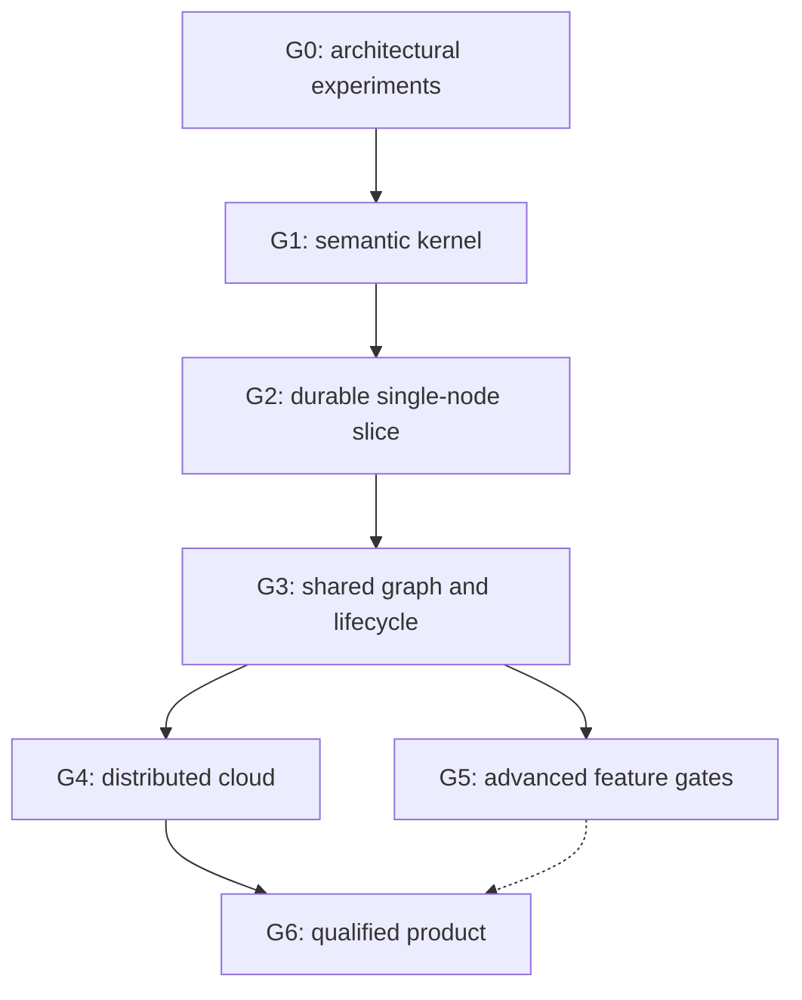

# Implementation plan and delivery gates

**Status:** Proposed, 2026-11-25. This is a plan for building the system, not a record of completed work. Every gate is currently **Not started**. Roles below are proposed ownership responsibilities, not assigned people. See [requirements](requirements.md), [qualification](qualification.md), and [risks](risks-and-open-questions.md).

## 1. Delivery strategy

Establish the semantic and durability contracts before distributing them. Build an end-to-end vertical slice through the public interface; expand one verified boundary at a time. Reuse existing Rockstream tests, fixtures, operational knowledge and selected kernels after dependency and semantic review. Avoid a wholesale fork that imports the old coupling into the new architecture.

The main release path is **G0 → G1 → G2 → G3 → G4 → G6**. **G5** is a portfolio of advanced features that can begin after their prerequisites and graduate independently. A production release can ship a deliberately smaller supported surface while recursion or sophisticated adaptive optimization remains experimental. Migration of a workload still requires parity for every capability that workload uses.

Security, deterministic simulation, resource accounting, observability and compatibility are work in every stage. G6 hardens and qualifies them; it is not when they first appear.

## 2. Staffing and estimates

Planning assumption: **six to eight experienced engineers**, covering a compiler/algebra lead plus one engineer, a storage/consistency lead plus one engineer, a runtime/cloud lead plus one engineer, and shared testing/operations capacity. A technical lead owns cross-contract decisions; one person other than the implementing author signs off each safety gate. A smaller team should reduce concurrent scope, especially G5, rather than omit qualification.

The estimates below are rough **engineer-weeks of focused work**, not elapsed commitments. They include implementation and local evidence but not unknown external compatibility work, production incident load, or hiring. Gate overlap makes simple summation unsuitable as a calendar estimate. Re-estimate after G0 with the selected runtime/backend and actual design-partner workloads. A planning envelope of roughly **9–15 months to a narrowly scoped first cloud release** for the assumed team has low confidence until those experiments complete; broad advanced SQL and universal migration parity may extend it.

| Gate | Indicative effort | Owner roles | Exit product |
| --- | --- | --- | --- |
| G0 | 8–14 engineer-weeks | Leads, verification | Evidence-backed runtime, storage, metadata and numeric decisions |
| G1 | 10–18 | Compiler/algebra, verification | Small semantic engine and independent oracle |
| G2 | 18–30 | Storage, engine, gateway | Durable single-domain database slice |
| G3 | 22–38 | Compiler, storage, connectors | Shared graph, online lifecycle, qualified sources/subscriptions |
| G4 | 30–50 | Runtime/cloud, storage, verification | Distributed execution and independent serving under failures |
| G5 | 8–20 per substantial feature family | Compiler/runtime researchers | Individually promoted advanced capabilities |
| G6 | 20–35, overlapping earlier stages | Operations, all leads | Reproducible production envelope and migration candidate |

These ranges are a budgeting aid. The critical path is usually durable state/publication → lifecycle/retention → distributed recovery, not parser coverage. Keep at most two experimental algorithm families active until that path is stable.

## 3. G0: resolve foundational choices

| Work ID | Deliverable | Dependencies | Acceptance |
| --- | --- | --- | --- |
| P0.1 | Semantic/type matrix and tiny independent batch evaluator | None | Explicit NULL, duplicates, initialization, numeric return/overflow, ordering and unsupported-combination rules |
| P0.2 | SlateDB arrangement adapter experiment and immutable-batch fallback | None | Exact pinned reopening after restart; staged data invisible; abort/retry from parent; durable protection survives compaction; record request/clone/checkpoint costs |
| P0.3 | Timely/Differential, Feldera/DBSP and minimal-runtime comparison | P0.1 cases | Same query/delta/state contract, progress and recovery trace on each feasible candidate; explain any infeasible adapter boundary |
| P0.4 | Publication/pin/GC state-machine model and metadata spike | None | Model rejects stale owner, omitted partition, expired-pin read, accepted-input GC, old-attempt packet and restore-incarnation counterexamples |
| P0.5 | Design-partner workloads and baseline evidence capture | Audit | Freeze common semantics, source/output amplification, SLO, state and read mix; no synthetic benchmark promoted as measured |
| P0.6 | Dependency/license/security review and build reproducibility plan | Candidate selections | Compatible licensing, pinned versions, threat boundary, supported cloud APIs, deterministic test hooks and decision updates |

**Gate G0:** ADRs 0003–0005 move from candidate to a selected implementation after artifacts are reviewed. If no candidate satisfies immutable pinned-state/recovery contracts economically, implement a simple immutable batch baseline and narrow the first product; do not weaken publication. Timebox any candidate to a comparable vertical-slice experiment and one documented remediation attempt before selecting or rejecting it.

**First three weeks, illustrative:** Week 1 defines executable contracts and frozen inputs while storage/runtime experiments begin. Week 2 exercises crash and reuse boundaries with the same tiny join-aggregate workload. Week 3 compares traces/costs, chooses components, closes or narrows unanswered questions, and revises estimates. Expand this timebox if evidence genuinely remains inconclusive; do not declare success from an API demo.

## 4. G1: semantic kernel

| Work ID | Deliverable | Dependencies | Acceptance |
| --- | --- | --- | --- |
| P1.1 | Core IDs, canonical rows, exact weights, schema/type descriptors | P0.1 | Canonicalization/codec laws, checked multiplicities, collision-safe descriptor comparison |
| P1.2 | Typed relational/incremental IR with interpreters | P1.1 | Well-typed plans preserve schema and time contracts; unsupported expressions rejected explicitly |
| P1.3 | Map/filter/union, join and delete-safe aggregates | P1.2 | Exact result equality after each epoch; simultaneous changes on both join inputs; `Q(empty)` initialization |
| P1.4 | SQL binder adapter and semantic normalization | P0.1, P1.2 | Public SQL cases reach intended kernels; DataFusion/PostgreSQL mismatches explicitly adapted or rejected |
| P1.5 | Property generators and shrinker, deterministic environment interfaces | P1.1–P1.3 | Reproducible seeds; shrinking preserves valid source transactions and discovers deliberately seeded errors |

**Gate G1:** every initially supported operator and SQL combination passes exact incremental-versus-independent-batch comparison with deletes, duplicate multiplicities, empty inputs and numeric boundaries. The kernel has no unmodeled I/O, clock or randomness dependency. Tests reject a deliberately omitted join cross-term and incorrect empty aggregate initialization.

## 5. G2: durable single-node vertical slice

| Work ID | Deliverable | Dependencies | Acceptance |
| --- | --- | --- | --- |
| P2.1 | Durable input log, serialized admission state and bounded idempotency | P0.4, P1.1 | Acknowledgement survives crash; conflicting preimages rejected against accepted state; expired sequences never readmitted |
| P2.2 | Arrangement preparation, manifests and metadata publication | P0.2, P0.4, P1.3 | Durable head advances only on complete exact state; ambiguous commit returns original outcome |
| P2.3 | Catalog and single-domain lifecycle | P1.4, P2.2 | Create/drop schema and basic views with durable semantic/plan version; failure preserves prior catalog/result |
| P2.4 | pgwire, keyed DML, pinned reads and result wait | P2.1–P2.3 | End-to-end driver transcript with cancellation, typed parameters, timeout-after-acceptance and RYW |
| P2.5 | Crash runner, checksums, resource budgets and local/cloud adapter conformance | P2.1–P2.4 | Process killed at each persistence boundary, object faults, input with zero views, exact cold reopen; distinct local failure profile |
| P2.6 | Initial identity/grants, secret references, metrics and structured errors | P2.3–P2.4 | Cross-user access denied, no secret leakage, budget/semantic error blocks only intended scope |

**Gate G2:** one direct-write transaction updates both sides of a join and an aggregate, receives durable acceptance, survives process destruction, then becomes visible once in a pinned query result. A failed or ambiguous attempt leaves no mixed state. The public API explains durable input versus published result. Published evidence covers deletes, zero-row results, retries, checked arithmetic and a read pin during compaction.

**First implementation milestone:** use a customer/orders join-aggregate with customer-region changes, not only an append-only counter. The exact expected output is fixed in the test fixture. This exercises the architectural boundaries without requiring distributed deployment or rich SQL breadth.

## 6. G3: shared graph, lifecycle and external data

| Work ID | Deliverable | Dependencies | Acceptance |
| --- | --- | --- | --- |
| P3.1 | Arrangement registry, consumer obligations and graph deduplication | P2.2–P2.3 | Full descriptor comparison, tenant isolation, shared-cost accounting, no premature release |
| P3.2 | View backfill, catch-up, replace, cancel and drop | P3.1, P2.1 | Consistent snapshot-to-tail boundary; restart any lifecycle state; atomic plan swap and rollback pins |
| P3.3 | History, read/subscription pins, output log and GC | P2.2, P3.1 | Pin/retirement race, no resurrection, late uploads, accepted-input roots and native backend GC coordination |
| P3.4 | Resumable snapshot-plus-delta subscriptions | P3.2–P3.3 | Complete cursor transcript; interrupted envelopes repeat safely; expired history and schema transition explicit |
| P3.5 | PostgreSQL CDC and Kafka source adapters | P2.1, P2.6 | Real services, snapshot/WAL overlap, rebalances, source reincarnation, retention loss, large transactions and missing preimages |
| P3.6 | Kafka outbox delivery with honest initial guarantee | P3.3–P3.4 | Stable envelope IDs, replay after ambiguous delivery; no exactly-once promotion without marker protocol |
| P3.7 | Rule-based state-aware optimizer and explain/system tables | P3.1–P3.2 | Planner sees update rates/state/reuse; estimates labelled; executed sharing agrees with explain |

**Gate G3:** overlapping views reuse actual maintained state; online creation/replacement and slow subscribers survive faults without losing promised history. A live source transaction reaches the public query/subscription path correctly after connector restart. Sharing beats the unshared baseline on the designated workload including lifecycle and retention cost. A fast but unbounded-retention implementation fails.

## 7. G4: distributed cloud

| Work ID | Deliverable | Dependencies | Acceptance |
| --- | --- | --- | --- |
| P4.1 | Multi-process task/exchange runtime and bounded flow control | Selected runtime, P2.5 | Attempt/generation isolation, duplicate/drop/delay injection, no progress outruns work |
| P4.2 | Virtual partition ownership and domain publication | P4.1, P3.3 | Complete coverage under owner changes; old process resurrection cannot publish |
| P4.3 | Independent serving pools and compatible cross-domain imports | P4.2, P3.4 | Exact shared-source cuts; unavailable cut waits/fails; read load cannot bypass maintenance quotas |
| P4.4 | Reassignment, cold restore and controlled repartition prototype | P4.2 | Durable state follows ownership safely; split/merge remains unpromoted until routing and pin tests pass |
| P4.5 | Cloud metadata/storage profile, mTLS and tenant quotas | P2.6, P4.1–P4.3 | Zone fault, metadata quorum loss, backend throttling, security negative controls and clear degraded modes |
| P4.6 | Distributed simulation and scale/cost qualification | P4.1–P4.5 | Verified faults on distinct processes; state beyond RAM, skew, bounded debt, 1/2/4/8/16-worker profiles |

**Gate G4:** distributed execution is the same semantic engine; failover and ownership changes preserve exact publication. An unrelated stalled domain does not block another. Same-source result groups may progress separately, but joins use compatible retained source cuts. Release evidence includes real cloud object-storage behavior, not only local filesystem or MinIO equivalence assumptions.

## 8. G5: independently gated advanced capabilities

| Work ID | Capability | Prerequisites | Promotion evidence |
| --- | --- | --- | --- |
| P5.1 | Outer/semi/anti joins, DISTINCT and decorrelation | G1 kernel, G3 lifecycle | NULL/empty/duplicate adversarial cases, deletion transitions, bounded state and exact recovery |
| P5.2 | Factorized/higher-order join-aggregate strategies | P3.7 | Rewrite preconditions, independent baseline, measured lifetime cost, safe fallback under skew |
| P5.3 | Top-K, ranking and selected window functions | G3 durable ordered state | Stable ties, refill after deletes, late updates, state bounds, wire ordering |
| P5.4 | Replayable clock, temporal predicates and late-event policy | G3 retention, G4 progress | Expiration without new rows, clock replay, finalization boundaries and explicit corrections |
| P5.5 | Restricted recursion | G1 algebra, qualified progress | Termination/resource contract; alternate paths/cycles/deletions; SCC/region rebuild policy and exact fixed-point oracle |
| P5.6 | Online adaptive optimization | P3.2, P3.7, G4 | Pinned base plus catch-up, exact boundary comparison, bounded duplication, rollback and anti-thrashing |

A first release can promote one useful subset, such as integer outer joins or Top-K, ahead of advanced research. Preserve the API capability matrix when doing so. Recursion cannot be declared general because insert-only reachability works. Approximate algorithms and user-defined aggregates need their own semantic contracts.

## 9. G6: production qualification and migration candidate

| Work ID | Deliverable | Dependencies | Acceptance |
| --- | --- | --- | --- |
| P6.1 | Backup, empty-environment restore and upgrade/downgrade drills | G3 pins, G4 profile | New incarnation, fenced old deployment, reconciled source/sink and exact query output |
| P6.2 | Operational diagnosis, quotas, incident tooling and audit | G4 | Traced freshness blockers, no hidden forced frontier, actionable resource/error runbooks |
| P6.3 | Scheduled/on-demand maintenance and bounded autoscaling | G4, P6.2 | Retained replay and timers, cold-resume envelope, hysteresis and cost cap |
| P6.4 | Full qualification bundle and independent checker | G4, promoted G5 | Correctness, faults, costs, negative controls, long soak and reproducible binaries/profiles |
| P6.5 | Workload-specific shadow migration and rollback rehearsal | P6.1–P6.4 | Exact common-cut parity, client/token/cursor behavior, sink fencing and reverse cutover |
| P6.6 | Release capability registry, support envelope and handover | P6.5 | Every advertised claim points to evidence; unresolved high-severity defects block release |

**Gate G6:** at least two agreed design-partner workloads meet the proposed business improvement gate without a protected workload regression; release all raw evidence and methodology internally with the candidate. If improvement is profile-specific, state that precisely. Do not retire the previous system until the workload's rollback window and migration gates are complete.

## 10. Issue templates and integration discipline

Each implementation issue uses: **problem; owning contract; dependencies; design/API/format changes; invariants affected; required exact examples and negative controls; resource/recovery impact; migration/compatibility; completion evidence**. The work IDs above are stable references suitable for issue titles. They are not claims that GitHub issues have already been created.

PRs should be small enough to trace a single invariant or complete vertical behavior. Do not merge a new operator behind a capability marked supported before its public path, backfill, live deltas, restart and failure behavior are qualified. Update design/ADR, format version, capability registry and evidence links together when changing a contract. Keep benchmarks and correctness oracles outside the implementation being evaluated wherever possible.

Review safety changes with one semantic and one storage/runtime owner when they cross boundaries. Red model/test counterexamples block optimization work on the affected contract. Freeze a known-good release profile for regression checks while allowing experimental strategies to evolve behind explicit capability gates. Every production fast path retains a portable reference behavior and diagnostic fallback, even when the reference is too slow for routine production use.

## 11. Stop, narrow, or change course

Revisit scope if G0 cannot produce economical durable arrangement versions; if the metadata kernel becomes a per-row bottleneck; if SQL semantic adapters erase reuse benefits; or if workload partners do not show meaningful total-cost gains. Prefer a smaller exact, durable product over an unbounded rewrite. Continue qualifying the original Rockstream in parallel as long as it carries real workloads. A clean-sheet design earns replacement through evidence, not its age or conceptual elegance.
