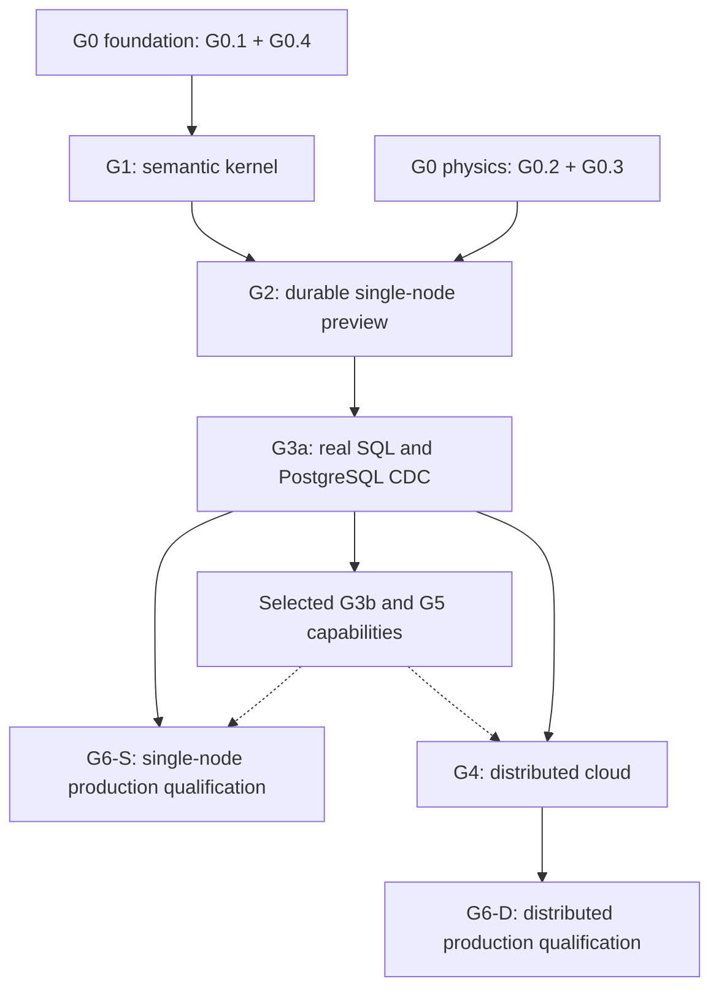

# Implementation plan and delivery gates

**Status:** Proposed, updated 2026-11-27. This is a plan for building the system, not a record of completed gates. Early G0 code and probe evidence exist; no gate or runtime profile is promoted by this design change. Autonomous coding agents are the primary implementation workforce. Roles below are responsibilities, not assigned people or agent instances. See [requirements](requirements.md), [qualification](qualification.md), and [risks](risks-and-open-questions.md).

## 1. Delivery strategy

This document is the **single roadmap authority**: gate names, work IDs, dependencies and exit evidence are defined here, and other documents summarize and link. [ADR 0012](../adr/0012-staged-mechanism-adoption.md) records mechanism staging; [ADR 0013](../adr/0013-minimum-mechanisms-and-independent-qualification.md) separates capability adoption and production qualification; [ADR 0014](../adr/0014-incremental-delivery-and-earned-complexity.md) defines incremental construction and evidence-triggered metadata optimization.

Establish the semantic and durability contracts before distributing them. Build an end-to-end vertical slice through the public interface; expand one verified boundary at a time. Adopt each mechanism at the first gate whose acceptance needs it; until then use the simplest baseline that preserves every invariant. Reuse existing Rockstream tests, fixtures, operational knowledge and selected kernels after dependency and semantic review. Avoid a wholesale fork that imports the old coupling into the new architecture.

The working direction is a SQL-first database with a lean Rockstream-native Arrow/DataFusion/Tokio runtime, DBSP semantics, object-backed authoritative input/state, and one conditionally updated metadata root with pre-allocated owner-generation namespaces. Start with one operation per root CAS and a compact bounded immutable metadata manifest. Add compositional batching only when the measured serialized baseline misses the frozen throughput, freshness or request-cost envelope; page metadata only for measured size, write-cost or recovery needs. These are extensions of the same state machine and per-operation outcomes, not parallel protocols. Immutable delta traces + SlateDB working indexes + bounded in-memory overlays are a storage candidate; G0.2 chooses the simplest single layout meeting the frozen contract and budgets. Reader leases and the grace-window GC protocol arrive with out-of-process serving at **G4**; arbitrary-cut logical MVCC arrives with independent consumers at **G3b-I**. **G0** validates the existential physics in two parallel tracks without building two full engines upfront: Timely/Differential evaluation is triggered only if the minimal native kernel spike (`G0.4`) hits a concrete predeclared complexity or correctness blocker. No mandatory external coordination service or custom storage engine is on the baseline delivery path. [ADR 0015](../adr/0015-azure-first-object-storage.md) selects Azure Blob Storage as the first real G0.2 target and Silo as a local diagnostic backend; provider qualification and layout lock still precede G2. Embedded OpenRaft, a cross-AZ fast WAL and scoped metadata partitioning remain G4+ optional/evidence-triggered profiles.

The initial production path is **G0 → G1 → G2 → G3a → G6-S**, adding only the capabilities the selected workload needs. **G6-D** qualifies distributed profiles after **G4**. **G3b-S/F/I/P** and **G5** are independently qualified capabilities, not a mandatory bundle before either production profile. G0 has two tracks: the **foundation track** (`G0.1`, reviewed `G0.4` feasibility verdict) unlocks G1, and the **durability-physics track** (`G0.2`, `G0.3`) runs in parallel with G1 and unlocks G2. Migration of a workload still requires parity for every capability that workload uses.

Dotted dependencies apply only when a profile advertises the capability. G6-S and G6-D are instances of the same production evidence contract, not separate engines or weaker correctness tiers. Distribution, independent schedules and broader SQL remain product goals; each earns adoption through a workload requirement and its own evidence.

### Incremental build sequence

Build the next runnable behavior within the existing gates, using their work IDs and prerequisites. These increments order implementation; they do not create new gates, weaken exit criteria or promote an internal prototype to a preview. Each increment must satisfy the safety contracts of its implemented path before expansion. Use ordinary issues and PRs to state the executable acceptance, omitted capabilities and next decision.

| Existing gate | Next runnable increment | Evidence before expanding it |
| --- | --- | --- |
| G1 | Run `W1-G` through general typed operators, then the SQL adapter; extend the supported subset only as its next consumer needs it | Independent PostgreSQL/batch parity, retractions and simultaneous join changes, empty/numeric cases and explicit unsupported-SQL errors; no fixture-specific production shortcut |
| G2, internal first slice | One process, ingestion domain, publication group, active interval and selected layout: durable acceptance → publication → pinned read → kill/restart with all local state lost | Exact same-cut output, stable retry outcomes, no double application, fencing and bounds at the actual persistence boundaries; this slice is not the G2 preview |
| G2, complete preview | Extend that same path to accepted-head keyed DML, authenticated `pgwire`, per-view or explicitly grouped heads, quarantine, retained published cuts/pins/GC and safe stop/restart | All P2.1–P2.7 acceptance, including physical resource qualification, healthy-sibling progress and retention isolation; one active interval per group does not create a global barrier |
| G3a | Add real PostgreSQL snapshot/WAL handoff to the durable path, then complete the declared SQL, online lifecycle and resumable-subscription envelope | Exact source transcript and same-cut results through snapshot/tail transition and restart, plus all G3a failure, schema and lifecycle cases before claiming the public preview |
| Selected G3b-S or G3b-F | When the workload needs it, qualify one same-group sharing case or one eligible factorization rule before adding unrelated mechanisms | Exact first-order baseline comparison and lower measured lifetime cost on the selected workload; preserve the baseline when the optimization is unhelpful |
| G6-S | Qualify the smallest complete single-node profile that meets the selected real workloads | Exact-candidate security, resource, backup/empty restore, incarnation fencing, upgrade/rollback, suspension, soak and two-partner economic evidence; distribution remains separately earned |

Use the [existing partner workload record](requirements.md#1-users-and-workloads) to choose the next increment. As soon as a durable path can run a representative workload, compare its full lifecycle cost and limiting resource against equivalent baselines before choosing more mechanisms. Label missing capabilities, estimates and synthetic results explicitly; none replaces the G6 two-partner business gate. A failed or inconclusive experiment stops the affected claim and leads to a bounded investigation, narrower workload/profile or reviewed redesign—not automatic adoption of batching, sharing, consensus or distribution. Independent work may continue under its own prerequisites.

Retire a named uncertainty in each increment: use a measured baseline before optimizing, a concrete workload or correctness requirement before adding a feature/mechanism, and independent evidence before making correctness or performance claims. Record the next decision in the existing issue, work ID and partner record; do not add a separate risk program.

### Gate ladder

Each gate ends in an artifact a named audience can run, so scope and direction stay cheap to change. A preview declares its support envelope and makes no production claim; only G6 yields a production release. Exit evidence for each gate is in its section below.

| Gate | Release artifact and capability | Mechanisms introduced here | Deliberately not yet | Stop or pivot signal |
| --- | --- | --- | --- | --- |
| G0 foundation | Contributors: workspace, fast CI, `W1-G` oracle, native kernel feasibility | Rust workspace, independent oracle, weighted Arrow batch kernel and logical bounds | Production allocator/resource qualification, storage or metadata implementation | Native semantic/progress/ownership or logical-bound wall: prototype Timely/Differential once, then decide |
| G0 physics | Locked storage layout and protocol model; no user-visible feature | Conditional-write root, comparable candidate-layout probes, Quint model | Leases, grace-window GC, separate-process readers, OpenRaft, fast WAL | Conditional writes or amplification unacceptable: narrow the provider or layout per [qualification](qualification.md) before G2 |
| G1 | Contributors: tested semantic library and independent oracle | Exact weights, typed IR, checked aggregates | I/O, clock, randomness | Oracle disagreement that cannot be explained by the independent authority |
| G2 | Design partners: single-node durable **developer preview** (`pgwire`, keyed DML, join-aggregate views, stop/restart) | Durable input log, G0.2-selected layout, one-operation root CAS, bounded metadata, per-view publication heads, in-process pins and published-version retention; batching only after its measured trigger and qualification | Reader leases and grace-window GC, arbitrary-cut MVCC, shared arrangements, connectors | Reproducible durable-acceptance or exact-recovery failure remains after focused root-cause investigation |
| G3a | First external users: single-node **preview** for application read models and CDC | Outer/semi/anti joins, `MIN`/`MAX`, online lifecycle, subscriptions, PostgreSQL CDC; Kafka source/outbox qualify independently if selected | Workload-wide sharing, F-IVM, multi-cadence MVCC | Connector or lifecycle semantics need a root-protocol change |
| G3b-S / G3b-F | Independently qualified shared-state / factorization capabilities | Same-group, same-cadence sharing / eligible factorization with an ordinary rule-based planner | Independent schedules, arbitrary-cut MVCC, distribution | No measured benefit over the first-order unshared baseline: keep that baseline and narrow the claim |
| G3b-I / G3b-P | Independently qualified scheduling / pipelining capabilities | Independent consumers with arbitrary-cut MVCC and isolation / depth-one pipeline when measured I/O requires it | Any unqualified capability combination | Retention, recovery or peak-resource budget fails: do not enable that capability |
| G4 | **Distributed preview** | `G4.0` probe, reader leases and grace-window GC, fenced partitions, preferred-committer hint, serving pools, drain and wake | Production claim | `G4.0` shows root contention or reader protection cost the design cannot meet: re-decide OpenRaft or scoped metadata partitioning |
| G5 | Individually promoted advanced SQL and optimizers | Per feature family | Anything not promoted | A feature lacks an independent oracle: do not promote it |
| G6-S / G6-D | **Production release** for a named single-node / distributed profile | Applicable security, operations, restore, upgrades, resource, soak, economics and migration qualification | Unselected or unqualified capabilities | A protected workload regresses or a high-severity defect is open |

Security, pure state-machine replay + real-backend crash testing, resource accounting, observability, compatibility and suspension are work in every stage. G2 proves durable single-process stop/restart from object storage, G3b-S accounts for shared-group obligations, G3b-I adds independent-consumer obligations, and G4 proves distributed drain/fencing and concurrent activation. G6-S qualifies single-process operations, including eligible suspension and fenced wake, without waiting for distributed lifecycle code. G6-D adds the distributed drills; neither production gate can omit applicable operational assurance.

## 2. Agent-first capacity planning and estimates

**Implementation model: primarily autonomous coding agents.** Organize work into compiler/algebra, storage/consistency, runtime/cloud, connectors/serving and independent verification responsibilities as needed, not a fixed number of people or agents. Agents implement, independently review and integrate the authorized milestone without per-PR human approval. The human maintainer reviews the completed milestone and separately authorizes releases; neither review replaces independent verification. The [agent operating model](../design/agent-development.md) defines risk tiers, authority, claims, worktree isolation and blocker handling. Start with at most three independent active implementation issues, one per agent and one owner per coupled contract change; increase only from G0 evidence and maintainer direction. Reduce scope, especially G5, rather than omit qualification when independent review capacity is constrained.

The earlier six-to-eight-engineer staffing assumption, 9–15 month calendar envelope and historical human effort ranges are **removed**: they were not forecasts for agent-led development. No delivery date, effort estimate or agent budget is established until measured. After G0, estimate each gate from actual accepted safe issue throughput, dependency/critical-path constraints, review and human decision wait, rework/reverts, and agent/CI/cloud spend. Report forecast uncertainty and include failed/abandoned work. A G0 timebox bounds scope, not a delivery date: an overrun triggers a scope review that cuts the lowest-value probe and records the cut as a risk.

The initial production critical path is durable state/publication → lifecycle/retention → single-node operational qualification. Distributed recovery extends that path only for a distributed profile. Keep at most two experimental algorithm families active until that path is stable.

## 3. G0: lean physics-first feasibility and foundation

[ADR 0011](../adr/0011-risk-reduction-before-implementation.md) cuts G0 to four executable kill-switch deliverables; [ADR 0012](../adr/0012-staged-mechanism-adoption.md) splits them into two tracks so G1 does not wait for storage physics it does not use:

| Track | Deliverables | Unlocks | Timebox |
| --- | --- | --- | --- |
| **Foundation** | `G0.1`, `G0.4` | G1 | ~2 weeks |
| **Durability physics** | `G0.2`, `G0.3` | G2 (runs in parallel with G1) | ~2–4 weeks |

| Work ID | Deliverable | Dependencies | Acceptance |
| --- | --- | --- | --- |
| **G0.1** | Minimal Rust workspace, fast CI, `W1-G` golden oracle, and Rockstream v1 donor register | None | Clean one-command local/CI fast check (<5 min), pinned toolchain/lockfile, crate dependency-direction negative control, minimal [RockStyle](../../ROCK_STYLE.md) lint baseline, frozen `W1-G` transactions (fixing `DECIMAL(18, 2)`/`BIGINT` oracle rules) + independent PostgreSQL/batch oracle with deliberately broken cross-term negative control, and pinned v1 donor dispositions |
| **G0.2** | Real object-store metadata & storage physics probe, scoped to what G2 consumes | None | On real Azure Blob Storage (record its region, primary endpoint, storage tier, redundancy and pinned client configuration; a single-zone tier is a separately named durability profile, never a silent default): (a) conditional-write conformance and latency (create-if-absent, `If-Match` success/failure, lost-response behavior, linearizable read-after-write, current-version discovery without listing), sequential freshness round trips, and the one-operation-per-CAS baseline with bounded metadata and pre-allocated owner namespaces; a bounded in-process group-commit experiment is conditional on measured baseline failure against frozen throughput/freshness/request-cost budgets; (b) **immutable-delta + per-group SlateDB working index + bounded delta overlay** vs. pure SlateDB history on `W1-G` plus a synthetic update stream: write/request amplification, post-CAS and mid-apply `SIGKILL` writable reopen with zero double-apply, metadata checkpoint registration and hard overlay-cap backpressure, cold recovery, idle cost per SlateDB instance, and one in-process historical lookup at a retained published boundary. Lock **one** production storage layout before G2 using the [predeclared G0.2 rubric](qualification.md#g0-feasibility-decisions) |
| **G0.3** | Core protocol model in **Quint** | None | One concise Quint specification of three properties: publication atomicity with expected-parent CAS and receipt coverage; ownership-generation fencing with idempotent operation outcomes (including a lost CAS response after a later root advance); GC reachability (pin-versus-retire race, no resurrection, abstract minimum object age). Each property has a deliberate negative control that must fail |
| **G0.4** | Minimal native runtime spike on `W1-G` | G0.1 | Acyclic scalar-epoch weighted Arrow batch kernel passing `W1-G` against the G0.1 independent oracle; explicit logical row/byte/queue/work limits, output ownership and exhaustion behavior. Review semantic/progress/state-ownership feasibility separately from dependency/process allocation completeness. **Only** prototype Timely/Differential once for the [predeclared native wall](qualification.md#g0-feasibility-decisions); a dependency allocator failure alone does not establish that wall. A reviewed feasibility pass seeds `P1.3`; retain physical-allocation gaps as blockers to G2 runtime-profile publication, and delete failed/disposable spike paths |

**Gate G0:** the independently reviewed [G0.4 bounded feasibility decision](../../evidence/g0-4/bounded-feasibility-decision.md) records a scoped native pass; historical inconclusive observations and physical-resource gaps remain. The foundation track passes only when G0.1 and G0.4 prerequisites both pass (G1 may start); the durability-physics track also requires recorded raw measurements, a locked storage layout, a passing Quint model with failing negative controls, and updated ADRs 0003–0005 and 0011 (G2 may start). Continuous design-partner engagement starts in parallel and feeds workload prioritization into G2/G3a without blocking G1. Reader-lease, grace-window GC, separate-reader, cross-AZ WAL and OpenRaft probes move to `G4.0`; Direct-DML primary-key index recovery moves to `P2.1` acceptance; sharing-scale benchmarks (100/1,000 views) move to **G3b-S**, with heterogeneous schedules in **G3b-I**; G2 qualifies single-process hibernation, G6-S hardens competing single-owner activation, and G4 qualifies fleet-wide drain and concurrent activation; complex governance automation waits until actual PR volume requires it.

Resolve G0.1's existing [inconclusive CI evidence](../../evidence/g0-1/preliminary.md) through the existing [delivery workflow](../design/development-workflow.md#1-fast-and-safe-delivery) and required-check enforcement. Record queue and execution time separately; the queue-inclusive objective and existing G0.1 exit criteria remain binding. Missing enforced protections are an explicit maintainer blocker, not authorization for an agent to bypass or rewrite policy. Finish the scoped G0.4 verdict without production allocator scaffolding; carry physical-memory decisions and unresolved probes into P1.3/P2.5, rather than delaying unrelated semantic work once its actual prerequisites pass.

## 4. G1: semantic kernel

| Work ID | Deliverable | Dependencies | Acceptance |
| --- | --- | --- | --- |
| P1.1 | Core IDs, canonical rows, exact weights, schema/type descriptors, and numeric type-return matrix | G0.1 | Canonicalization/codec laws, checked multiplicities, collision-safe descriptor comparison, and finalized G1/G2 checked widened integer/decimal (`p <= 38`) accumulator & type-return matrix with range proof |
| P1.2 | Typed relational/incremental IR with interpreters and versioned rewrite contracts | P1.1 | Well-typed plans preserve schema and time contracts; machine-readable eligibility records distinguish enforced semantic facts from statistics and link independent counterexamples/evidence; unsupported expressions rejected explicitly |
| P1.3 | Map/filter/union, inner equi-join, and checked widened `COUNT`/`SUM`/`AVG` | P1.2, G0.4 | Exact result equality after each epoch; simultaneous changes on both join inputs; `Q(empty)` initialization; checked widened decimal/integer accumulators matching `P1.1`; seeded from the passing `G0.4` spike; W1 fixed-delta work regression with exact oracle parity, bounded input/state/output work and a deliberately hidden scan/copy negative control ([benchmark protocol](qualification.md#8-benchmark-protocol)) |
| P1.4 | SQL binder adapter and semantic normalization | G0.1, P1.2 | Public SQL cases reach intended kernels; DataFusion/PostgreSQL mismatches explicitly adapted or rejected |
| P1.5 | Property generators and shrinker, deterministic environment interfaces | P1.1–P1.3 | Reproducible seeds; shrinking preserves valid source transactions and discovers deliberately seeded errors |

**Gate G1:** every initially supported operator and SQL combination passes exact incremental-versus-independent-batch comparison with deletes, duplicate multiplicities, empty inputs and numeric boundaries (`p <= 38` range-proven accumulators). For the selected key-local W1 join-aggregate path, demonstrate the fixed-delta work bound and negative control specified in qualification; preserve correctness at every measured cut. Every migrated capability adds the original engine to that comparison on common semantics and preserves its applicable donor regressions; legacy disagreements are investigated against the independent authority, never copied into expected results. The kernel has no unmodeled I/O, clock or randomness dependency. Negative controls reject a deliberately omitted join cross-term, incorrect empty aggregate initialization, and order-dependent decimal overflow. Stop/pivot: if an unexplained oracle disagreement or irreconcilable DataFusion mismatch appears, reject the affected SQL shape explicitly or replace the adapter before entering G2.

## 5. G2: durable single-node vertical slice

| Work ID | Deliverable | Dependencies | Acceptance |
| --- | --- | --- | --- |
| P2.1 | Durable input log, bounded PK admission index, and idempotency | G0.2, G0.3, P1.1 | Acknowledgement survives crash; conflicting preimages rejected against accepted state; expired sequences never readmitted; keyed direct-DML PK image index uses the selected layout with bounded accepted-head state and zero-double-apply recovery after `SIGKILL` (hybrid candidate: checkpoint + input-log overlay, metadata checkpoint registration before trimming, and hard overlay-cap backpressure) |
| P2.2 | G0.2-selected storage layout and atomic metadata publication | G0.2, G0.3, P1.3 | Distinct computed/durable published uppers; pre-allocated owner-generation namespaces; one operation per root CAS over a compact bounded immutable metadata manifest, resolving each ambiguous outcome with bounded outcome-table retention; admission/control capacity remains bounded and fair. Enable compositional batching only after its measured trigger, using the same transitions/outcomes and qualifying queue bytes/count/work/wait bounds, control fairness and composed-operation failure cases. Paging likewise needs measured size/write/recovery evidence. Layout-specific conformance preserves exact-parent writable recovery and bounded trailing state (for the hybrid candidate: metadata checkpoint registration before overlay trimming, `_meta/applied_cut` / takeover-only clone recovery, and overlay-cap backpressure); bounded retention of published versions (latest, pinned, and a configured recent count or age) serving published interval-boundary cuts; exact-parent recovery. Arbitrary-cut `[S_hot, Cp]` lookup is `P3.3` |
| P2.3 | Catalog, per-view/grouped publication heads, durable view-level fault quarantine, and basic lifecycle | P1.4, P2.2 | Create/drop schema and views with durable semantic/plan version; default per-view publication head (explicit `publication_group` for coupled views); derived runtime error commits durable `Active → Quarantined` without crash-looping on restart, lets unaffected views advance, and enforces retention-quota expiry (`IncrementalRetained → BackfillRequired`) so healthy compaction is never wedged |
| P2.4 | `pgwire`, keyed DML, in-process reads, and result wait | P2.1–P2.3 | End-to-end driver transcript with cancellation, typed parameters, timeout-after-acceptance, and RYW; `latest-committed` resolves the root inline (serving last valid cut on quarantined views); `WAIT FOR PUBLICATION`/RYW fails fast with `RS_VIEW_QUARANTINED` on quarantined targets; a cached bounded-staleness read mode qualifies independently only when a selected workload requires it, with explicit `max_staleness`, periodic root refresh and measured end-to-end latency; every query holds an in-process pin; repeatable reads, tokens and subscriptions hold durable metadata pins. Reader leases and strict-immediate-revocation arrive with out-of-process readers (G4) |
| P2.5 | Real-process crash runner, cut reconciler, resource budgets, and local/cloud conformance | P2.1–P2.4 | Process `SIGKILL` at each selected-layout persistence boundary (including post-CAS/mid-apply SlateDB and pre-checkpoint-registration for the hybrid), object faults, input with zero views, exact cold reopen; bounded read-only cut reconciliation against independent typed multisets; retired objects deleted only after a committed tombstone and a configured minimum object age, with a read pin held during compaction. Before publishing any G2 runtime profile, close its G0.4 physical-allocation gaps: shared/temporary/dependency bytes, process headroom, overload/cancellation and recovery capacity with independently checked exhaustion/failure behavior (trusted Arrow attribution, constrained-process overload, actual allocation failure or OOM-kill recovery, no false acknowledgement or skipped replay); repeat fixed-delta regression on the durable path |
| P2.6 | Initial identity/grants, secret references, metrics, and structured errors | P2.3–P2.4 | Cross-user access denied, no secret leakage, explicit deletion/retirement authorization with retained-obligation reporting |
| P2.7 | Durable single-process stop/restart and eligible hibernation | G0.2, P2.1–P2.6 | Same binary runs local or cloud profile without external coordination; safe stop with zero views or pending accepted input, new ownership fence on restart, exact recovery after loss of all local files; confirmed predecessor drain/termination before replacement serving/GC, otherwise fail closed; cold activation losers never admit readers |

**Gate G2:** one direct-write transaction updates both sides of a join and an aggregate, receives durable acceptance, survives process destruction, then becomes visible once in a pinned query result. The declared runtime resource envelope must pass P2.5; a G0.4 feasibility pass is not that evidence. Envelope: single-process binary, one ingestion domain with per-view or explicitly grouped publication heads, published interval-boundary cuts only (cross-view reads require a shared `publication_group`), in-process + durable pins (no reader leases, no arbitrary-cut MVCC, no connectors). A failed or ambiguous attempt leaves no mixed state. The public API explains durable input versus published result. Published evidence covers deletes, zero-row results, retries, checked arithmetic, exact published versions, the selected layout’s post-publication/mid-apply recovery without double-apply, durable view quarantine across restart (with `RS_VIEW_QUARANTINED` fast-fail and retention-quota release), hard trailing-state backpressure, and a read pin during compaction. An eligible deployment stops with no Rockstream process left running and resumes from authoritative durable roots; cloud-profile recovery may not depend on a surviving local file or control process. Stop/pivot: halt G3a if reproducible durable-acceptance, exact-recovery, or quarantine-isolation failures persist after focused root-cause investigation.

**First implementation milestone:** use a customer/orders join-aggregate with customer-region changes, not only an append-only counter. Use [W1-G](implementation-start.md) with the fixed exact output at each complete cut. Qualify the local one-command quickstart with authenticated SQL, observed update, explicit result wait and durable restart; measure the five-minute usability objective. This exercises the architectural boundaries without requiring distributed deployment or rich SQL breadth.

## 6. G3a: real-world single-node SQL and live connectors

Deliver an immediately useful single-node streaming database for application read models and PostgreSQL CDC pipelines. The first profile uses direct writes and PostgreSQL CDC; qualify Kafka source and outbox capabilities independently when a selected workload needs them. Retain their existing work IDs and full guarantees, without making unused connectors a release prerequisite.

| Work ID | Deliverable | Dependencies | Acceptance |
| --- | --- | --- | --- |
| P3.1a | Table-stakes SQL operators: `LEFT OUTER JOIN`, `DISTINCT`, semi/anti joins (`EXISTS`/`NOT EXISTS`), and delete-safe `MIN`/`MAX` | P1.3, P2.2 | Independent PostgreSQL + bag oracle parity under duplicates, NULL keys, simultaneous both-side updates, zero-crossing transitions, and exact crash recovery |
| P3.2a | Online view backfill, catch-up, replace, cancel, and drop | P2.2–P2.3 | Pinned snapshot/replay, exact same-cut switchover, crash/restart recovery at any lifecycle phase, peak coexistence budget reservation, and zero disruption to unrelated readers |
| P3.4 | Resumable snapshot-plus-delta subscriptions | P3.2a, P2.2 | Complete cursor transcript across snapshot/tail boundary; interrupted envelopes repeat safely; expired history and schema transitions explicit |
| P3.5 | PostgreSQL CDC (initial profile) and independently qualified Kafka source | P2.1, P2.6 | Per-adapter real-service evidence: exported snapshot/WAL handoff and unused additive-column tolerance for PostgreSQL; rebalance for Kafka; breaking DDL, source reincarnation, retention loss, large transactions and missing preimages for each applicable contract |
| P3.6 | Independently qualified Kafka outbox with honest initial guarantee | P3.4 | Stable envelope IDs, replay after ambiguous delivery; no exactly-once promotion without marker protocol |

**Gate G3a:** direct-write and live PostgreSQL CDC transactions flow through real application SQL (`LEFT OUTER JOIN`, `DISTINCT`, semi/anti joins, `COUNT`/`SUM`/`AVG`/`MIN`/`MAX`) into durable views, pinned reads and resumable subscriptions across restarts and benign additive schema changes. Kafka source/outbox are separately qualified selections of P3.5/P3.6, required for any profile or migration that uses them. Envelope: single-node preview with published interval-boundary cuts and no arrangement sharing or F-IVM yet. Negative controls verify breaking DDL stops explicitly, missing before-images fail closed, `NOT IN` with NULL keys matches SQL three-valued logic, expired subscription cursors return `RS_CURSOR_EXPIRED` without skipping gaps, and a crash or cancel mid-backfill exposes no partial view. Stop/pivot: if connector or online-lifecycle semantics require a root-protocol change, update the Quint model (`G0.3`) and ADR 0003 before proceeding.

## 7. G3b: independently qualified sharing and optimization

G3b is a capability family, not one cumulative release barrier. Qualify the smallest mechanism that improves the selected workload; use the same engine, semantic contract and publication kernel throughout.

| Capability | Prerequisites and work IDs | Qualification boundary |
| --- | --- | --- |
| **G3b-S: shared state** | G3a, P3.1b baseline | Canonical sharing only within one explicit atomic publication group at one cadence; full descriptor/security equality; common publication and quarantine boundary. No independent freshness or fault-isolation claim for members of the group |
| **G3b-F: eligible factorization** | G3a, P3.7 selected-rule contract/diagnostics, P3.8 | Selected join-aggregate shapes with enforced eligibility and exact first-order comparison; no dependency on sharing, independent consumers, online isolation or a monetary cost advisor |
| **G3b-I: independent consumers** | G3b-S, P3.1b consumer extension, P3.2b, P3.3, P3.9 schedule portion | Separate result heads/cadences, arbitrary-cut logical MVCC, history/recovery budgets and exact online isolation; qualify the combination before exposing independent scheduling |
| **G3b-P: depth-one pipelining** | G2, P3.9 pipeline portion; every capability used by the selected plan | Measured serialized-I/O freshness bottleneck, bounded peak reservation, exact abort/quarantine/drain behavior; independent of whether schedules or factorization are enabled |

| Work ID | Deliverable | Dependencies | Acceptance |
| --- | --- | --- | --- |
| P3.1b | Arrangement registry and rule-based sharing; independent consumer extension | P3.2a for G3b-S; P3.3 and P3.2b jointly for the G3b-I extension | Full descriptor comparison and tenant isolation; G3b-S enforces an explicitly selected common group/cadence and reports common quarantine scope; the optimizer cannot merge atomic groups to obtain reuse. G3b-I adds independent freshness/history/recovery budgets and schedules. W2 compares 100/1,000 same-cadence views before heterogeneous-schedule claims |
| P3.2b | Safe consumer isolation (pinned snapshot, replay, exact-cut atomic cutover) | P3.1b baseline, P3.3 | Cutover compares live head/cursor, drains active speculation to depth 0, fences old attempts and rejects stale verification; preserves every promised historical cut and recovery dependency via replacement coverage or retained old references; reserves peak coexistence capacity |
| P3.3 | Multi-cadence logical MVCC at arbitrary cuts, read/subscription pins, and in-process GC | P2.2, P3.1a, P3.1b baseline | Full `[S_hot, Cp]` logical MVCC: reconstruct common logical cuts from disjoint physical checkpoints and preserve nonlinear intermediate outputs (`DISTINCT`, `MIN`/`MAX`, outer joins); pin/retirement race, no resurrection, late uploads, accepted-input roots, and native backend GC coordination. Cross-view joins over independently scheduled views become available only with G3b-I; earlier views must share a publication group |
| P3.7 | Rule-based state-aware planner and `EXPLAIN INCREMENTAL` / system tables | P1.2, G2; capability-specific extensions only when selected | Finite eligible candidate set with first-order baseline, enforced-key vs. statistics distinction, rejected-precondition reasons, state/fanout/amplification visibility; executed strategy agrees with `EXPLAIN`. A fixed qualified factorization rule does not wait for sharing or isolation; monetary advisor remains P5.6 |
| P3.8 | Initial eligible partial aggregation and factorized maintenance (F-IVM) | G3a, P3.7 selected-rule contract/diagnostics | Exact first-order baseline, machine-readable eligibility/NULL/multiplicity contracts, delete-safe recovery, and lower measured lifetime cost for named join-aggregate shapes; retain baseline where unfavorable |
| P3.9 | Independent consumer policies; separately qualified depth-one pipelining | Schedule portion: P2.7, P3.1b baseline, P3.2b, P3.3, P3.4. Pipeline portion: G2 and selected-plan capability prerequisites | G3b-I result domains advance at separate cadences while slower consumers retain bounded history; cursor expiry/resnapshot explicit, no lost valid pins. G3b-P activates only when serialized-I/O freshness is measured limiting: reserve peak state, discard `k+1` immediately if `k` aborts/quarantines, drain to depth 0 before cutover/reassignment. Initial single-process stop/restart remains P2.7 and needs neither portion |

**Qualification:** G3b-S must beat the unshared baseline on W2 (100/1,000 same-cadence views), including lifecycle, retention, metadata and cold catch-up cost; a group member's failure must quarantine the group without pretending independent isolation. G3b-F requires exact oracle parity and lower total lifetime cost on its named shapes, including deletes and cold recovery; observed uniqueness alone cannot establish eligibility. G3b-I adds W14 and heterogeneous W2 evidence: independent progress, nonlinear intermediate cuts, bounded slow-consumer obligations and stale-head cutover rejection. G3b-P adds the measured bottleneck and abort/quarantine negative controls. Qualify combinations on their combined public path; separate component passes are not combination evidence.

**Stop or narrow:** failed sharing economics keeps the unshared path; an MVCC/retention failure blocks G3b-I, not an otherwise qualified same-group or factorized profile; an unhelpful pipeline stays disabled. No production or distribution gate requires all four capabilities. No existing supported guarantee is relaxed by omitting a capability.

## 8. G4: distributed cloud

G4 requires G3a and only the G3b capabilities the distributed profile actually uses. Mechanisms deferred from earlier gates arrive here, each gated by the `G4.0` probe: reader leases with the grace-window GC protocol, out-of-root heartbeats, the preferred-committer hint, and the optional Embedded OpenRaft and fast-WAL profiles.

| Work ID | Deliverable | Dependencies | Acceptance |
| --- | --- | --- | --- |
| **G4.0** | Distributed-readiness probe and Quint extension | G2 | Separate-process readers at `Cp`; real grace-window GC deletion under live readers (`Δ_gc_grace >> Δ_read_lease`); warm versus strict-latest read latency; multi-writer root contention (and candidate-boundary partitioning dependency map if contention motivates partitioning research); a Quint extension for reader leases, VM pauses and clock discontinuities with negative controls; lease clock that counts suspended time (`CLOCK_BOOTTIME` or platform equivalent) with a detected discontinuity treated as lease loss; evidence-based decision on Embedded OpenRaft and cross-AZ fast WAL. Results update ADRs 0003 and 0012 |
| P4.1 | Multi-process task/exchange runtime and bounded flow control | G0.4, G2 | Attempt/generation isolation, duplicate/drop/delay injection, no progress outruns work |
| P4.2 | Virtual partition ownership, preferred-committer hint/fallback, and domain publication | G4.0, P4.1, P2.2 | Complete coverage under owner changes; out-of-root worker heartbeats; old process resurrection cannot publish; clean committer failover to direct CAS |
| P4.3 | Independent serving pools (with cache-affinity routing), reader leases and optional compatible cross-domain imports | G4.0, P4.2, P3.4; G3b-I additionally for imports/joins across independent result groups | Exact shared-source cuts; unavailable cut waits/fails; reader leases with post-read monotonic deadline verification, sweeper-observed grace-window GC and opt-in `strict-immediate-revocation`; consistent-hash/tenant-affinity routing preserves NVMe cache locality; read load cannot bypass maintenance quotas |
| P4.4 | Reassignment, cold restore and controlled repartition prototype | P4.2 | Durable state follows ownership safely; split/merge remains unpromoted until routing and pin tests pass |
| P4.5 | Qualified object-metadata/storage profile, mTLS, tenant quotas, and optional Embedded OpenRaft profile | P2.6, P4.1–P4.3 | Zone/process loss, unavailable conditional writes, CAS contention/ambiguity, throttling, security negative controls; optional Embedded OpenRaft qualified separately against the unmeasured `<10 ms` strict-latest target (and optional cross-AZ fast WAL tier against the unmeasured `≤100 ms` P99 freshness target) |
| P4.6 | Distributed simulation and scale/cost qualification | P4.1–P4.5 | Verified faults on distinct processes; state beyond RAM, skew, bounded debt, 1/2/4/8/16-worker profiles |
| P4.7 | Distributed drain, suspension and concurrent activation | P2.7, P4.2–P4.5; P3.9 schedule portion only for independent consumers | Stop eligible pools or the whole Rockstream fleet, retain authoritative roots, fence late old packets/uploads and losing activations; activate using manual/platform trigger with no always-on Rockstream quorum |

**Gate G4:** distributed execution is the same semantic engine; failover and ownership changes preserve exact publication. An unrelated stalled domain does not block another. Profiles advertising G3b-I let same-source result groups progress separately and join only compatible retained source cuts; other profiles reject unsupported cross-group joins. Eligible workloads survive total compute suspension and races between old and new activations. Release evidence includes real cloud object-storage behavior, not only local filesystem or MinIO equivalence assumptions. Negative controls verify paused serving nodes waking past `lease_deadline` or observing clock discontinuities fail closed (`RS_LEASE_EXPIRED`), mixed-lineage cross-domain joins are rejected (`RS_INCOMPATIBLE_CUT`), preferred-committer death falls back cleanly without duplicate outcomes, and stale owners returning after concurrent activation cannot publish. A claimed independent schedule may not hide a global graph barrier, while the shared metadata serialization point remains an explicitly measured contention limit. Stop/pivot: if `G4.0` shows reader protection, root contention, or target latency cannot meet the declared cloud profile, do not enable serving pools under that profile—re-decide OpenRaft, scoped metadata partitioning, or narrower scope via ADR before proceeding.

## 9. G5: independently gated advanced capabilities

| Work ID | Capability | Prerequisites | Promotion evidence |
| --- | --- | --- | --- |
| P5.1 | `FULL OUTER JOIN`, complex correlated subqueries, and nested types (arrays/JSON) | G1 kernel, G3a | NULL/empty/duplicate adversarial cases, deletion transitions, explicit equality/serialization contracts, bounded state and exact recovery |
| P5.2 | Broader factorized and higher-order join-aggregate strategies | P3.8 | Extend the G3b eligible core only with rewrite preconditions, independent baseline, measured lifetime cost and safe fallback under skew |
| P5.3 | Top-K (`ORDER BY ... LIMIT`), ranking, and selected window functions | G3a durable ordered state | Stable ties, refill after deletes, late updates, state bounds, wire ordering |
| P5.4 | Replayable clock, temporal predicates and late-event policy | Required retention and qualified local progress; G3b-I/G4 only when the selected capability uses their contracts | Expiration without new rows, clock replay, finalization boundaries and explicit corrections |
| P5.5 | Restricted recursion | G1 algebra, qualified progress | Termination/resource contract; alternate paths/cycles/deletions; SCC/region rebuild policy and exact fixed-point oracle |
| P5.6 | Multi-term monetary cost advisor and online adaptive optimization | P3.7 and qualified lifecycle; P3.2b for shared-consumer isolation, G4 for distributed plan changes | Read-only whole-workload monetary advice using measured production telemetry, followed by automatic activation only after proven prediction quality, hysteresis, cooldown, peak transition reservation, rollback and anti-thrashing |

A first release can promote one useful subset, such as integer outer joins or Top-K, ahead of advanced research. Preserve the API capability matrix when doing so. Recursion cannot be declared general because insert-only reachability works. Approximate algorithms and user-defined aggregates need their own semantic contracts.

## 10. G6: production qualification by profile

**G6-S** qualifies the single-node Object-Native product after G3a and its selected capabilities. **G6-D** qualifies a distributed product after G4 and its selected capabilities. Both apply the same P6.1–P6.6 assurance obligations to the exact release candidate; no automatic inheritance from a preview or another profile. A single owner does not promise uninterrupted service during owner loss. Freeze its availability and recovery envelope before comparing economics.

| Work ID | Deliverable | Dependencies | Acceptance |
| --- | --- | --- | --- |
| P6.1 | Backup, empty-environment restore and upgrade/downgrade drills | G3a durable pins and selected layout; G4 additionally for distributed profiles | Coherent protected backup, new incarnation, fenced old deployment, invalidated old tokens, reconciled source/sink and exact query output. Recover after all local state is lost. Test the declared upgrade/rollback window; single-node restart upgrades do not claim rolling availability |
| P6.2 | Operational diagnosis, security, quotas, incident tooling and audit | G3a and selected profile/capabilities | Auth/tenant/secret negative controls, resource and recovery reserves, traced freshness blockers, no hidden forced frontier, actionable resource/error runbooks. Distributed mTLS/placement tooling only when applicable |
| P6.3 | Production suspension and activation envelope; optional autoscaling | P2.7, P6.2; G3b-I for independent consumers, P4.7 only for distributed profiles | Single-node eligible stop/wake with admission closure, durable obligations and generation fencing; require confirmed predecessor drain/termination before replacement serving/GC, reject uncertain handoff and losing cold activators, lose all local files and verify exact recovery. A paused predecessor is not presumed terminated; overlapping failover requires separately qualified durable read protection. Qualify real source/timer/sink constraints, cold-resume latency, trigger failure, retained-history headroom and total cost cap. Automatic scaling additionally proves hysteresis and bounded transitions; it is not required to qualify manual single-node suspension |
| P6.4 | Full qualification bundle and independent checker | G3a for G6-S or G4 for G6-D; every selected G3b/G5/connector capability; P6.1–P6.3 | Correctness, actual profile faults, security, resource exhaustion, 72-hour mixed-load soak, cost, negative controls and reproducible binaries/profiles; state beyond RAM for cloud storage-independence claims |
| P6.5 | Workload-specific shadow migration and rollback rehearsal | P6.1–P6.4 | Exact common-cut parity, client/token/cursor behavior, sink fencing and reverse cutover for each migrated workload; no parity claim for unselected capabilities |
| P6.6 | Release capability registry, support envelope and handover | P6.1–P6.5 as applicable to the declared release | Every advertised claim points to exact-candidate evidence; explicit rejection of unselected capabilities; unresolved high-severity defects block release; human release authorization remains required |

**Gate G6-S or G6-D:** at least two agreed real design-partner workloads in the named profile meet the business gate of **≥30% lower total cost per million correct durable changes**, under equivalent semantics, freshness, availability, retention, serving and durability constraints, without a protected workload regression. Retain the three partner workload classes in the evaluation program; do not replace the two-workload gate with W1-G or synthetic fixtures. Publish raw evidence and methodology internally with the candidate. If the initial single-node envelope cannot meet a partner's scale or availability requirement, that workload waits for G6-D; do not relax the comparison to call it a win. Do not retire the previous system until the workload's rollback window and migration gates are complete.

The release record declares selected capabilities, topology, provider, resource limits and every applicable workload/fault case. Mark an irrelevant case not applicable with its contract reason; missing evidence for an advertised guarantee blocks release. G6-S includes real-provider crash/cold recovery, durable pin and GC safety, backup/DR, upgrades/rollback, security, overload, eligible suspension and the full 72-hour soak. Distribution-specific cases and independent-consumer history are added when selected, never used to imply that those features were qualified in the single-node baseline.

## 11. Issue templates and integration discipline

Use the lightweight GitHub issue/PR templates and [agent operating model](../design/agent-development.md). Each implementation issue uses: **problem; owning contract; dependencies; design/API/format changes; invariants affected; required exact examples and negative controls; resource/recovery impact; migration/compatibility; completion evidence**. Include risk tier, lowest effective test layer, affected verification ledger entries, exact reproduction command/seed and required pre-merge checks versus background/release evidence. The work IDs above are stable references suitable for issue titles. They are not claims that GitHub issues have already been created.

PRs should be small enough to trace a single invariant or complete vertical behavior. Do not merge a new operator behind a capability marked supported before its public path, backfill, live deltas, restart and failure behavior are qualified. Update design/ADR, format version, capability registry and evidence links together when changing a contract. Keep benchmarks and correctness oracles outside the implementation being evaluated wherever possible.

Keep ordinary PRs small and fast under the [development workflow](../design/development-workflow.md), with the [test pyramid](../design/testing-and-verification.md), deterministic regression corpus and continuous deep verification established from G0. Merge only with required exact-integration checks; capability promotion and release remain separate. Deep verification failures are tracked and acted on, not ignored. The root [AGENTS.md](../../AGENTS.md) is maintained with real commands as implementation progresses.

Apply risk-based autonomy: agents integrate authorized milestone changes after the required independent review and evidence, with human review of the completed milestone and separate human release authorization. Review safety changes with one semantic and one storage/runtime owner when they cross boundaries; neither independent slot may be filled by the implementing author. Red model/test counterexamples block optimization work on the affected contract. Freeze a known-good release profile for regression checks while allowing experimental strategies to evolve behind explicit capability gates. Every production fast path retains a portable reference behavior and diagnostic fallback, even when the reference is too slow for routine production use.

## 12. Stop, narrow, or change course

Revisit scope if G0 cannot produce an economical storage layout with exact-parent recovery on SlateDB; if G3b-I cannot make logical MVCC economical for its selected consumers; if the metadata kernel becomes a per-row bottleneck; if the native runtime does not justify its maintenance burden against Timely/Differential; if full suspension requires hidden always-on authority; if SQL semantic adapters erase reuse benefits; if a pre-1.0 dependency cannot meet its adapter conformance suite ([ADR 0012](../adr/0012-staged-mechanism-adoption.md)); or if workload partners do not show meaningful total-cost gains. Prefer a smaller exact, durable product over an unbounded rewrite. Continue qualifying the original Rockstream in parallel as long as it carries real workloads. A clean-sheet design earns replacement through evidence, not its age or conceptual elegance.
