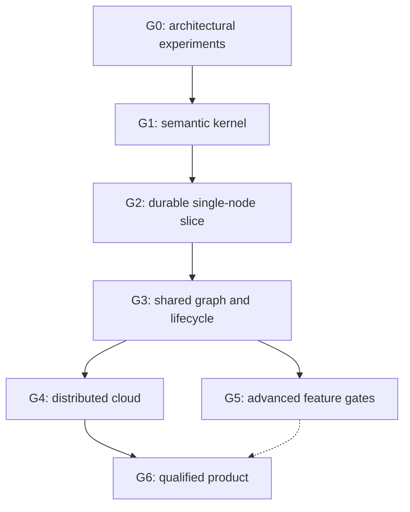

# Implementation plan and delivery gates

**Status:** Proposed, 2026-11-25. This is a plan for building the system, not a record of completed work. Every gate is currently **Not started**. Autonomous coding agents are the primary implementation workforce. Roles below are responsibilities, not assigned people or agent instances. See [requirements](requirements.md), [qualification](qualification.md), and [risks](risks-and-open-questions.md).

## 1. Delivery strategy

Establish the semantic and durability contracts before distributing them. Build an end-to-end vertical slice through the public interface; expand one verified boundary at a time. Reuse existing Rockstream tests, fixtures, operational knowledge and selected kernels after dependency and semantic review. Avoid a wholesale fork that imports the old coupling into the new architecture.

The working direction is a SQL-first database with a lean Rockstream-native Arrow/DataFusion/Tokio runtime, DBSP semantics, SlateDB-backed arrangements, logical MVCC and object-store-backed transactional metadata. Decouple logical input transactions, epochs, publications and readers from physical object operations through safe group commit, reader-group protection and checkpoint amortization. G0 must test that direction against serious alternatives, especially Timely/Differential for computation; selecting the direction is not evidence that its implementation will win. No mandatory external coordination service or custom storage engine is on the baseline delivery path. Partitioned metadata and embedded consensus remain evidence-triggered alternatives, not parallel implementation projects.

The main release path is **G0 → G1 → G2 → G3 → G4 → G6**. **G5** is a portfolio of advanced features that can begin after their prerequisites and graduate independently. A production release can ship a deliberately smaller supported surface while recursion or sophisticated adaptive optimization remains experimental. Migration of a workload still requires parity for every capability that workload uses.

Security, deterministic simulation, resource accounting, observability, compatibility and suspension are work in every stage. G0 tests full hibernation feasibility, G2 proves durable single-process stop/resume, G3 accounts for shared consumer obligations, and G4 proves distributed drain/fencing and concurrent activation. G6 hardens and qualifies these behaviors; it is not when they first appear.

## 2. Agent-first capacity planning and estimates

**Implementation model: primarily autonomous coding agents.** Organize work into compiler/algebra, storage/consistency, runtime/cloud, connectors/serving and independent verification responsibilities as needed, not a fixed number of people or agents. Human maintainer(s) prioritize work, decide architectural/contract changes, approve high-risk changes and authorize releases. Independent review agents handle routine medium-risk reviews and assist safety review; an authorized human signs off safety gates and releases, never as a substitute for independent review. The [agent operating model](../design/agent-development.md) defines risk tiers, authority, claims, worktree isolation and escalation. Start with at most three independent active implementation issues, one per agent and one owner per coupled contract change; increase only from G0 evidence and maintainer approval. Reduce scope, especially G5, rather than omit qualification when independent review or human decision capacity is constrained.

The earlier six-to-eight-engineer staffing assumption and 9–15 month calendar envelope are **superseded**, not forecasts for agent-led development. Preserve the earlier effort ranges below only as historical rough human engineer-week complexity indicators; they predate the expanded logical MVCC, suspension, P0.9 and agent-first foundation. They are neither agent-weeks nor a basis for multiplying human output by an assumed agent speedup. No delivery date or agent budget is established yet. After G0, re-estimate each gate from actual accepted safe issue throughput, dependency/critical-path constraints, review and human decision wait, rework/reverts, agent/CI/cloud spend, and long-running qualification cost. Report forecast uncertainty and include failed/abandoned work.

| Gate | Historical human effort (not a forecast) | Owner roles | Exit product |
| --- | --- | --- | --- |
| G0 | 8–14 engineer-weeks | Leads, verification | Evidence-backed runtime, logical MVCC, storage, metadata, suspension and numeric decisions |
| G1 | 10–18 | Compiler/algebra, verification | Small semantic engine and independent oracle |
| G2 | 18–30 | Storage, engine, gateway | Durable single-domain database slice with logical MVCC and stop/resume |
| G3 | 22–38 | Compiler, storage, connectors | Shared graph, independent consumer schedules, online lifecycle, eligible factorization and qualified sources/subscriptions |
| G4 | 30–50 | Runtime/cloud, storage, verification | Distributed execution, suspension and independent serving under failures |
| G5 | 8–20 per substantial feature family | Compiler/runtime researchers | Individually promoted advanced capabilities |
| G6 | 20–35, overlapping earlier stages | Operations, all leads | Reproducible production envelope and migration candidate |

These inherited ranges need replacement with agent-era work and capacity estimates before committing a delivery schedule. The critical path is usually durable state/publication → lifecycle/retention → distributed recovery, not parser coverage. Keep at most two experimental algorithm families active until that path is stable.

## 3. G0: resolve foundational choices

| Work ID | Deliverable | Dependencies | Acceptance |
| --- | --- | --- | --- |
| P0.1 | Semantic/type matrix, donor regression inventory and independent differential evaluator | None | Versioned W1-G history and expected cuts; three-way original-engine/new-kernel/independent-oracle comparison for common semantics; map SQL, failure, security and protocol regressions to migration gates; explicit NULL, duplicates, initialization, numeric/overflow, ordering and dialect rules; golden-fixture metamorphic equality under valid physical batching/scheduling choices |
| P0.2 | Logical-MVCC layout, preparation and checkpoint-amortization experiment | None | Compare protected checkpoint/clone, immutable attempt namespaces and proven writer reuse; exact current-index/base/delta reads at every promised cut, no abandoned-state visibility or recovery parent, multiple logical epochs per physical checkpoint, bounded reconstruction/history/compaction/request and cold-recovery cost; validate expected object identity/integrity and fail-slow behavior; qualify shared physical writer fencing, recovery scope and grouped-versus-isolated interference |
| P0.3 | Bounded native kernel versus Timely/Differential; selective reuse review | P0.1 cases | Acyclic graphs, scalar domain epochs, one active maintenance interval per domain and bounded internal parallelism; identical semantics/durability/lifecycle/recovery cases using production transition logic under simulation, reproducible named fault delivery and captured replay; binding technology decision includes enforced operator resource contracts, allocation/copy work, integration and maintenance burden, not throughput alone |
| P0.4 | Metadata group-commit, reader-group and pin/GC model plus object-store spike | None | Compatible operations commit under one validated root revision with per-operation outcomes; bounded fair queues, committer failover and scoped predicates; amortize durable pins while preserving linearizable latest selection and completion validation; reject stale owner, omitted receipt, group admission/release/revocation/GC races and ambiguous-outcome duplicates; measure full-path contention and physical operations per logical operation; exercise release-enabled invariant enforcement, ambiguous outcomes and fail-slow storage |
| P0.5 | Design-partner workloads and baseline evidence capture | Audit | Obtain real partner workload manifests; freeze common semantics, source/output amplification, SLO, state and read mix; measure complete-path latency/resource cost feasibility; record user outcome, minimum capability set, protected regressions and proceed/narrow/stop decision; prioritize one first journey without dropping the three workload classes or G6 business gate; no synthetic benchmark promoted as measured |
| P0.6 | Dependency/license/security review and build reproducibility plan | Candidate selections | Compatible licensing, pinned versions, threat boundary, named initial Linux/filesystem/object-store/client candidates, supported cloud APIs, deterministic test hooks and decision updates |
| P0.7 | Complete hibernation and cold activation economics | P0.2, P0.4 prototypes | Stop every Rockstream process and discard cloud-profile local state; restore accepted input, dedupe, published and pinned histories and obligations; fence concurrent/stale activations; bound first-correct-read/catch-up cost including source retention and wake infrastructure; explicitly select partial suspension where full sleep cannot satisfy obligations |
| P0.8 | Sharing economics, isolation and eligible factorization experiment | P0.1, P0.3; P0.2/P0.4 for durable cases | Compare shared and isolated prototypes at 100 and 1,000 overlapping views with independent schedules and slow consumers; include pinned-snapshot/replay/verified-cutover isolation and bounded duplication; retain first-order versus eligible factorized comparison on identical skew/deletes; choose sharing only where total cost meets declared limits |
| P0.9 | Test architecture, developer commands and CI foundation (start first, in parallel with P0.1/P0.4) | None for bootstrap; component finalists for joint evidence | Executable clean bootstrap/local/CI fast and targeted commands, deterministic execution/replay of production-intended code with injected clock/RNG, controlled scheduling/I/O, named adversarial fault sites and independent delivery evidence, reusable golden workload/checker across simulated and real paths, machine-readable failure artifacts, safety/liveness/swarm and performance-diagnostic campaigns sized to available production slices, independent oracle/negative control, initial invariant ledger with production enforcement points and failure actions, risk selector with skip/fail negative controls, isolated asynchronous verification and failure reporting, measured cold/warm builds and CI critical path; pinned toolchain/lockfile and dependency graph checks with negative controls; establish [RockStyle](../../ROCK_STYLE.md) enforcement baseline and measure simulator throughput/replay cost; own the joint G0 feasibility record with component owners; document gaps and tune budgets |
| P0.10 | Agent-first issue-to-merge pilot and governance | P0.9 initial commands; representative prototype issue | Validate issue claims/worktree isolation, independent review, policy-controlled low/medium merge path, high-risk human approval boundary, denied self-approval/bypass/privilege and unknown-risk negative controls, exact-revision CI and background regression handoff; record lead time, rework, cost and human bottlenecks; minimal versioned capability schema and performance/diagnostic baseline; no production credentials |

**Gate G0:** demonstrate the initial verification and delivery foundation (P0.9) against actual prototype tests, including a deliberately broken check and reproducible seeded failure. Demonstrate the agent-first operating model (P0.10) against representative executable prototype work; verify authority and independence rather than trusting agent reports. Establish measured feedback, cost and capacity baselines and a prioritized plan for any missed budgets; record the initial platform/profile and complete-path latency/resource feasibility decisions against the [implementation-start experiments](implementation-start.md); no safety gate may be relaxed to achieve a timing target. All six feasibility decisions in [qualification](qualification.md#g0-feasibility-decisions) (P0.1/P0.2/P0.3/P0.4/P0.7/P0.8) require predeclared acceptance budgets, independent correctness evidence and an explicit pass, fail or inconclusive disposition with the selected fallback. Unmeasured mitigation is not risk closure. Then review ADRs 0003–0006 and 0008–0010 against those artifacts. A failed performance experiment can select a different component or narrower profile; a correctness failure blocks the affected choice and capability. SlateDB is the preferred backend: first test a focused arrangement layout, batching and checkpoint policy, then consider a bounded upstream change if warranted. A minimal immutable baseline may serve as an experimental comparator; it is not authorization to build a custom storage engine. If a material limitation remains, record it and reconsider scope or backend explicitly without weakening publication. Timebox a candidate to a comparable vertical-slice experiment and a documented remediation attempt before selecting or rejecting it.

G0 closure additionally requires the [joint feasibility record](qualification.md#joint-g0-feasibility-record): the selected components meet one frozen mixed-load profile through the same durable golden path, including shared physical storage interference, retained history, peak lifecycle capacity and cold recovery. A component pass cannot close a failed or inconclusive combined choice. This extends P0.9 and the six component packages rather than adding new work IDs or a second engine project; later public-path and production gates remain required.

The metadata spike starts with one authoritative root pointing to immutable metadata objects and an embedded commit scheduler with adaptive, conflict-aware batches, bounded priority queues and a disposable preferred committer. Model group reader admission, release, revocation and GC before measuring pin amortization; a cached pin or TTL is insufficient. Measure independent-domain and read traffic together, including authoritative selection/completion reads. Keep transaction scopes explicit for possible later partitioning, but keep all jointly atomic predicates in one root. Throughput failure triggers evaluation of scoped partitioning with protected imports and retention handoff; latency failure triggers evaluation of embedded consensus, after batching/read amortization and honest profile limits are assessed. Evaluate `slatedb-txn-obj` for suitable primitives without assuming that one-object CAS provides a multi-object transaction. Qualify each supported object store's read and conditional-write semantics. An embedded Raft library is an evidence-triggered alternative only if this design fails a material requirement; its durable replica, membership and available-quorum needs must be included in a revised operational and sleep profile.

**Initial G0 sequence, not a calendar commitment:** The [implementation-start brief](implementation-start.md) defines the three first issue seeds (P0.9a bootstrap/CI, P0.4a metadata model, P0.1a golden fixture/evaluator), WIP limits and acceptance.  Establish bootstrap/local/CI commands, deterministic harness, invariant ledger, and the agent claim/review pilot while defining executable contracts and frozen inputs and starting independent storage/runtime experiments within WIP limits. Next exercise crash and reuse boundaries with the same tiny join-aggregate workload. Compare traces/costs, choose components, close or narrow unanswered questions, and re-estimate from measured agent capacity. Assign each experiment an owner, explicit time/compute budget, exit criterion and cleanup decision; extend only when evidence genuinely remains inconclusive. Do not declare success from an API demo.

FoundationDB-inspired refinements use the existing work IDs: P0.9 starts the simulation execution environment and named-fault/replay artifact contract alongside the first production-intended transitions; P0.3 demonstrates that the selected runtime supports that replay and measured pressure/overload behavior; P0.2/P0.4 qualify exact-parent generation/attempt replacement and ambiguous-outcome recovery. Reuse W1-G scenarios and independent expectations across simulation and real-dependency probes. Exercise routine recovery/activation at the applicable G2–G4/G6 gates. Do not introduce a second runtime, mandatory FoundationDB dependency, standalone controller or new work package. The existing WIP, component-selection, joint G0 and qualification rules still apply.

## 4. G1: semantic kernel

| Work ID | Deliverable | Dependencies | Acceptance |
| --- | --- | --- | --- |
| P1.1 | Core IDs, canonical rows, exact weights, schema/type descriptors | P0.1 | Canonicalization/codec laws, checked multiplicities, collision-safe descriptor comparison |
| P1.2 | Typed relational/incremental IR with interpreters and versioned rewrite contracts | P1.1 | Well-typed plans preserve schema and time contracts; machine-readable eligibility records distinguish enforced semantic facts from statistics and link independent counterexamples/evidence; unsupported expressions rejected explicitly |
| P1.3 | Map/filter/union, join and delete-safe aggregates | P1.2 | Exact result equality after each epoch; simultaneous changes on both join inputs; `Q(empty)` initialization |
| P1.4 | SQL binder adapter and semantic normalization | P0.1, P1.2 | Public SQL cases reach intended kernels; DataFusion/PostgreSQL mismatches explicitly adapted or rejected |
| P1.5 | Property generators and shrinker, deterministic environment interfaces | P1.1–P1.3 | Reproducible seeds; shrinking preserves valid source transactions and discovers deliberately seeded errors |

**Gate G1:** every initially supported operator and SQL combination passes exact incremental-versus-independent-batch comparison with deletes, duplicate multiplicities, empty inputs and numeric boundaries. Every migrated capability adds the original engine to that comparison on common semantics and preserves its applicable donor regressions; legacy disagreements are investigated against the independent authority, never copied into expected results. The kernel has no unmodeled I/O, clock or randomness dependency. Tests reject a deliberately omitted join cross-term and incorrect empty aggregate initialization.

## 5. G2: durable single-node vertical slice

| Work ID | Deliverable | Dependencies | Acceptance |
| --- | --- | --- | --- |
| P2.1 | Durable input log, serialized admission state and bounded idempotency | P0.4, P1.1 | Acknowledgement survives crash; conflicting preimages rejected against accepted state; expired sequences never readmitted |
| P2.2 | Logical-MVCC arrangements, manifests and amortized object-root publication | P0.2, P0.4, P1.3 | Distinct computed/durable published uppers; exact promised cuts with bounded reconstruction and qualified physical checkpoint amortization; selected attempt isolation preserves exact parents; group commits publish only complete protected state and resolve each ambiguous operation outcome |
| P2.3 | Catalog and single-domain lifecycle | P1.4, P2.2 | Create/drop schema and basic views with durable semantic/plan version; failure preserves prior catalog/result |
| P2.4 | pgwire, keyed DML, protected reads and result wait | P2.1–P2.3 | End-to-end driver transcript with cancellation, typed parameters, timeout-after-acceptance and RYW; qualified reader-group admission/drain/revocation, repeatable token reuse, historical pins and authoritative latest-selection/completion paths |
| P2.5 | Crash runner, cut reconciler, resource budgets and local/cloud adapter conformance | P2.1–P2.4 | Process killed at each persistence boundary, object faults, input with zero views, exact cold reopen; bounded read-only reconciliation pins identical source/result cuts and compares independent typed multisets; missing history/cancellation never passes; distinct local failure profile |
| P2.6 | Initial identity/grants, secret references, metrics and structured errors | P2.3–P2.4 | Cross-user access denied, no secret leakage, budget/semantic error blocks only intended scope; explicit deletion/retirement and decommissioning authorization with retained-obligation reporting |
| P2.7 | Durable single-process suspension and activation | P0.7, P2.1–P2.6 | Same binary runs local or cloud profile without external coordination; safe stop with zero views or pending accepted input, new ownership fence on activation, exact recovery after loss of all cloud-profile local files; explicit activation and retention contract |

**Gate G2:** one direct-write transaction updates both sides of a join and an aggregate, receives durable acceptance, survives process destruction, then becomes visible once in a pinned query result. A failed or ambiguous attempt leaves no mixed state. The public API explains durable input versus published result. Published evidence covers deletes, zero-row results, retries, checked arithmetic, exact retained cuts and a read pin during compaction. An eligible deployment stops with no Rockstream process left running and resumes from authoritative durable roots; cloud-profile recovery may not depend on a surviving local file or control process.

**First implementation milestone:** use a customer/orders join-aggregate with customer-region changes, not only an append-only counter. Use [W1-G](implementation-start.md) with the fixed exact output at each complete cut. Qualify the local one-command quickstart with authenticated SQL, observed update, explicit result wait and durable restart; measure the five-minute usability objective. This exercises the architectural boundaries without requiring distributed deployment or rich SQL breadth.

## 6. G3: shared graph, lifecycle and external data

Extend the G2 single domain with independently scheduled consuming result domains over a common input timeline. Each result domain still owns exactly one atomic publication group; sharing does not create per-view heads within that group. This local arrangement qualifies MVCC/scheduling separation before G4 introduces distributed groups and general cross-domain imports.

| Work ID | Deliverable | Dependencies | Acceptance |
| --- | --- | --- | --- |
| P3.1 | Arrangement registry, consumer contracts and cost-aware sharing | P2.2–P2.3; P0.8 decision | Full descriptor comparison, tenant isolation, independent consumer freshness/history/recovery budgets and schedules, shared-cost attribution, explicit isolation choice and no premature release |
| P3.2 | View backfill, catch-up, replace, isolate, cancel and drop | P3.1, P2.1 | Pinned snapshot/replay and exact same-cut comparison; cutover compares live head/cursor, fences old attempts and rejects stale verification; preserve every promised historical cut and recovery dependency through replacement coverage or authoritative old references; restart any lifecycle state; reserve peak old/new/replay/rollback capacity and charge retained tails until safe release; concurrent builds cannot spend the same headroom |
| P3.3 | Logical history, read/subscription pins, output log and GC | P2.2, P3.1 | Pin/retirement race, no resurrection, late uploads, accepted-input roots and native backend GC coordination; reconstruct a common logical cut from disjoint physical checkpoint schedules and preserve nonlinear intermediate outputs |
| P3.4 | Resumable snapshot-plus-delta subscriptions | P3.2–P3.3 | Complete cursor transcript; interrupted envelopes repeat safely; expired history and schema transition explicit |
| P3.5 | PostgreSQL CDC and Kafka source adapters | P2.1, P2.6 | Real services, snapshot/WAL overlap, rebalances, source reincarnation, retention loss, large transactions and missing preimages |
| P3.6 | Kafka outbox delivery with honest initial guarantee | P3.3–P3.4 | Stable envelope IDs, replay after ambiguous delivery; no exactly-once promotion without marker protocol |
| P3.7 | Rule-based state-aware optimizer, bounded materialization advisor and explain/system tables | P3.1–P3.2 | Finite eligible candidate set with baseline, rejected-precondition reasons and bounded planning budget; rank marginal whole-workload cost under freshness/history/recovery limits; expose uncertainty, build overlap and retained tails; compare predictions with observed resources; advice is read-only and explicit application revalidates current facts/capacity; executed strategy agrees with explain |
| P3.8 | Initial eligible partial aggregation and factorized maintenance | P0.8, P3.7 | Exact first-order baseline, explicit eligibility/NULL/multiplicity rules, delete-safe recovery and lower measured lifetime cost for named shapes; retain baseline where unfavorable |
| P3.9 | Continuous, freshness-batched, scheduled and on-demand consumer policies | P2.7, P3.1–P3.4 | Separate result domains over common input/history advance independently while slower consumers retain bounded history; sleep/catch-up admission checks, cursor expiry/resnapshot, timers and sink obligations remain explicit; no loss of valid pins |

**Gate G3:** overlapping views in separately scheduled result domains reuse actual maintained state while readers select compatible logical cuts; each domain's publication remains atomic. Online creation/replacement and slow subscribers survive faults without losing promised history. A live source transaction reaches the public query/subscription path correctly after connector restart. Sharing beats the unshared baseline on the designated sharing-benefit workload including lifecycle, retention and cold catch-up cost; affected workloads use qualified isolated arrangements when sharing is more expensive. An adversarial slow consumer is isolated through a pinned snapshot, replay and verified atomic cutover without dropping another consumer's valid history. A fast but unbounded-retention implementation fails. Automatic cost-driven splitting remains P5.6; G3 uses explicit or bounded rules. Sleep is rejected or narrowed when source retention, timers, delivery or consumer commitments require active work.

## 7. G4: distributed cloud

| Work ID | Deliverable | Dependencies | Acceptance |
| --- | --- | --- | --- |
| P4.1 | Multi-process task/exchange runtime and bounded flow control | Selected runtime, P2.5 | Attempt/generation isolation, duplicate/drop/delay injection, no progress outruns work |
| P4.2 | Virtual partition ownership and domain publication | P4.1, P3.3 | Complete coverage under owner changes; old process resurrection cannot publish |
| P4.3 | Independent serving pools and compatible cross-domain imports | P4.2, P3.4 | Exact shared-source cuts; unavailable cut waits/fails; read load cannot bypass maintenance quotas |
| P4.4 | Reassignment, cold restore and controlled repartition prototype | P4.2 | Durable state follows ownership safely; split/merge remains unpromoted until routing and pin tests pass |
| P4.5 | Qualified object-metadata/storage profile, mTLS and tenant quotas | P2.6, P4.1–P4.3 | Zone/process loss, unavailable conditional writes, CAS contention and ambiguity, backend throttling, security negative controls and clear degraded modes; no required coordinator service |
| P4.6 | Distributed simulation and scale/cost qualification | P4.1–P4.5 | Verified faults on distinct processes; state beyond RAM, skew, bounded debt, 1/2/4/8/16-worker profiles |
| P4.7 | Distributed drain, suspension and concurrent activation | P2.7, P3.9, P4.2–P4.5 | Stop eligible pools or the whole Rockstream fleet, retain authoritative roots, fence late old packets/uploads and losing activations; activate using manual/platform trigger with no always-on Rockstream quorum |

**Gate G4:** distributed execution is the same semantic engine; failover and ownership changes preserve exact publication. An unrelated stalled domain does not block another. Same-source result groups may progress separately, but joins use compatible retained source cuts. Eligible workloads survive total compute suspension and races between old and new activations. Release evidence includes real cloud object-storage behavior, not only local filesystem or MinIO equivalence assumptions. A claimed independent schedule may not hide a global graph barrier, while the shared metadata serialization point remains an explicitly measured contention limit.

## 8. G5: independently gated advanced capabilities

| Work ID | Capability | Prerequisites | Promotion evidence |
| --- | --- | --- | --- |
| P5.1 | Outer/semi/anti joins, DISTINCT and decorrelation | G1 kernel, G3 lifecycle | NULL/empty/duplicate adversarial cases, deletion transitions, bounded state and exact recovery |
| P5.2 | Broader factorized and higher-order join-aggregate strategies | P3.8 | Extend the G3 eligible core only with rewrite preconditions, independent baseline, measured lifetime cost and safe fallback under skew |
| P5.3 | Top-K, ranking and selected window functions | G3 durable ordered state | Stable ties, refill after deletes, late updates, state bounds, wire ordering |
| P5.4 | Replayable clock, temporal predicates and late-event policy | G3 retention, G4 progress | Expiration without new rows, clock replay, finalization boundaries and explicit corrections |
| P5.5 | Restricted recursion | G1 algebra, qualified progress | Termination/resource contract; alternate paths/cycles/deletions; SCC/region rebuild policy and exact fixed-point oracle |
| P5.6 | Online adaptive optimization | P3.2, P3.7, G4 | Extend qualified advisory choices with automatic activation only after measured prediction quality, pinned base plus catch-up, semantic eligibility and exact boundary comparison, reserved peak capacity, rollback and anti-thrashing; obsolete advice cannot bypass current constraints |

A first release can promote one useful subset, such as integer outer joins or Top-K, ahead of advanced research. Preserve the API capability matrix when doing so. Recursion cannot be declared general because insert-only reachability works. Approximate algorithms and user-defined aggregates need their own semantic contracts.

## 9. G6: production qualification and migration candidate

| Work ID | Deliverable | Dependencies | Acceptance |
| --- | --- | --- | --- |
| P6.1 | Backup, empty-environment restore and upgrade/downgrade drills | G3 pins, G4 profile | New incarnation, fenced old deployment, reconciled source/sink and exact query output |
| P6.2 | Operational diagnosis, quotas, incident tooling and audit | G4 | Traced freshness blockers, no hidden forced frontier, actionable resource/error runbooks |
| P6.3 | Production suspension profiles and bounded autoscaling | P3.9, P4.7, P6.2 | Qualify earlier maintenance policies across real source/timer/sink constraints; cold-resume envelope, hysteresis, activation failure, retained-history headroom and total cost cap |
| P6.4 | Full qualification bundle and independent checker | G4, promoted G5 | Correctness, faults, costs, negative controls, long soak and reproducible binaries/profiles |
| P6.5 | Workload-specific shadow migration and rollback rehearsal | P6.1–P6.4 | Exact common-cut parity, client/token/cursor behavior, sink fencing and reverse cutover |
| P6.6 | Release capability registry, support envelope and handover | P6.5 | Every advertised claim points to evidence; unresolved high-severity defects block release |

**Gate G6:** at least two agreed design-partner workloads meet the proposed business improvement gate without a protected workload regression; release all raw evidence and methodology internally with the candidate. If improvement is profile-specific, state that precisely. Do not retire the previous system until the workload's rollback window and migration gates are complete.

## 10. Issue templates and integration discipline

Use the lightweight GitHub issue/PR templates and [agent operating model](../design/agent-development.md). Each implementation issue uses: **problem; owning contract; dependencies; design/API/format changes; invariants affected; required exact examples and negative controls; resource/recovery impact; migration/compatibility; completion evidence**. Include risk tier, lowest effective test layer, affected verification ledger entries, exact reproduction command/seed and required pre-merge checks versus background/release evidence. The work IDs above are stable references suitable for issue titles. They are not claims that GitHub issues have already been created.

PRs should be small enough to trace a single invariant or complete vertical behavior. Do not merge a new operator behind a capability marked supported before its public path, backfill, live deltas, restart and failure behavior are qualified. Update design/ADR, format version, capability registry and evidence links together when changing a contract. Keep benchmarks and correctness oracles outside the implementation being evaluated wherever possible.

Keep ordinary PRs small and fast under the [development workflow](../design/development-workflow.md), with the [test pyramid](../design/testing-and-verification.md), deterministic regression corpus and continuous deep verification established from G0. Merge only with required exact-integration checks; capability promotion and release remain separate. Deep verification failures are tracked and acted on, not ignored. The root [AGENTS.md](../../AGENTS.md) is maintained with real commands as implementation progresses.

Apply risk-based autonomy: low/medium changes can merge automatically under validated repository policy after required evidence and review as applicable; high-risk and architecture/policy changes need authorized human approval. Review safety changes with one semantic and one storage/runtime owner when they cross boundaries; neither independent slot may be filled by the implementing author. Preserve human release authorization. Red model/test counterexamples block optimization work on the affected contract. Freeze a known-good release profile for regression checks while allowing experimental strategies to evolve behind explicit capability gates. Every production fast path retains a portable reference behavior and diagnostic fallback, even when the reference is too slow for routine production use.

## 11. Stop, narrow, or change course

Revisit scope if G0 cannot produce economical logical MVCC on SlateDB; if the metadata kernel becomes a per-row bottleneck; if the native runtime does not justify its maintenance burden against Timely/Differential; if full suspension requires hidden always-on authority; if SQL semantic adapters erase reuse benefits; or if workload partners do not show meaningful total-cost gains. Prefer a smaller exact, durable product over an unbounded rewrite. Continue qualifying the original Rockstream in parallel as long as it carries real workloads. A clean-sheet design earns replacement through evidence, not its age or conceptual elegance.
